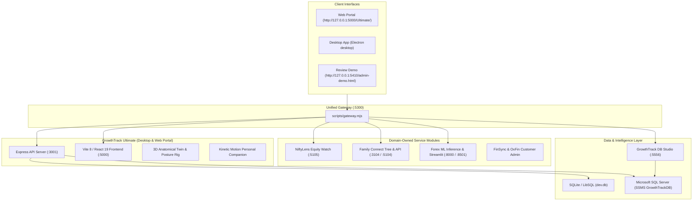

# GrowthTrack workspace

A desktop workspace for personal growth, work, family, equity and Forex research, with a dedicated customer-admin area for the separate FinSync and OxFin products.

**Runtime:** Node.js/npm workspace; Ultimate uses React, Vite and Express. Companion services retain their current frameworks.

**Status:** NiftyLens, Family Connect and Forex have native Ultimate UI modules. The fictional review demo stays isolated; read-only customer-admin adapters require explicit product configuration and approved readers.

## Setup

Run these commands from this application directory. Configure required values locally before starting the live application.

```powershell
npm install --prefix growthtrack-ultimate
Copy-Item growthtrack-ultimate/.env.example growthtrack-ultimate/.env
npm --prefix growthtrack-ultimate run db:generate
```

## Run

```powershell
npm run dev
```

## Configuration

- Configure Ultimate's ignored .env for the live application. The design demo requires no credentials.
- Install and configure companion dependencies before using npm run dev. Use npm run dev:core for Ultimate, the gateway and database console only.

Keep credentials in ignored local environment files or a deployment secret manager. Tracked examples contain empty secret fields. Do not paste passwords, keys, personal records or production connection strings into this README. `NEXT_PUBLIC_`, `VITE_` and `EXPO_PUBLIC_` values are visible to clients.

## Verification

```powershell
npm run build:design
npm run test:design
npm run test:gateway
npm run design:check
node --test tests/code-context.test.mjs
```

## Scope and limitations

- Design demo: http://127.0.0.1:5410/admin-demo.html. Use All pages & review to inspect every page, tab, theme and UI state.
- Live workspace: npm run dev, then http://127.0.0.1:5000/Ultimate/. This starts Ultimate, the gateway, database console, Family API and Forex API. npm run dev:all also runs the standalone customer and legacy UIs.
- Customer applications remain separate. The demo's customer records are fictional, with no product APIs connected.
- Local code retrieval: npm run context:index, then npm run context:search -- "question or symbol". Embeddings are optional planned work.
- Tested Node runtime for this change: 24.12.0. Python and external data services are required only for their respective applications.

## Architecture and System Topology



## Service Port & Protocol Matrix

| Service | Port | Local URL | Health Check | Description |
| :--- | :--- | :--- | :--- | :--- |
| **Workspace Gateway** | `5300` | [http://127.0.0.1:5300](http://127.0.0.1:5300) | `/health` | Unified reverse proxy & companion router |
| **Ultimate UI** | `5000` | [http://127.0.0.1:5000/Ultimate/](http://127.0.0.1:5000/Ultimate/) | `/Ultimate/` | Core React 19 / Vite 8 portal interface |
| **Ultimate API** | `3001` | [http://127.0.0.1:3001](http://127.0.0.1:3001) | `/api/health` | Express backend, SQLite adapter, authentication |
| **GrowthTrack DB Studio** | `5556` | [http://localhost:5556](http://localhost:5556) | `/api/tables` | Live database browser and console |
| **NiftyLens (Equity)** | `5105` | [http://127.0.0.1:5105](http://127.0.0.1:5105) | `/health` | NSE/BSE market watch and technical charting |
| **Family Connect API** | `3104` | [http://127.0.0.1:3104](http://127.0.0.1:3104) | `/health` | Tree nodes, permissions and documents |
| **Family Connect Web** | `5104` | [http://127.0.0.1:5104](http://127.0.0.1:5104) | `/` | Standalone family interface (legacy) |
| **Forex Inference API** | `8000` | [http://127.0.0.1:8000](http://127.0.0.1:8000) | `/health` | FastAPI saved-model prediction service |
| **Forex Dashboard** | `8501` | [http://127.0.0.1:8501](http://127.0.0.1:8501) | `/_stcore/health` | Streamlit currency analytics dashboard |
| **Admin Design Demo** | `5410` | [http://127.0.0.1:5410/admin-demo.html](http://127.0.0.1:5410/admin-demo.html) | `/admin-demo.html` | Fictional customer-admin preview |

## Key Capabilities & Highlights

- Shared personal workspace, domain-owned customer administration, 3D avatar editing and motion controls.
- Versioned Notes and explicit companion actions; credentials use the server sealer. Existing record fields are not all encrypted at rest.
- Selectable SQLite or SQL Server storage with separate reviewed schema/migration paths.
- Electron desktop uses a build fingerprint and packaged-file verification; the version label alone does not establish freshness.
- Provider-backed features require configuration and authorization; page availability is not proof of a working external connection.

## Microsoft SQL Server & SSMS Setup

Ultimate supports selectable SQLite and Microsoft SQL Server providers. The local API has been migrated to SQL Server. Open `docs/GrowthTrack_MSSQL_SSMS.sql` in SSMS for a non-destructive bootstrap of 73 application tables; matching repeat runs are a no-op and mismatched existing schemas are rejected. No Prisma Studio is required. Read [SQL Server setup and cutover](docs/SQL_SERVER_SETUP.md) for the local instance, credentials, backup requirements and migration limits. SSMS manages SQL Server; Prisma remains the internal query layer.

## GitHub Wiki Architecture Plan

The planned GitHub Wiki structure organizes the platform into modular guides:

1. **Home & Quickstart:** High-level project vision, directory map, prerequisites, and instant launcher guide.
2. **System Architecture & Gateway:** Reverse proxy routing, inter-service contracts, port matrix, and isolation policies.
3. **3D Digital Twin & Morph Engine:** Parametric avatar modeling, MakeHuman CC0 asset pipeline, GLB validation, and skeletal rigging.
4. **Life OS & Personal Companion:** Reactive motion physics, state persistence, habits matrix, and encrypted vault storage.
5. **Database Strategy (SQLite vs SSMS):** Provider selection, verified SQLite-to-SQL Server migration, SSMS and database-specific backups.
6. **Domain Modules & Portals:** NiftyLens (Equity), Family Connect, Forex ML Studio, and FinSync/OxFin admin adapters.
7. **Desktop Packaging & Electron:** Electron Builder setup, code signing, hardware acceleration, and release workflows.
8. **Testing & Quality Assurance:** Running Vitest, Playwright E2E tests, architecture linting, and accessibility audits.

## Workspace documentation

- [Complete UI workflow and style guide](docs/UI_WORKFLOW_AND_STYLE_GUIDE.md)
- [Agent workflow, Jev and TOON](docs/AGENT_WORKFLOW.md)
- [Application directory](docs/APPLICATIONS.md)
- [Repository structure and file policy](docs/REPOSITORY_STRUCTURE.md)
- [Current architecture](docs/ARCHITECTURE.md)
- [Ownership and independent builds](docs/BUILD_BOUNDARIES.md)
- [Desktop redesign and architecture](docs/plans/2026-10-28-admin-redesign.md)
- [Complete architecture and UI review handoff](docs/UI_ARCHITECTURE_HANDOFF.md)
- [Implemented UI proposal and remaining review gates](docs/plans/2026-10-28-proposal-implementation.md)
- [Approved production UI integration](docs/plans/2026-10-28-production-ui.md)
- [UI impact and scale checks](docs/plans/2026-10-28-ui-system-impact.md)
- [Code retrieval and embedding plan](docs/plans/2026-10-28-code-retrieval.md)

<!-- Generated from docs/applications.json by scripts/application-docs.mjs. Edit the catalog, then regenerate. -->
