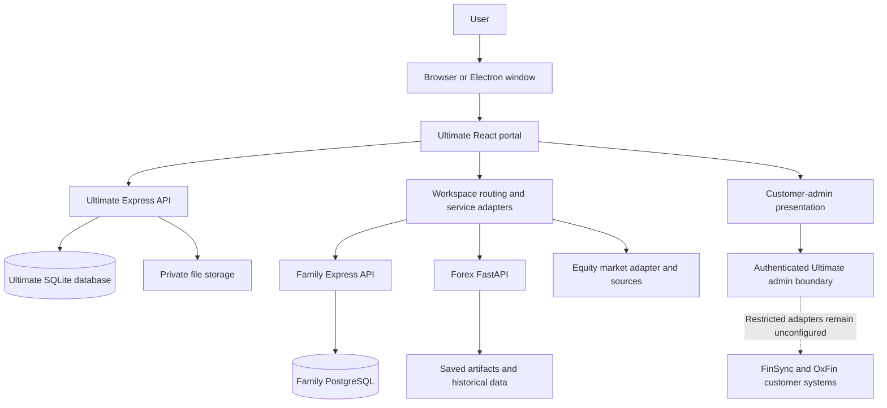
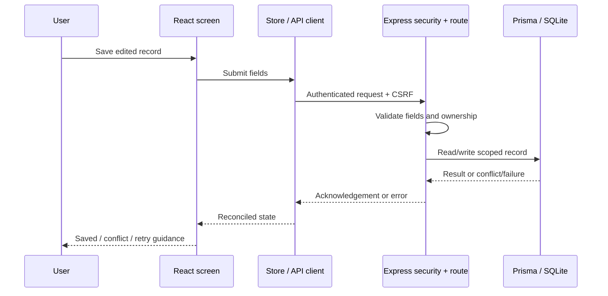

# GrowthTrack codebase guide: beginner to advanced

Prepared on 4 November 2026 from the current workspace source and architecture documents.

This guide is for someone who has never seen the repository. Start at the beginning for the product explanation; use the later sections to understand implementation, security, operations and extension points. Paths are relative to the repository root unless stated otherwise.

This is a source-based explanation, not a fresh execution report. Builds, browser flows, deployments and recovery procedures were not rerun while writing it. Configuration-dependent capabilities are described separately from implemented source. Existing audit transcripts contain historical observations; consult their remediation records before treating a finding as current.

## Contents

1. [What this project is](#1-what-this-project-is)
2. [The vocabulary](#2-the-vocabulary)
3. [The applications](#3-the-applications)
4. [Repository map](#4-repository-map)
5. [How the system fits together](#5-how-the-system-fits-together)
6. [Ultimate frontend](#6-ultimate-frontend)
7. [Ultimate backend](#7-ultimate-backend)
8. [Data and persistence](#8-data-and-persistence)
9. [A request from click to database](#9-a-request-from-click-to-database)
10. [Companion products and their boundaries](#10-companion-products-and-their-boundaries)
11. [Security and privacy](#11-security-and-privacy)
12. [AI assistance](#12-ai-assistance)
13. [The 3D subsystem](#13-the-3d-subsystem)
14. [Design system and isolated demo](#14-design-system-and-isolated-demo)
15. [Local setup and commands](#15-local-setup-and-commands)
16. [Testing and verification](#16-testing-and-verification)
17. [Desktop, containers and release](#17-desktop-containers-and-release)
18. [Advanced engineering concepts](#18-advanced-engineering-concepts)
19. [How to approach common changes](#19-how-to-approach-common-changes)
20. [Current limitations and stack direction](#20-current-limitations-and-stack-direction)
21. [A learning path](#21-a-learning-path)
22. [Source references](#22-source-references)
23. [Feature ownership and source navigation](#23-feature-ownership-and-source-navigation)
24. [Notes architecture in depth](#24-notes-architecture-in-depth)
25. [API contracts and failure handling](#25-api-contracts-and-failure-handling)
26. [Configuration and runtime modes](#26-configuration-and-runtime-modes)
27. [Synchronization and external data](#27-synchronization-and-external-data)
28. [Performance, accessibility and observability](#28-performance-accessibility-and-observability)
29. [Troubleshooting and change verification](#29-troubleshooting-and-change-verification)
30. [Review coverage and maintenance](#30-review-coverage-and-maintenance)

## 1. What this project is

GrowthTrack is a workspace for managing personal growth, work, wellness, finance, family information and market research. Its central application is **GrowthTrack Ultimate**, a desktop-oriented portal that can run in a browser or inside an Electron desktop application.

A person can use its screens to manage tasks, notes, goals, calendars, habits, workouts, financial records, documents and related information. Some screens provide access to other applications in the repository.

The repository also contains separate finance customer products, family services, market applications and Python research software. These applications have different databases, identities and deployment requirements.

Three distinctions are essential:

- **Repository:** the collection of source code and supporting documents.
- **Application:** a runnable product or service inside that repository.
- **Feature:** a screen or workflow inside an application.

Opening a Family screen inside Ultimate does not mean Family's database has moved into Ultimate. Similarly, placing FinSync administration in Ultimate does not merge FinSync's customer product into Ultimate.

The project is not the NestJS/Evergreen mill-management system described in some pasted review material. Terms such as weighbridge, mill dispatch and `@evergreen/*` do not describe this workspace's architecture.

## 2. The vocabulary

- **Frontend:** the code that draws screens and handles interaction in the browser.
- **Backend:** the server code that authenticates requests, applies rules and reads or writes data.
- **API:** the request/response interface between those layers or between services.
- **Database:** durable structured storage. Data survives application restarts when storage is correctly configured.
- **Schema:** the definition of tables, fields and relationships.
- **ORM:** a library that translates application operations into database queries. This repository uses Prisma in Ultimate and Family.
- **Runtime:** the environment executing code, such as Node.js or Python.
- **Build:** conversion of source into distributable assets or executable output. Building does not deploy an application.
- **Gateway/proxy:** a component that forwards a request to its owning service.
- **Domain:** an area of responsibility, such as notes, family, finance or customer administration.
- **Session:** the server-recognized identity associated with a signed-in client.
- **Migration:** a controlled change to stored data or database structure.
- **Contract:** the agreed structure and meaning of requests, responses and errors.
- **CI:** automated checks run by the repository hosting platform.
- **Feature flag:** configuration selecting whether a particular implementation path is active.

## 3. The applications

### Ultimate

Location: `growthtrack-ultimate/`.

Ultimate owns the portal shell, owner session, personal records, shared desktop experience and customer-admin presentation. Its primary technologies are React, Vite, React Router, Zustand, TanStack Query, Express, Prisma and SQLite/LibSQL. Electron provides optional desktop packaging.

The feature registry and application entry include wellness, physique, training, nutrition, tasks, projects, notes, calendar, finance, portfolio, family, equity, Forex, insights and system views. Presence in navigation does not prove that every external integration is connected.

### FinSync

Location: `FinSync/`, with canonical web and mobile packages under `apps/`.

FinSync is a separate customer finance product. Its web app uses Next.js, React and Firebase integrations. Its mobile source uses Expo and React Native. FinSync has its own npm workspace and declares Turborepo tooling.

### OxFin

Location: `FinSync/OxFin/`.

OxFin is a separate customer product with wallet, payment, bill and investment-related source. The web app uses Next.js, NextAuth and PostgreSQL access through `pg`; Redis-related infrastructure and dependencies also exist.

The `services/` examples are reference prototypes with incomplete manifests. They must not be treated as a production microservice platform or a trusted administrator authentication boundary.

### Family Connect

Location: `Family Connect/familyconnect/`.

It contains a React/Vite frontend and an Express/TypeScript/Prisma/PostgreSQL backend. It owns family accounts, tree permissions, relationships, members, events and private documents. Ultimate has native React views that consume the existing Family service.

### Equity / NiftyLens

Location: `Equity/NiftyLens/`.

NiftyLens contains a standalone Next.js market application and a separate market-data pipeline. Its manifest includes Firebase and Supabase integrations. Ultimate also has a native equity module using market adapters. Available data depends on configured sources; unavailable feeds must remain visibly unavailable.

### Forex

Location: `Forex/`.

Forex is Python research and serving software. It includes a FastAPI API, saved-model inference, a Streamlit dashboard and training/research dependencies. Ultimate's native Forex views consume Python service data. Training is separate from frontend builds.

`Forex/Forex-Ensemble-Prediction/` is historical reference source, not a second default application.

## 4. Repository map

This is an orientation map, not an exhaustive file listing:

```text
Tracker/
  AGENTS.md                         Workspace engineering rules
  README.md                         Starting point and commands
  package.json                      Root application launch/build commands
  .nvmrc                            Selected Node version
  .github/workflows/                CI and optional deployment workflows
  docs/                             Architecture, ownership, plans and audits
    applications.json               Source catalog for generated READMEs
    BUILD_BOUNDARIES.md              Independent application ownership
    plans/                          Implementation and remediation records
  scripts/                          Launcher, gateway and repository tooling
  tests/                            Workspace-level checks
  styles/                           Shared design-system source/adapters
  growthtrack-ultimate/
    src/
      main.jsx                      Frontend bootstrap and providers
      App.jsx                       Application composition and route selection
      app/                          Route/lazy-loading support
      config/                       Feature and product registries
      context/                      Authentication context
      store/                        Zustand state and persistence actions
      lib/                          API client and shared utilities/contracts
      components/                   Shared controls and many existing features
      domains/                      Domain-owned newer UI modules
      admin-demo/                   Isolated fictional review application
      styles/                       Production styles and tokens
    server.js                       API bootstrap and remaining inline routes
    server/
      security.js                   Session and request-security behavior
      config.js                     Validated server configuration
      controllers/                  Reusable record controllers
      domains/                      Backend domain modules
      agents/                       Optional AI provider/streaming boundary
    prisma/schema.prisma            Ultimate database model
    desktop.js                      Electron application entry
    preload.cjs                     Desktop preload boundary
    tests/                          Unit, backend and browser checks
    scripts/                        App-specific tooling and packaging
    public/                         Static assets, including runtime 3D assets
  FinSync/
    apps/web/                       FinSync customer web app
    apps/mobile/                    Canonical FinSync mobile source
    OxFin/                          Separate OxFin product
  Family Connect/familyconnect/
    frontend/                       Standalone Family UI
    backend/                        Family API and PostgreSQL schema
  Equity/NiftyLens/                  Market app and pipeline
  Forex/                            Python API, dashboard and research
```

The root package exposes orchestration commands; it is not a single flattened dependency installation for every application. Install dependencies in the owning application/workspace as its README specifies.

`Claude/` and historical 3D plans preserve provenance. They are not canonical application code or required runtime agent dependencies.

## 5. How the system fits together

Conceptually, Ultimate is a modular application surrounded by separately owned products and services.



This diagram describes responsibility rather than every physical HTTP hop. Development uses Vite proxies and the workspace gateway; standalone and packaged Ultimate can serve their own frontend and API without the full workspace launcher.

The root launcher is `scripts/workspace.mjs`. The gateway is `scripts/gateway.mjs`; routing/proxy behavior also lives in `scripts/workspace-proxy.mjs`.

Default development port assignments include:

- Ultimate browser UI: `5000`, under `/Ultimate/`.
- Ultimate API: `3001`.
- Workspace gateway: `5300`.
- Database console: `5556`.
- Family API: `3104`.
- Forex API: `8000`.
- Optional FinSync, OxFin and Equity standalone UIs: `5101`, `5102`, `5105`.
- Optional Family standalone UI: `5104`; Streamlit Forex UI: `8501`.

These are source defaults, not a promise that services are currently running. Configuration can change some addresses.

## 6. Ultimate frontend

### Startup

`src/main.jsx` mounts React and supplies application-wide providers:

- React Router for browser navigation.
- Authentication context for the signed-in user/session.
- TanStack Query for asynchronous server data and caching.
- Motion context for shared animation behavior.

It also initializes consent-controlled frontend monitoring and registers the production service worker. Service-worker registration alone does not establish complete offline editing or synchronization support.

### Features and navigation

`src/config/featureRegistry.ts` describes feature identity, area, paths, views and readiness information. `src/App.jsx` maps features to components and composes the shell around them.

Many pages are lazy-loaded. Their JavaScript is requested when needed instead of all being loaded at startup. Route preloading can begin before navigation, such as when the user signals interest in a destination.

The frontend is partway through a domain-oriented organization. Some established features live in `src/components/`; newer modules live in `src/domains/`. The folder layout therefore contains both patterns.

### State management

Two complementary systems exist:

**Zustand** stores application/session collections, preferences and domain actions. Start with `src/store/useStore.ts` and its imported slices/actions. Its persisted projection includes selected interface preferences; it is not a blanket persistence of every account record into local storage.

**TanStack Query** handles request-oriented data, including customer directory queries, notifications and synchronization views. Query keys identify cached requests. Mutations and invalidation determine when data is fetched again.

The database remains the durable authority for saved records. A visible update in component memory is not, by itself, proof of a successful save.

### Network access

`src/lib/apiClient.js` centralizes Ultimate requests. It provides cookie credentials, CSRF headers for writes, cancellation, request timeouts, structured errors and bounded retries for safe methods. Mutating requests are not automatically retried by this client.

Family has a separate client because it uses a separately owned account/token. A Family authentication failure should expire that connection without signing the user out of Ultimate.

## 7. Ultimate backend

`server.js` starts Express, loads configuration, initializes Prisma, constructs security and storage services, registers domain routes and installs serving/lifecycle behavior. It still contains legacy inline routes; the extraction into domains is substantial but incomplete.

Important supporting files include:

- `server/config.js`: configuration parsing and validation.
- `server/security.js`: authentication and request protection.
- `server/frontend.js`: production frontend serving and SPA fallback.
- `server/lifecycle.js`: orderly shutdown.
- `server/eventLogger.js` and `logger.js`: application/audit logging.
- `server/controllers/`: shared record handling.
- `server/domains/`: notes, finance, files, records, integrations, backups and other owner-specific rules.

The backend must validate requests even when the frontend already validates them. A browser client can be modified or bypassed.

Not every endpoint has the same response shape. Older and newer routes coexist. Inspect the owning contract/client before making assumptions about arrays, envelopes, timestamps or error codes.

## 8. Data and persistence

### Ultimate's database

`prisma/schema.prisma` declares a SQLite datasource. The backend uses Prisma with the LibSQL adapter. Prisma is the query/schema layer; SQLite is the underlying database technology.

The schema includes account/session information, preferences, tasks, finance records, budgets, goals, notes, documents, habits, workouts, nutrition, health metrics, body profiles, plans, integration credentials and audit/session/login logs.

Many records relate to a user. Server-side ownership conditions determine which records a caller may access. Knowing a record ID must not grant access by itself.

### Structured rows and legacy documents

The data model contains both relational records and bounded JSON/string documents. Some older fields remain for compatibility, malformed-input preservation or rollback workflows.

Notes and calendar/portfolio records have migration-aware paths. Flags such as `GROWTHTRACK_NOTES_V1` and `GROWTHTRACK_RECORD_ROWS` select implementations after the appropriate migration checks. Do not assume flags are enabled on every installation.

### Concurrent edits and repeat requests

Some routes accept `expectedUpdatedAt` or `expectedRevision`. A mismatch produces a conflict rather than silently overwriting a newer change.

Notes and newer record paths include mutation identifiers and change/revision tracking. These are foundations for retry safety and incremental synchronization; they do not establish a complete cross-device synchronization product.

### Files

Private file bytes live outside public frontend assets; database records describe them. Downloads and previews pass through authenticated, owner-scoped endpoints.

Configured encryption protects new uploads with authenticated encryption. Existing plaintext compatibility paths remain explicit. Encryption of uploads does not mean the entire SQLite database, logs and historical files are encrypted.

### Backups

Optional scheduled SQLite backups include encrypted archives and decrypt/checksum verification. Recovery still requires the appropriate keys and the rest of the application recovery set. Uploaded files are a separate concern from the database archive.

See the configuration and remediation documents for the current procedures and limits.

## 9. A request from click to database

Consider saving a task. This is a conceptual flow; exact handlers differ by record type:

1. A React component collects the edited fields.
2. A store/domain action constructs the request and captures the relevant session context.
3. The API client sends JSON with the session cookie and CSRF token.
4. Express applies request/security middleware.
5. The endpoint validates fields and checks record ownership.
6. The controller/domain module performs the Prisma operation.
7. The database accepts or rejects the operation.
8. The server returns an acknowledgement or a structured error.
9. The frontend reconciles its state with that result and shows success, conflict or failure.



A useful real contract to study is finance CSV import. The backend first previews and validates rows, then commits an owner-scoped preview. It rechecks duplicates inside a transaction and recognizes repeated commits. This shows why a workflow can need more than a single generic create endpoint.

## 10. Companion products and their boundaries

### Family

Ultimate provides native Family screens, while the Family backend retains its identity, permissions, PostgreSQL data and private documents. Tree roles govern editing. The portal's owner session is not a replacement for those rules.

### Equity

The native module presents dated quotes and source status. Provider configuration and market pipelines remain separate concerns. A chart should distinguish absent data from a real zero and historical observations from current prices.

### Forex

The React module consumes the Python service. Saved artifacts, datasets and inference dependencies belong to Python. Historical fitted outputs are not automatically held-out accuracy or live market observations.

### FinSync and OxFin

Their customer-facing apps remain independently buildable. Ultimate owns their intended customer-admin presentation and backend-for-frontend boundary.

Currently, `server/domains/customerAdmin.js` returns an explicit `503` with `ADMIN_ADAPTER_NOT_CONFIGURED` for recognized products. This is an intentional readiness boundary. It does not return fictional customers as live records.

Product handoff and product administration are different capabilities. A token that opens a customer product must not be interpreted as unrestricted administrator authorization.

## 11. Security and privacy

Security is distributed across several boundaries:

- **Ultimate session:** server-recognized cookie authentication.
- **CSRF protection:** write requests require the expected request token/origin behavior.
- **Record ownership:** backend queries and mutations must scope records to the caller.
- **Optional MFA:** owner authenticator-code support exists; provisioning is configuration/operator work.
- **Rate limits and throttling:** bound requests and login attempts.
- **CSP:** the shared content-security policy restricts scripts and connections; application-owned inline scripts receive hashes.
- **Private storage:** file bytes remain outside public assets and require authenticated access.
- **Secrets:** server keys remain in ignored local environments or deployment secret storage.
- **Logging:** audit and error reporting should describe operations without exposing private values.
- **Companion identity:** each product retains its own authorization obligations.

Frontend variables beginning with `VITE_`, `NEXT_PUBLIC_` or `EXPO_PUBLIC_` are browser/app-visible configuration. They are not a safe location for confidential credentials.

FinSync's legacy onboarding encryption uses browser-visible configuration. The documented direction is an authenticated server-side encryption boundary with ciphertext compatibility planning before production use of that flow.

The existence of guards does not certify every endpoint or integration. Any change affecting identities, files, exports, administrators or external connections needs targeted boundary verification.

## 12. AI assistance

Ultimate has an optional Agents API under `server/agents/`, mounted behind the normal authentication/security boundary.

The source supports configured Groq or Ollama providers. Provider configuration and keys are server-side. Missing configuration reports an unavailable state; the application does not silently download a local model or switch to another provider.

Chat can include selected account context. Sensitive wellness, finance and journal categories require the matching explicit consent and selected records. Context is reference material, not authority to execute code or override application policy.

The server normalizes provider streams into events such as metadata, text deltas, completion and errors. This uses **Server-Sent Events**, a streaming HTTP format. The client requires an explicit successful completion; a connection simply closing is not enough.

Action planning is separated from persistence:

1. The model proposes structured actions.
2. The application validates the proposal.
3. The user reviews selected actions and chooses Apply.
4. Existing authenticated record commands perform the changes.

The model is not given unrestricted database tools. Client-side review protections supplement, rather than replace, server-side authorization.

These product assistants are separate from developer code-retrieval tooling. Indexing repository source does not make that source available to customer sessions.

## 13. The 3D subsystem

The Physique/body tooling uses Three.js, React Three Fiber, Drei and related graphics dependencies. It contains runtime model assets, loading/quality choices, measurement contracts and build/validation scripts.

- **Three.js** renders graphics.
- **React Three Fiber** connects scene construction to React.
- **Drei** supplies supporting scene utilities.
- **GLB** files package 3D model data.

Large assets affect download size, installation size, graphics memory and interaction performance differently. A large `dist` folder does not prove that every asset is downloaded at startup; lazy loading and model variants matter.

Historical research belongs under `growthtrack-ultimate/docs/3d-plans/`. Runtime assets and existing validation/model scripts remain application responsibilities. Preserve provenance and licensing checks when changing distribution or models.

The isolated demo's schematic Physique preview is not equivalent to the production 3D renderer or a medically validated body measurement system.

## 14. Design system and isolated demo

The approved design direction includes a shared shell, light/dark themes, semantic states, reusable controls and desktop-first layouts.

The live application and the review demo are separate entry points:

- **Production application:** real sessions, permissions and persistence.
- **`src/admin-demo/`:** fictional fixtures, local review behavior and no real product connections.

Never import demo fixtures or mock mutations into production to fill an unavailable integration. Likewise, do not add real queries or authentication bypasses to the fictional demo.

Shared design adapters are maintained through repository scripts. UI impact maps identify potential route/import effects; they do not prove rendered correctness. Passing component tests does not replace the user's visual page approval.

## 15. Local setup and commands

Use the application READMEs for exact setup. The repository's `.nvmrc` currently selects Node `24.12.0`; engine declarations also describe supported runtime ranges. Python and companion services need their own setup.

For Ultimate, the documented initial commands from the repository root are:

```powershell
npm install --prefix growthtrack-ultimate
Copy-Item growthtrack-ultimate/.env.example growthtrack-ultimate/.env
npm --prefix growthtrack-ultimate run db:generate
```

Copy an environment example only when creating a new local configuration; preserve an existing environment file. Fill required values locally. Generating the Prisma client creates query code; it does not initialize or migrate the database.

Owner creation, MFA provisioning and schema initialization are distinct procedures. Follow the current configuration guide and selected application's README. Database synchronization/migration commands can change existing data structures and should not be run casually against an established installation.

Useful root commands:

```powershell
# Ultimate, gateway and database console
npm run dev:core

# Native workspace, including Family and Forex APIs
npm run dev

# Also start the standalone customer and legacy interfaces
npm run dev:all

# Isolated fictional design preview
npm run dev:design

# Build one selected application
npm run build:ultimate
npm run build:finsync
npm run build:oxfin
npm run build:equity
npm run build:family:web
npm run build:family:api
```

The broader launch commands require configured companion dependencies. An Ultimate frontend build does not install Python packages, train Forex models or start customer product databases.

## 16. Testing and verification

The workspace has several different kinds of evidence:

- **Static checking:** TypeScript, linting, schema validation and architectural boundary rules.
- **Unit tests:** pure logic, transformations and isolated rules.
- **Component tests:** React behavior under controlled inputs.
- **Backend tests:** API behavior using synthetic fixtures and temporary databases.
- **Browser tests:** selected workflows in actual browser engines.
- **Performance tooling:** startup/compression budgets, browser page measurements and bounded synthetic models.
- **Contract/drift checks:** generated READMEs, shared design adapters, UI impact and handoff artifacts.

Representative commands include:

```powershell
npm --prefix growthtrack-ultimate run typecheck
npm --prefix growthtrack-ultimate run lint
npm --prefix growthtrack-ultimate test
npm --prefix growthtrack-ultimate run test:e2e
npm run build:design
npm run test:design
npm run test:gateway
npm run test:plan
npm run design:check
npm run impact:ui:check
node scripts/application-docs.mjs --check
```

Run the isolated backend runner from `growthtrack-ultimate/`:

```powershell
node tests/unit/server-backend/run.mjs
```

Use the checks relevant to a change. A documentation edit does not require a full graphics/browser suite. A new file-permission path requires more than a frontend render test.

CI definitions live under `.github/workflows/`. They include build/static checks, unit sharding, backend tests, browser checks, configuration/security checks and performance-related jobs. A workflow file's existence does not establish a successful hosted run. Some companion-build work may be present as local working-tree changes before it is committed.

## 17. Desktop, containers and release

### Electron

`desktop.js` hosts the application in a desktop window. The window disables Node integration and enables context isolation and sandboxing, with a preload bridge for permitted desktop interactions.

Local desktop mode uses application user-data storage for the database, private files, logs and backups. It includes database inspection/initialization and owner setup paths. A configured shared-server mode loads a remote application instead of owning a local server/database lifecycle.

Packaging excludes secrets, databases, uploads, vault material and developer indexes. Desktop shutdown coordinates with the local server and backup work.

### Containers

Ultimate has its own container/Compose packaging. The Compose definition includes persistent application storage, file-based secrets, a restricted/read-only application container and a Caddy HTTPS front end.

This packages Ultimate; it does not automatically deploy every companion product. Family, OxFin and Forex retain separate runtime/infrastructure concerns.

### Static hosting

The repository contains an opt-in Pages workflow. Static hosting distributes frontend assets; it cannot supply the authenticated API, database, private file storage or Python services. A successful static publish is not a full workspace deployment.

## 18. Advanced engineering concepts

### Modular monolith plus separate services

Ultimate groups many backend domains in one Express process. Family, Forex and customer applications retain separate runtimes. This balances shared portal experience with product ownership. It does not require splitting every Ultimate domain into a network microservice.

### Dependency direction

Domain modules should depend on shared primitives and explicit contracts. Importing another domain's implementation creates coupling. `scripts/check-architecture.mjs` checks selected resolved dependencies, including demo-to-production boundaries and sibling-domain rules; its static graph has documented coverage limits.

### Concurrency has several layers

Frontend write queues reduce request races. Revision checks detect stale edits. Database transactions protect related operations. Process-local locks prevent overlap only inside one process. These mechanisms solve different problems and cannot substitute for one another.

The sync engine's in-memory inflight set and timer are suitable implementation details to revisit if multi-instance coordination or durable scheduling becomes necessary.

### Idempotency

A repeated request can arrive after a timeout even if the first attempt succeeded. Mutation IDs, deterministic import IDs and replay recognition help prevent duplicate effects. Retrying a payment or record mutation blindly is different from retrying a read.

### Time and provenance

Purchase date, observed market date, fetch time and database update time are different facts. The portfolio path preserves source and observation information instead of inventing current values. Apply the same discipline to health imports and model outputs.

### Graceful degradation

An optional service being offline should produce an explicit unavailable/setup state in its feature. It should not substitute empty or fictional records, or disable unrelated portal pages.

### Generated documentation

Application READMEs come from `docs/applications.json` through `scripts/application-docs.mjs`. Change the catalog and regenerate when altering that documentation; do not independently edit generated READMEs and create drift.

### Developer retrieval

The local code index and architecture graph are optional navigation tools:

```powershell
npm run context:index
npm run context:search -- "how are private file downloads authorized"
npm run context:graph
npm run context:graph:query -- growthtrack-ultimate/server.js
npm run context:graph:coverage
```

Generated indexes stay local and ignored. The checked-in policy excludes environments, databases, uploads, datasets and redundant historical/tool material. Read cited source before editing. Graph results represent supported static imports, not a complete runtime or authorization proof. Embedding-assisted retrieval remains planned optional work.

## 19. How to approach common changes

### Add a new Ultimate feature

Identify its owning domain, define its route/feature metadata, implement its UI, and use existing primitives and authenticated APIs. Add backend validation and ownership checks if it saves data. Verify route compatibility, relevant behavior, and visual approval requirements.

### Change an existing record

Read the schema, route/controller, client/store action and UI together. Identify any migration flag, legacy field, version condition or rollback behavior. Do not update a schema field while leaving serializers and stale-write protection inconsistent.

### Connect a provider

Determine whether the service belongs to Ultimate or a companion product. Keep credentials server-side, validate external destinations and bound requests. Preserve source timestamps and explicit unavailable states. Configuration being present is not proof that an integration is implemented.

### Change shared UI

Locate canonical tokens/primitives and generated adapters. Check consumers across independently built apps. Preserve real workflows and demo isolation. Use impact/drift checks and the appropriate browser/visual review.

### Diagnose a failed save

Inspect the browser request, response code, session/CSRF behavior, owning route, database condition and request-correlated logs. Distinguish validation errors, expired identity, stale revisions and unavailable storage. Avoid interpreting all failures as an empty account.

### Work on customer administration

Start from the authenticated boundary and product contract, not demo fixtures. Implement explicit product/customer authorization, minimal fields and redacted audit behavior before enabling real records or writes.

## 20. Current limitations and stack direction

The source-reviewed [engineering plan](Eng%20Plan.md) reconciles the supplied reviews, records fresh schema/gateway evidence, and defines priorities and acceptance criteria. Its maintained sections supersede the historical review text retained in its appendix. Keep the existing stack; replace the FinSync encryption boundary and build authorized customer-admin adapters, while improving contracts, type coverage, dependency support and packaging incrementally. Monetary mirror triggers already exist; do not infer an unused migration from Prisma `@ignore` or replace nonmonetary Float measurements.

The following distinctions should remain visible to a new maintainer:

- Customer-admin presentation exists; FinSync/OxFin adapters are deliberately unconfigured.
- Health/bank/device/provider setup states do not establish completed ingestion.
- Full localization and cross-device transport/conflict resolution remain separate feature work.
- Optional MFA, backups, providers and monitoring require installation-specific configuration.
- Ultimate uses mixed JavaScript/TypeScript and contains legacy organizational/persistence paths.
- Existing security and recovery mechanisms have defined scopes; they are not blanket certification of every product.
- Historical audit results are not current test results.

The sensible stack direction is to retain the major frameworks while strengthening contracts, expanding type checking, maintaining supported dependencies, adding cross-service diagnostics where useful, and separating Python serving/training packaging.

A PostgreSQL migration for hosted Ultimate, durable job infrastructure or wider build caching should follow concrete deployment, contention, durability or CI requirements. Desktop SQLite and independent companion databases already serve different purposes.

## 21. A learning path

### Beginner: understand the product

Read the root README and application directory. Run only the isolated design preview if you need to explore proposed layouts without credentials. Learn which screens own real data and which require connections.

### Intermediate: follow one workflow

Read `src/main.jsx`, the feature registry, `src/App.jsx`, one screen, its store/client action, its backend route and the corresponding Prisma model. Trace one read and one write end to end.

### Advanced: study correctness boundaries

Read session/CSRF handling, record ownership, revision/mutation contracts, private storage, sync scheduling and shutdown. Run relevant isolated tests with synthetic data. Compare local, desktop and hosted assumptions.

### Expert: reason across products

Study independent builds, gateway behavior, companion identity, source provenance, migration rehearsal, recovery sets and architectural graph limitations. Evaluate a change against correctness, privacy, performance, operability and product ownership together.

Expertise here means understanding why a boundary exists before removing it, and identifying what evidence would prove a change safe and correct.

## 22. Source references

Start with these maintained sources:

- [Root README](../README.md)
- [Workspace instructions](../AGENTS.md)
- [Application directory](APPLICATIONS.md)
- [Application catalog](applications.json)
- [Build and ownership boundaries](BUILD_BOUNDARIES.md)
- [Desktop portal architecture](plans/2026-10-28-admin-redesign.md)
- [Production UI integration](plans/2026-10-28-production-ui.md)
- [Native modules implementation](plans/2026-10-30-native-modules.md)
- [Audit remediation and recorded verification](plans/2026-11-04-audit-remediation.md)
- [UI workflow and style guide](UI_WORKFLOW_AND_STYLE_GUIDE.md)
- [Code retrieval plan](plans/2026-10-28-code-retrieval.md)
- [Ultimate configuration](../growthtrack-ultimate/docs/CONFIGURATION.md)
- [Scoped backend contracts](../growthtrack-ultimate/server/backend-contracts.md)
- [Agents API contract](../growthtrack-ultimate/server/agents/README.md)

Useful implementation entry points:

- [Frontend bootstrap](../growthtrack-ultimate/src/main.jsx)
- [Application composition](../growthtrack-ultimate/src/App.jsx)
- [Feature registry](../growthtrack-ultimate/src/config/featureRegistry.ts)
- [Application store](../growthtrack-ultimate/src/store/useStore.ts)
- [API client](../growthtrack-ultimate/src/lib/apiClient.js)
- [Server bootstrap](../growthtrack-ultimate/server.js)
- [Ultimate schema](../growthtrack-ultimate/prisma/schema.prisma)
- [Customer-admin readiness boundary](../growthtrack-ultimate/server/domains/customerAdmin.js)
- [Desktop entry](../growthtrack-ultimate/desktop.js)
- [Workspace launcher](../scripts/workspace.mjs)
- [Gateway](../scripts/gateway.mjs)

When documents and implementation disagree, inspect the current owning source and configuration, then correct the maintained documentation. Keep historical transcripts identifiable as historical evidence.

## 23. Feature ownership and source navigation

The feature registry groups navigation into six areas. These are UI groupings, not separate databases or independently deployed services. Canonical feature paths generally follow `/<area>/<module>`; the customer directory explicitly uses `/customers`. The browser router adds the application's configured base path, normally `/Ultimate/`.

| Area | Registered feature families | Where to begin |
| --- | --- | --- |
| Finance | Overview, transactions, analytics, trends, budgeting, subscriptions, portfolio, SIP, shopping, sync, FinSync/OxFin customers, NiftyLens | Registry, finance store slice, finance/portfolio backend domains |
| Insights | Overview, actions, current information, analytics, dashboards, progress, forecast, Forex | Application composition, `src/domains/insights/`, `src/domains/forex/` |
| Wellness | Overview, sleep, lifestyle, mind, medical, Health+, habits, physique, assessment, training, strength, nutrition, hydration, health sync | Existing feature components, health slice, health/workout/body contracts |
| Workspace | Overview, calendar, files, notes, tasks, projects, timesheet, skills, goals | Existing components, task slice, `src/domains/workspace/` |
| Life | Overview, social, entertainment, places, Family Connect | Existing components, social/location domains, Family client |
| Hub | Overview, customers, apps, suite, agents, databases, settings, notifications, help, logs, about, plans | Registry, shell, capabilities, customer-admin and Agents boundaries |

This inventory describes registered destinations and views. A registered tab is not evidence of a connected provider or a complete workflow. The registry's `availability` and the live capability/API response answer different readiness questions.

For a precise change, follow the implementation chain rather than relying only on a screen name:

| Concern | Owning source to inspect |
| --- | --- |
| Route identity, aliases and tabs | [Feature registry](../growthtrack-ultimate/src/config/featureRegistry.ts), then [App](../growthtrack-ultimate/src/App.jsx) |
| State actions and save acknowledgement | [Store](../growthtrack-ultimate/src/store/useStore.ts), [persistence helpers](../growthtrack-ultimate/src/store/persistence.ts), and the imported slice/action |
| Versioned Notes rules | [Notes contracts](../growthtrack-ultimate/src/domains/workspace/contracts/notes.js), [Notes service](../growthtrack-ultimate/server/domains/notes.js) |
| Collection validation and compatibility | [Collection fields](../growthtrack-ultimate/server/domains/collectionFields.js), [record fields](../growthtrack-ultimate/server/domains/recordFields.js), and the Prisma schema |
| Native market and Forex service access | [Native server routes](../growthtrack-ultimate/server/domains/nativeModules.js), then the owning market/Python service |
| Family account, requests and tree rendering | [Family client](../growthtrack-ultimate/src/domains/family/familyClient.js), [Family page](../growthtrack-ultimate/src/domains/family/FamilyPage.jsx), [tree layout](../growthtrack-ultimate/src/domains/family/treeLayout.js) |
| File validation, metadata and bytes | [Files routes](../growthtrack-ultimate/server/domains/files.js), [metadata](../growthtrack-ultimate/server/domains/fileMetadata.js), [private storage](../growthtrack-ultimate/server/domains/privateStorage.js) |
| Runtime database readiness | [Database initialization](../growthtrack-ultimate/server/domains/databaseInitialization.js), [desktop database](../growthtrack-ultimate/server/domains/desktopDatabase.js) |

The schema also models skills, manual projects, repository notes and assessment rounds/answers. Do not confuse these with workspace Notes merely because their names contain “note” or “project.” Read each relationship and its owner before reusing a table.

## 24. Notes architecture in depth

Notes provides a concrete example of domain-oriented code inside the larger application:

- `src/domains/workspace/domain/` contains note rules, parsing, duplication and knowledge-related transformations.
- `application/` contains draft, file and synchronization coordination.
- `adapters/` implements HTTP, Markdown and encrypted local-draft access.
- `contracts/notes.js` is shared with the backend, so client and server can interpret the same versioned input shapes.
- `server/domains/notes.js` owns persistence, mutation receipts, revisions and changes; `noteMigration.js` owns the migration procedure.

The domain layer describes valid behavior; the application layer coordinates a use case; adapters connect that use case to storage or HTTP. This lets tests exercise rules without mounting the entire portal or starting the production server.

The versioned API starts at `/api/v1/workspace/notes`. Source registers listing, creation, individual reads, updates, deletion, revision history, restoration and a `/sync` changes feed. Disabled installations return `503 NOTES_MIGRATION_REQUIRED`; setting a flag without completing the migration is not a supported substitute for database readiness.

An edit includes a mutation identifier and expected revision. The service records revisions and change events within its transaction path. A stale edit can return `409` with the current record for reconciliation. Deletion uses a tombstone, allowing history and restoration behavior instead of assuming immediate permanent removal. The changes feed returns a cursor and `hasMore`; consumers must continue pagination rather than treating the first response as all changes.

Legacy note routes coexist with the versioned service. Compatibility code preserves timestamp preconditions and prevents an ordinary edit from moving a note between Workspace and the private Mind journal. That separation protects domain meaning as well as display grouping.

[Encrypted drafts](../growthtrack-ultimate/src/domains/workspace/adapters/encryptedNoteDrafts.ts) use browser Web Crypto AES-GCM with a random IV and owner/note identity as authenticated additional data. Writes queue per owner/note. Recovery reports unreadable drafts separately rather than treating every failed decryption as an empty draft list. Local draft encryption is distinct from server upload encryption and database backup encryption; their keys, storage and recovery procedures differ.

## 25. API contracts and failure handling

Use the [backend contract](../growthtrack-ultimate/server/backend-contracts.md) together with the current route source. The examples below identify concrete behavior worth understanding before extending a workflow.

| Workflow | Implemented contract | Implication for the UI |
| --- | --- | --- |
| CSV import | Preview, then commit by owner-scoped `previewId`; previews expire after 15 minutes or restart | Show validation before commit and allow a new preview after expiration |
| CSV validation | Required `amount,type,date`; bounded input of 2 MB/5,000 rows; invalid rows block commit | Do not show partial success when the entire import was rejected |
| File upload | Multipart `file`; private visibility; 25 MB/file, 250 MB/owner, 100 files | Send bytes with FormData and surface quota errors |
| File preview | Bounded UTF-8 text or verified raster bytes; unsupported formats remain downloads | Do not render arbitrary HTML, SVG or PDF inline through this preview path |
| Legacy file metadata | `metadataOnly` records have no available byte download | Preserve the visible record while explaining missing bytes |
| Versioned update | Selected controllers accept `expectedUpdatedAt`; Notes uses revisions | Offer conflict reconciliation rather than reporting a successful overwrite |
| Capabilities | Billing and connection readiness come from the authenticated server | Do not infer availability solely from a visible button or environment key |
| Location history | Owner-scoped list; bulk deletion requires `{ confirm: true }` | Distinguish an actual empty history from a failed database request |
| Customer administration | Known product returns `503 ADMIN_ADAPTER_NOT_CONFIGURED`; unknown product returns 404 | Render an explicit setup state without fabricated customer records |

HTTP status and the response's machine-readable `code` should be interpreted together. `400` may mean invalid input; `409` can mean a stale version; `410` can mean an expired preview or unavailable legacy file bytes; `413` means a size bound; `415` means unsupported preview type; `501` identifies selected unimplemented connector paths; `503` can identify an unconfigured adapter or unavailable dependency. These meanings are route-specific, not a universal error envelope.

The frontend [persistence helpers](../growthtrack-ultimate/src/store/persistence.ts) require acknowledged records or successful mutation counts. They capture session version, data revision and owner identity so a delayed response or rollback does not alter a different account or newer snapshot. A write queue serializes operations for its key while preserving rejection for callers that await the result. Component code must still display the error and avoid claiming a save before acknowledgement.

## 26. Configuration and runtime modes

[Server configuration](../growthtrack-ultimate/server/config.js) uses Zod parsing, bounded numbers, explicit boolean spellings and validated URL/origin shapes. Invalid configuration stops startup rather than silently becoming an invalid numeric value. Environment examples document variable names; local environment contents are not documentation inputs.

Selected source defaults are useful for orientation:

| Setting | Default | Responsibility |
| --- | --- | --- |
| `LISTEN_HOST` / `PORT` | `127.0.0.1` / `3001` | Ultimate API listener |
| `APP_URL` | `http://localhost:5000/Ultimate` | Application address, including frontend path |
| `SERVE_FRONTEND` | Off | Explicit frontend-serving switch; production also has serving behavior |
| `TRUST_PROXY` | Off | Whether the server trusts upstream proxy information |
| `SESSION_HOURS` | 12 | Configured session duration |
| `GROWTHTRACK_NOTES_V1` | Off | Versioned Notes migration gate |
| `GROWTHTRACK_RECORD_ROWS` | Off | Structured-record migration gate |
| `BACKUP_ENABLED` | Off | Scheduled database-backup opt-in |
| `GROWTHTRACK_SYNC_SCHEDULER` | On | Sync scheduler switch |
| `SYNC_SCHEDULER_INTERVAL_MINUTES` | 5 | Scheduler polling interval, distinct from provider cadence |

Defaults are not evidence of the effective settings on a user's installation. The sync scheduler being enabled also does not create provider connections or credentials.

There are four different operating contexts to understand:

1. **Development:** Vite serves the portal, Express serves its API, and workspace tooling optionally launches companion services.
2. **Standalone server/container:** a built frontend can be served by Ultimate under the configured base path; storage and secrets must survive container replacement.
3. **Local Electron:** desktop startup owns local server/database lifecycle and application user-data paths.
4. **Shared-server Electron:** the desktop window loads the configured remote application; the remote service owns persistence.

Changing the frontend base requires agreement among Vite/router configuration, server serving, gateway routes and service-worker scope. Changing a URL in only one layer can produce a working root page with broken assets or nested routes.

In Windows PowerShell, if execution policy blocks `npm.ps1`, use `npm.cmd run ...` for the same script. Changing the machine execution policy is unnecessary for invoking npm this way.

## 27. Synchronization and external data

The [sync engine](../growthtrack-ultimate/server/domains/sync/engine.js) uses a connector catalog, credential/state sealing, safe fetch helpers and bounded persistence. Its configured connectors include mutual-fund, cryptocurrency, equity-provider and calendar-feed paths; inspect [connectors](../growthtrack-ultimate/server/domains/sync/connectors.js) for exact supported inputs. These paths are separate from unfinished bank/device/provider setup endpoints.

Connection state distinguishes available, needs-key, connected, paused and error conditions. The engine exposes safe configuration/status information and whether a secret exists, rather than returning the secret. Credential records are scoped by user and provider. Secret sealing binds context to the user/provider boundary.

Quote application preserves source, observation date, currency and fetch time. Currency mismatches produce conflicts instead of silently valuing a holding in another currency. History is bounded to fit the portfolio payload budget; a rejected oversized result should not be described as a completed update.

[Safe fetch](../growthtrack-ultimate/server/domains/sync/safeFetch.js) protects owner-supplied external fetch destinations. It requires public HTTPS, rejects embedded credentials and nonstandard ports, checks redirect destinations, and validates DNS results at socket lookup. It also caps response bytes, request time and redirects. Fixed providers can be pinned by host allowlists. This prevents a feed URL from becoming an arbitrary request to private infrastructure. These safeguards belong to this helper; they are not proof that every outbound HTTP call in every product uses it.

The native Forex proxy is a different boundary: its backend base is operator-configured through `FOREX_API_URL`, defaulting to loopback port 8000. It forwards bounded supported query parameters to `/workspace/metadata` and `/workspace/history`, enforces a 45-second abort timer, and normalizes failures. The equity native route uses the market-feed adapter. Both are behind Ultimate authentication and return no-store responses. Family uses its separate identity/client flow.

## 28. Performance, accessibility and observability

[Frontend bootstrap](../growthtrack-ultimate/src/main.jsx) sets TanStack Query defaults to a 30-second stale interval, five-minute cache garbage-collection interval and no automatic window-focus refetch. Its query retry predicate excludes 401/403 and limits attempts; mutations have retries disabled. Per-query settings and the HTTP client's own policies can differ, so inspect both before diagnosing repeated network traffic.

Performance work spans several independent costs:

- Lazy route imports affect startup JavaScript and navigation loading.
- Table virtualization affects the number of mounted rows; it does not remove backend pagination requirements.
- Charts, motion and 3D scenes affect rendering, CPU/GPU work and interaction latency.
- Asset compression and model variants affect transfer and graphics memory differently.
- Synthetic scale tests measure their model operations; browser performance scripts measure selected pages under their configured conditions.

Useful source entry points include `src/components/ui/DataTable.virtual.test.tsx`, `src/components/ui/VisibleResponsiveContainer.test.tsx`, `src/components/motion/`, `scripts/page-performance.mjs` and `scripts/kinetic-budgets.mjs` inside Ultimate. The package exposes `performance:pages`, `performance:check`, `check:kinetic-budgets` and `test:kinetic`. These are available checks, not measured performance claims in this guide.

Accessibility checks need keyboard operation, visible focus, meaningful labels, dialog focus behavior, reduced motion, table semantics and readable states. Automated assertions and browser accessibility checks complement human review. A loading skeleton, error panel, denied state and empty record list communicate different facts and should remain distinct.

Monitoring initialization is consent-controlled. The bootstrap only enables Sentry when a DSN exists and analytics consent is granted, disables tracing there, removes user/request/breadcrumb/extra/context fields, and redacts message and exception text before sending. Withdrawing consent closes monitoring. This describes that initialization path, not a privacy audit of every logger or third-party package.

Backend events, operational status and recovery work remain server concerns. [Scheduled backups](../growthtrack-ultimate/server/domains/scheduledBackups.js) encrypt a SQLite snapshot, decrypt the actual archive into a temporary destination and compare checksums before publishing a success manifest. The restore helper requires a new destination rather than overwriting an existing owner database. Recovery must also account for private files, configuration and the matching encryption keys.

## 29. Troubleshooting and change verification

| Symptom | First checks | Source to inspect |
| --- | --- | --- |
| Portal loads but a nested URL or asset fails | Base path, gateway forwarding, SPA fallback versus missing-asset handling | Vite configuration, gateway/proxy, `server/frontend.js` |
| Login works but a write fails | Response status/code, cookie, CSRF header, origin and current session | `server/security.js`, API client, owning route |
| Save appears to revert or reports conflict | Acknowledgement, expected version, session changes, write ordering | Persistence helpers, store action, mutation/controller |
| Notes reports migration required | Database readiness and versioned Notes gate | Notes service, migration script and configuration guide |
| Family alone signs out | Family token/account response and service availability | Family client and Family backend |
| Forex reports unavailable | Python service, saved artifacts/dataset and proxy response | Native routes, Forex API and its README |
| Customer directory reports setup required | Recognized product and adapter readiness | Customer-admin server boundary |
| File record exists but download fails | `metadataOnly`, storage availability, owner access, matching encryption key | File metadata, private storage and files routes |
| Provider rejects a feed address | HTTPS/public destination, redirects, provider limits and payload size | Sync safe-fetch helper and connector |
| Backup cannot restore | Correct key, archive integrity, new destination and complete recovery set | Scheduled backups, restore CLI and recovery docs |

Read only the relevant request metadata and redacted logs when diagnosing a problem; private payloads and local credentials do not belong in shared bug reports.

Choose verification from the actual affected boundary:

| Change | Appropriate initial evidence |
| --- | --- |
| Generated application documentation | Edit catalog, regenerate, run `node scripts/application-docs.mjs --check` |
| Demo-only screen | `build:design`, `test:design`, affected state/viewport review |
| Shared design tokens/adapters | `design:check`, affected independent builds and visual review |
| Production feature route | Focused route/component tests, affected build and browser navigation |
| API record/ownership logic | Isolated backend tests, validation, cross-owner and conflict cases |
| Database migration | Inspect migration/rollback procedure and rehearse using a disposable copy |
| Desktop storage/package | Desktop checks and package inspection for storage/secret exclusions |
| Retrieval policy/graph | `node --test tests/code-context.test.mjs tests/code-graph.test.mjs` and freshness checks |

Do not start the production server or run database synchronization merely to verify prose. Existing working-tree changes must be preserved; a documentation update is not authorization to deploy, migrate, commit or replace local data.

## 30. Review coverage and maintenance

This expansion reviewed the existing guide and cross-checked architecture and ownership documents against root/Ultimate manifests, frontend bootstrap, the feature registry, store/persistence helpers, schema model inventory, backend contracts, customer-admin/native routes, Notes implementation, draft encryption, configuration, sync engine/safe fetch and backup implementation. It also used the bounded local source index for navigation. The review describes the current workspace, including uncommitted source where present.

This is not a claim that every line of every application has been audited. Companion implementation detail remains in its owning source and application documentation. No new build, browser, deployment, migration, load or recovery results are asserted here. Source review establishes what code expresses; tests and configured runtime review establish whether it works under the conditions being checked.

When updating this guide:

1. Follow the feature from route to client, backend, persistence and tests before describing it as implemented.
2. Link the owning source and explain any configuration gate or unavailable state.
3. Keep product ownership, identity and storage boundaries explicit.
4. Record execution evidence separately with date, command, scope and result.
5. Update the contents and verify relative links after adding or moving sections.
6. Rebuild the ignored developer index after source/document edits when continuing retrieval work.

The guide is a learning and navigation document. Detailed API contracts, operational procedures and generated application setup remain maintained at their linked sources so this overview does not become a competing configuration authority.
