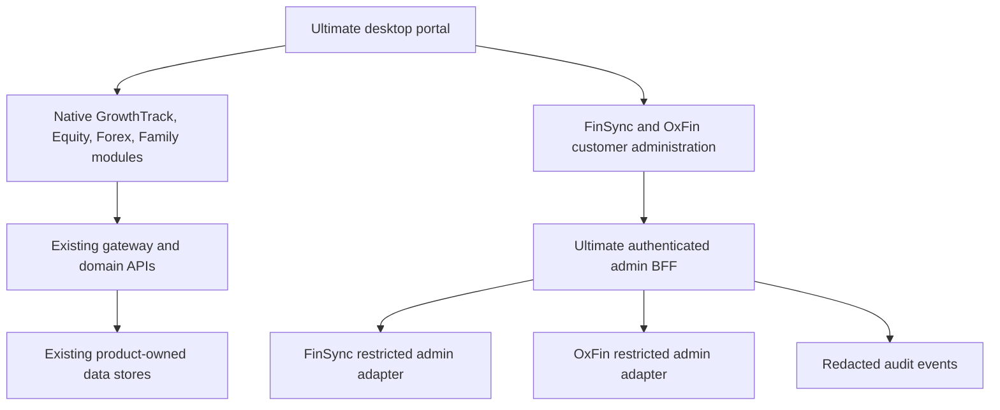

# GrowthTrack Ultimate: desktop portal redesign

Status: the user approved the demo direction and authorised implementation in the real app. The shared production UI is integrated; rendered scope verification and remaining integrations are pending. See the [production implementation](2026-10-28-production-ui.md). This plan supersedes earlier proposals that embedded all companion UIs in Ultimate. Real customer adapters and complete native companion migration have not shipped.

## Product boundaries

| Product | Destination | Data ownership |
| --- | --- | --- |
| GrowthTrack Ultimate | Portal shell, personal growth, work, insights, and optional physique workspace | Existing Ultimate store and API |
| Equity / NiftyLens | Native portal routes for instruments, watchlists, indices, options, holdings, alerts | Existing Equity services; migrate UI incrementally |
| Forex | Native research, model comparison, forecast and evaluation routes | Existing Python API; keep training outside the UI process |
| Family Connect | Native family, tree, memories, events, and document routes | Existing family API and permission checks |
| FinSync | Separate customer product; **its customer-admin UI belongs in Ultimate** | FinSync remains the source of customer records |
| OxFin | Separate customer product; **its customer-admin UI belongs in Ultimate** | OxFin remains the source of customer records |

FinSync and OxFin are not merged into GrowthTrack's personal finance feature. Their customer-facing web/mobile applications keep their own authentication and lifecycle. The portal must never use an owner's product handoff as an administrator credential.

## Design preview

From the repository root:

```powershell
npm run dev:design
```

Open `http://127.0.0.1:5410/admin-demo.html`. `ADMIN_DEMO_PORT` in Ultimate's local environment can override the preview port. The standalone build is `npm run build:design`; the output is `growthtrack-ultimate/dist-admin-demo/`. It contains fictional data, local review preferences, and session-only edits. There is no API proxy, backend connection, credential collection, service worker, analytics or model request in this entry.

The sidebar's **All pages & review** catalog contains every feature in `src/config/featureRegistry.ts`, plus customer administration and public pages. Use each page's tabs, light/dark toggle, and populated/empty/loading/error/denied/unavailable selector. A saved approval identifies its page, tab, theme, density, state, design version, and viewport dimensions. It does not approve unreviewed variants. Export the review JSON to retain feedback outside the browser. Later design revisions must change the review version and invalidate earlier approvals.

The prototype uses reusable layout families. Secondary tabs show the proposed layout and sample content; they are not implementations of their live APIs. The Physique workspace now has independent Current/Goal controls, a debounced schematic outline and explicit local save/history/download behaviour; it is not a connected 3D renderer or garment fitter. Legal pages are typography proposals, not published policies. Mobile is a responsive fallback, with desktop as the primary product target.

## Visual system

The agreed direction is a warm light workspace, forest-dark sidebar, restrained green actions, legible numeric tables, semantic statuses, and a matching dark workspace. The prototype styles are isolated under `src/admin-demo/`. Canonical values live in `styles/tokens.css`; layout/primitives in `portal.css`; proposal frames in `styles/proposal.css`; review additions in `styles/workspaces.css`; Physique styles load with the domain. See the [supplied-proposal implementation](2026-10-28-proposal-implementation.md) for contrast corrections and adaptive frame decisions.

Target desktop widths: 1024, 1280, 1440 and 1920 pixels. Keep the sidebar visible at desktop widths, use a readable content width, make table overflow local to its table, and avoid whole-page horizontal scrolling. Below 960 pixels, use a navigation drawer. Check a 390-pixel fallback after desktop review. Keyboard search, dialog focus, accessible tables, visible focus, reduced motion and non-colour status labels are part of the shared shell.

The CSS migration manifest lists **every tracked stylesheet**, including old versions and archived snapshots. Cover every file in the audit; do not add another permanent override stack. After approval, consolidate tokens, shell, primitives and domain styles; replace redundant production rules and retain historical snapshots only under documentation. Update generated product adapters through `scripts/sync-design-system.mjs`. FinSync and OxFin need their own customer-app visual reviews; their admin demo does not represent a redesign of those customer-facing apps.

## Target implementation



Suggested module boundaries inside Ultimate: `src/app` for the shell, `src/components/ui` for shared primitives, and `src/domains/{growth,equity,forex,family,customer-admin}` for routes, view models and API clients. Server adapters belong under `server/admin/{finsync,oxfin}`. Share typed, versioned response contracts; keep framework and persistence details inside adapters. Preserve the current canonical feature URLs or add tested redirects.

The user's confirmed preference is modular features and independent application builds. The demo now separates screen implementations into twenty-four component files and loads thirteen route families on demand. Root build scripts select each existing application independently. See [ownership and independent builds](../BUILD_BOUNDARIES.md) for the build matrix, shared UI boundaries and separate runtime responsibilities. The [latest UI audit](2026-10-28-ui-audit.md) records source/interaction audits plus the supplied-proposal implementation and 989 passing automated checks. The [UI system impact analysis](2026-10-28-ui-system-impact.md) maps static reach across seven ownership areas, synthetic record/review scale and the supplied 3D architecture. Visual approval and live page deployment remain separate stages.

### Customer administration contract

No shared, production-ready customer admin API was found in FinSync or OxFin during this work. The existing OxFin service examples are prototypes, including an identity service that does not validate login passwords. They cannot be used as an admin authentication boundary.

Build server-owned endpoints beneath `/api/admin/products/:product/customers`. Initially support paginated listing, a customer summary, support notes and audit history. Use a stable envelope with source product, opaque customer ID, account status, plan/entitlements and timestamps. Return minimal fields appropriate to the caller. Product/customer IDs must be resolved on the server, with an explicit product allowlist.

Add product-scoped roles such as `finsync.customers.read`, `oxfin.customers.read`, `customers.support.write` and `customers.entitlements.write`. Enforce permissions on **every** endpoint, including individual records, searches and exports. Use Ultimate sessions and existing CSRF/origin protection at the BFF. Use separate server-side product service identities or verified product-admin tokens downstream. Keep signing/encryption/provider secrets out of all browser bundles and public environment prefixes.

List requests need bounded pagination, filtering and rate limits. Mutations need input validation, explicit changed fields, version checks to prevent stale edits, idempotency where retries matter, and redacted actor/product/record/result audit events. Use no-store responses for customer records. An unavailable adapter returns an explicit setup/unavailable state; it must not substitute sample customers. Do not expose payment instruments, balances, government identifiers or medical information by default.

Before enabling writes: replace FinSync's legacy `NEXT_PUBLIC_ENCRYPTION_KEY` flow with server-side encryption and managed key versioning; verify existing ciphertext compatibility before migration. No keys or records are rotated, deleted or re-encrypted in this design phase. Complete per-product authentication, tenant-boundary and audit tests before connecting real customers. The local preview plan selector only edits a fictional record in memory.

### Native module migration

1. Introduce the approved shell and shared tokens behind a reversible route/feature switch.
2. Move Equity views into the portal, adapting existing market APIs. Preserve watchlists and provider configuration.
3. Move Family views with its existing server permissions and document access; keep storage locations unchanged.
4. Move Forex views to React while retaining Python inference/training services. Display data timestamps, evaluation horizon, uncertainty and unavailable-model states honestly.
5. Consolidate GrowthTrack pages by domain and retire conflicting CSS once each approved page is verified.
6. Add FinSync and OxFin read-only admin adapters, then reviewed mutations. Do not copy their customer UIs into the portal.
7. Retire iframe launch routes only after redirects, equivalent functionality and data-preservation checks pass.

## Repository organisation

The v2, continuation, v3 and v4 model-plan HTML files and their preview assets now live in `growthtrack-ultimate/docs/3d-plans/`. Model-preview generators and tests use that location. Runtime 3D assets and the existing Physique implementation remain in Ultimate. This keeps useful research without making it a root-level application.

`Claude/` is historical model material, not an application dependency. Preserve it for provenance; exclude it, copied `.claude`/`.windsurf` skills and tool caches from source retrieval. Do not remove runtime assistants on the assumption that they are obsolete. Put optional assistants under optional tools and keep the portal usable without any AI provider.

All application READMEs follow one generated schema in `docs/applications.json`. They describe actual source locations, purpose, setup, environment, checks and limitations. They contain no usable credentials, personal records, private endpoints or machine-specific paths. Environment templates contain empty secret fields. Public client variables are configuration visible to users, not a place to hide secrets.

## Delivery and acceptance

| Phase | Evidence required | Current state |
| --- | --- | --- |
| Inventory and boundaries | Route/CSS inventories, native-module and customer-admin mapping | Included |
| Reviewable design | Local interactive demo, all-page catalog, themes and feedback export | Included |
| Automated preview checks | Build, route rendering, customer workflows and review-state checks | Run results recorded separately |
| Human visual review | Page/tab review at desktop widths in both themes, with responsive fallback | Demo direction approved; rendered coverage still pending |
| Production shell and CSS | Approved tokens/components wired to existing authenticated routes | Planned after review |
| Native application consolidation | Equivalent functionality, tested adapters and preserved data | Planned |
| Real customer administration | Verified product roles, adapters, audit and isolation checks | Planned |
| Embedding-assisted code retrieval | Retrieval evaluation and privacy checks | See companion plan |

The current automation connection reported no available browser, so automated component rendering is not a screenshot or visual pass. Do not mark the visual-review phase complete based on a successful build. No customer systems, deployments, databases or secret files were changed by the preview.
