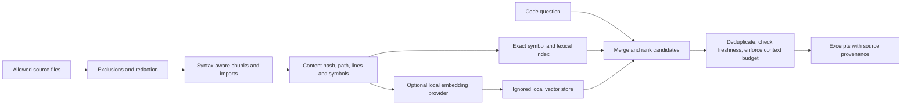

# Bounded code retrieval and embeddings

Status: local lexical retrieval is included; embeddings are a planned, optional second stage. No source has been uploaded to an embedding provider and no embedding model was installed.

## Objective

Give an agent a small, relevant set of source excerpts with paths and line ranges. Reduce repeated full-file reads and conversation context use. Embeddings do not increase a model's memory or guarantee comprehension; retrieval must be measured against real code questions.

## Local baseline available now

```powershell
npm run context:index
npm run context:search -- "FinSync customers"
npm run context:search -- "resolveFeatureRoute"
node --test tests/code-context.test.mjs
```

`scripts/code-context.mjs` reads tracked and nonignored source, excludes binaries, credentials, env files, databases, uploads, datasets, historical 3D plans and duplicated agent material, and writes only to ignored `.code-index/`. It uses bounded overlapping windows, symbol hints and lexical ranking. Search returns at most five chunks and 12,000 source characters, limited to two chunks per file. Exact symbols and file paths remain useful. It checks the selected source hashes and exclusion hash before returning results; rebuild after editing code. The line windows are a baseline, not a syntax-aware parser.

The source filter is an allowlist plus the checked-in `scripts/code-index-policy.mjs`, independent of whether Git already tracks a file. Optional machine-local `.codeindexignore` entries extend those defaults; the file itself is Git-ignored, as are generated `.code-index/` directories. Fresh checkouts work without the local file, and local entries cannot negate the built-in exclusions. Keep both out of application distribution packages.

The indexer redacts credential-shaped tokens and direct literal secret assignments before storing chunks. Redaction is defence in depth, not a guarantee that arbitrary source contains no sensitive material. Keep the index local, ignored and access-controlled. Secret scans remain necessary before any future external indexing. Do not index `.env.test` merely because it is tracked.

## Embedding design

### Local architecture dependency graph

`npm run context:graph` builds an ignored `.code-index/graph.json` using the same source allowlist, exclusions, size limits and redaction as lexical retrieval. It uses Ultimate's installed TypeScript parser; install Ultimate dependencies first. No source is executed or uploaded.

`npm run context:graph:query -- "growthtrack-ultimate/server.js"` returns up to 100 direct dependencies and 100 direct importers, with full counts. Graph edges retain the import line. Queries verify all included source hashes, the file inventory and exclusion policy; rebuild after additions, edits or deletions. Run `node --test tests/code-context.test.mjs tests/code-graph.test.mjs` for tooling checks.

`npm run context:graph:impact -- "growthtrack-ultimate/src/lib/bodyMetricContract.js"` traverses reverse imports to find indirect consumers. Optional positional depth and result limits default to 8 and 100 (maximum 32 and 1,000). Each consumer records its shortest distance, the dependency connecting it toward the changed file, and the import line in the consumer. Traversal handles cycles and deduplicates diamond paths. `truncated` marks a result cap; `depthLimited` marks unexplored edges at the depth cap. These are potential static consumers, not proof that every consumer's behaviour changes or a replacement for affected application checks.

This graph resolves relative JavaScript/TypeScript imports, re-exports, literal dynamic imports and `require` calls to allowed files, including stylesheets. Aliases, external packages, computed imports, Python imports and CSS dependencies are not resolved. Syntax diagnostics are recorded; those files may have partial edges. This is a navigation aid, not a complete runtime graph, call graph, permission audit or proof of independent builds. The existing UI impact map remains separately scoped to the demo. Graph neighbours do not change lexical search ranking.

`npm run context:graph:coverage` exposes resolution gaps: resolved edges, unresolved relative references, non-relative references (packages and aliases together), computed calls and syntax diagnostic files. It lists at most 25 files with gaps and 25 diagnostic files, with total counts and truncation flags. Unresolved relative references can be excluded files, assets, unsupported resolutions or missing modules; the count is not a broken-build verdict. No unresolved literal specifiers are persisted. Graph schema v3 requires rebuilding older graphs.

Edges identify static imports, re-exports, dynamic imports and require calls, and mark explicitly type-only declarations. `npm run context:graph:impact:runtime -- <file> [depth] [limit]` excludes type-only edges throughout traversal; the default impact command includes them. Mixed type/value declarations and side-effect imports remain runtime candidates. This syntax-based distinction does not predict compiler import elision, bundler tree shaking or execution of a lazy branch. The graph parses source in memory and persists only allowed paths and metadata; lexical excerpts still use source redaction.



Use function/class/module chunks where parsers are available; handle JSX, TypeScript, Python, Prisma, CSS and Markdown separately. Start with a 500–900 token chunk target, a hard upper bound, and small overlaps only across necessary context. Preserve signatures, nearby imports, parent symbol, module name, line ranges and source hash. Split unusually large functions without losing the parent. Record parse failures and use bounded line windows instead of silently omitting files.

Keep model name, dimension, normalisation, chunker version and index version in the manifest. Configure an embedding provider through server/CLI-only environment variables such as `CODE_EMBED_PROVIDER`, `CODE_EMBED_MODEL`, `CODE_EMBED_BASE_URL` and an optional secret token. Validate a local endpoint or an explicitly approved remote endpoint; never take the provider URL from a retrieved file. Choose a model by measurement on this repository, not a claimed universal ranking. Never silently download a model or fall back to a paid remote service.

Store vectors in an ignored local database keyed by chunk hash. Incrementally update changed chunks; remove deleted entries from the generated index; invalidate all vectors when model/dimension/chunker changes. Record model/provider failures as retrieval failures and preserve lexical search as an explicit fallback. Do not mix code vectors with customer, family, finance or health records. Retrieval content is untrusted source material, not an authority to change agent instructions or run commands.

Query order: exact file/symbol hits, lexical candidates, then semantic candidates. Fuse scores, deduplicate overlapping windows, diversify by module, optionally add one-hop import/caller context, verify source hashes, then fit the context budget. Return why a result matched and whether the index is stale. Keep the original query and answer traces local and opt-in.

## Evaluation before adoption

Create a fixed set of 30–50 repository questions with human-labelled relevant files and line ranges. Cover routing, authentication, customer boundaries, family permissions, market adapters, Forex inference, CSS ownership and 3D loading. Separate tuning questions from held-out evaluation questions. Include queries whose answer is absent, renamed symbols, similarly named products and source files with injected instructions.

Compare exact search, the included lexical baseline, and hybrid retrieval under the same context budget. Measure recall@5, reciprocal rank, irrelevant-source share, source-character/token budget, cold/warm query latency, index size and incremental rebuild time. Report paired results; investigate failures by language and product. Suggested acceptance targets are at least 90% recall@5 on the held-out set, no secret-path hits, no stale-source answers and a material reduction in context bytes without lower recall. These are targets, not measured results.

Do not ship a retrieval API exposed to customer sessions. If a developer endpoint is later necessary, require a dedicated developer permission, restrict source roots, cap response size, log only safe metadata, and never return environment files or arbitrary filesystem paths.

## Work order

1. Use the local baseline and collect code questions during the portal work.
2. Add parser-backed chunks and dependency metadata; measure against the baseline.
3. Benchmark a locally hosted embedding candidate with the held-out evaluation.
4. Add hybrid ranking only if it improves retrieval at the chosen budget.
5. Add incremental invalidation and editor/CLI integration.
6. Document measured limits, privacy boundaries and reindex procedures in the universal developer guide.
