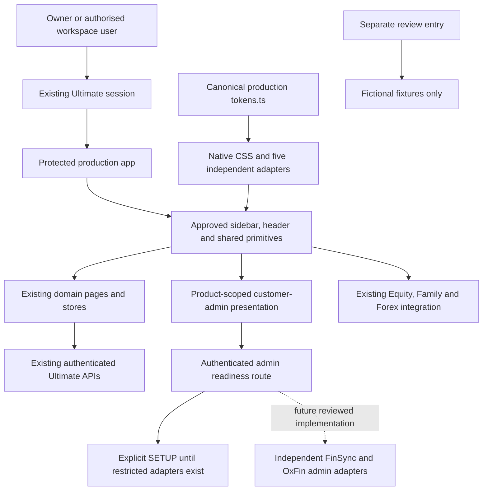

# Approved portal design in the real application

28 October 2026. The user approved the review demo and requested: **“Demo Preview is good make sure that to implement in real app too.”** This authorises applying that design to the real app. It does not turn generated review scopes into browser observations or publish a release.

The production frontend is available at [GrowthTrack Ultimate](http://127.0.0.1:5000/Ultimate/). It uses the existing owner sign-in and configured backend. The separate [fixture-only review demo](http://127.0.0.1:5410/admin-demo.html) remains available for design comparison.

## Implemented

| Surface | Production behaviour |
| --- | --- |
| Shared theme | Approved light workspace and dark forest sidebar, matching dark mode, existing AMOLED support, local Inter, accessible text/action/input tokens, comfortable/compact table density |
| Navigation | One 224px sidebar with seven domain areas and a separate Overview link; active-area children share its width; optional 64px collapse; modal drawer below 960px; existing mobile dock retained below 640px |
| Header and primitives | 64px utility header, platform-correct search shortcut, existing real notifications/account controls, 28px page titles, flat 12px cards, restrained actions, input boundaries, local table scrolling/sticky headers and semantic states |
| Existing domain pages | Finance, notes, tasks, calendar, health, training, settings, notifications, logs and the Physique editor keep their actual components, API clients, records and save behaviour; shared presentation now follows the approved system |
| Customers | First-class Customers area with All customers, FinSync and OxFin directories; product/search/status/plan filters, bounded 25/50/100-row requests, count/pagination, inline read-only profile and focus restoration |
| Product boundary | FinSync/OxFin routes lead to administration. Their customer products remain separate and can be opened from Apps Suite. Equity/Family/Forex retain their existing integrations until native views have parity |
| Public pages | Shared production theme, Inter typography, smaller headings and readable policy measure; real owner sign-in, password handling and safe return routing remain intact |
| Preferences | New preference records default to forest; existing explicit palettes/order remain valid. Prior default ordering gains Customers; deliberate custom order is preserved. AMOLED can be saved consistently |
| Dynamic fixes | Missing table values stay last in both sort directions; product switches clear previous customer details; source shrink clamps pagination; delayed sidebar saves do not steal focus after the user moves on |

No production screen imports `src/admin-demo` fixtures. The demo's sample plans, support notes, synthetic timers and fictional records were not substituted for actual product data. The production root still uses `AuthProvider`, `QueryClientProvider`, existing session reset/logout safeguards and domain stores.

## Runtime flow

## Customer administration readiness

The real directory uses the existing authenticated `apiClient` and a small domain client at `src/domains/customer-admin/customerAdminClient.js`. Responses must match the requested product, offset and limit, contain unique records, and expose only allowed presentation fields. Invalid or cross-product responses are rejected before rendering. Query data is held in the existing query cache, which the application clears at session boundaries; it is not written to local storage.

`GET /api/admin/products/:product/customers` runs behind the existing authentication middleware and sends `Cache-Control: no-store`. FinSync/OxFin currently return **503 / `ADMIN_ADAPTER_NOT_CONFIGURED`**, which the UI renders as SETUP. Unknown products return 404. This endpoint is a readiness boundary, not an implementation of privileged customer access. No real customer adapter, role grant or support/entitlement mutation is enabled by this UI change.

Directory, Activity and Support are distinct destinations. Activity/support services remain explicit setup states; no audit events or saved support notes are fabricated. A future adapter must implement server-side product/tenant permissions, bounded filtering/pagination, minimal fields and audit before returning records. Product customer login is not an admin credential. Existing FinSync encryption and OxFin identity blockers remain in the architecture plan.

Canonical FinSync/OxFin paths remain `/finance/finsync` and `/finance/oxfin` for compatibility, with customer-admin content. `/customers/finsync` and `/customers/oxfin` redirect to those paths. `/customers` is the new directory entry. Equity, Family and Forex routes are preserved; their complete native migrations remain separate work packages.

## Source and CSS ownership

`src/design/tokens.ts` v4 is the production semantic contract. `npm run design:sync` regenerates native `styles/design-tokens.css` and all five independently buildable product adapters; `design:check` verifies them. Existing user palette choices remain supported. The review demo retains its isolated styles.

The existing `editorial-shell.css` was replaced in place with the approved portal shell. `editorial-components.css`, `editorial-overviews.css`, `editorial-settings.css`, `responsive-foundation.css`, `desktop-responsive.css` and public-page styles were reconciled with that design. No new permanent shell override stack was appended. Domain-specific styles remain with their existing components; `domains/customer-admin/customer-admin.css` owns the new admin frame. Rows use minimum density heights so multiline data and interactive controls can grow.

Legacy domain styles remain where their real workflows depend on them. Retire them incrementally after rendered parity; deleting all older CSS would discard working page-specific behaviour. The inventory now covers 61 production feature routes and 54 source stylesheets. The review catalog remains 65 pages / 201 destinations, including four public layouts.

## Verification

The production build, Ultimate TypeScript check and isolated preview build pass. **200 targeted production checks pass**, covering navigation, keyboard/focus, delayed saves, preference persistence, routes, shared components, production token contrast, admin response validation, setup/denied/unavailable states, product switching, pagination, API client/auth provider contracts and finance state. The separate design suite has **989 passing checks**. Targeted lint of UI JS/JSX, the new readiness module and the token generator reports zero errors and zero warnings; server syntax checking also passes.

The production bundle manifest contains no demo entry or demo modules. The production frontend serves HTTP 200 on port 5000. Component tests and token calculations do not establish actual browser alignment or successful real customer integration. Browser control still reports no connected browser, so rendered production review, real sign-in/service checks and device-specific layout verification remain pending. Existing browser-layout test sources were updated for the new typography; those browser tests were not run through an alternative browser driver.

No deployment, private environment edit, database/schema migration, key rotation, data deletion, real customer mutation or 3D model regeneration was performed. Starting the frontend does not start or reconfigure product backends. Keep application builds independent and use the existing application README for backend setup.

Remaining production integration is explicit in [the architecture handoff](../UI_ARCHITECTURE_HANDOFF.md): restricted admin adapters, native Equity/Family/Forex parity, remaining specialised workflows, incremental domain CSS retirement and real renderer/device verification. These items are not declared complete by the shared UI rollout.
