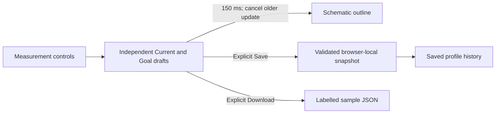

# UI system continuation and impact analysis

28 October 2026. Implementation scope: the isolated desktop design preview. This analysis supports the current source changes; it is not production approval or a claim of exhaustive visual verification.

## What changed

The Physique workspace now has a separate lazy screen and domain stylesheet. Its Blueprint/3D workspace includes Current/Goal selection, measurement sliders, front/side/back schematic views, zoom, and explicit save/download actions. Measurements compare the two independent contexts; Targets edits Goal only; History shows the last saved snapshot rather than the current draft. Drafts survive tab and route changes. Only an explicit successful local save survives reload. Storage failure retains the draft and offers a JSON download.

The stage is deliberately labelled as a schematic. It debounces outline updates for 150 ms and cancels obsolete timers. It does not bake a body, fit cloth, load production assets or contact product services. GLB export stays unavailable because a semantic UI draft is not a completed avatar package. The downloadable JSON has its own demo format and is not represented as a production avatar document.

Shared records now render 25 rows by default, with 50/100-row choices. Search and sorting apply to the complete supplied result before pagination. Search/sort/page-size changes reset navigation; shrinking the source clamps the page; missing sort values remain last. This bounds DOM rows, not the size of an API response. Real datasets still require server-owned bounded pagination and filtering.

Review revision v5 distinguishes density as well as page, view, theme, state and viewport. The catalog shows exact-scope progress and completed pages, allows area/status/search filtering, and finds the next unapproved view. A single approved tab does not complete a page. Catalog navigation preserves the selected preview state. Feedback retains the target viewport captured when opened, even if the window is resized. Blank feedback is rejected. A compact local storage envelope removes repeated metadata; exported reviews keep the full readable records. Storage failures remain visible in the review catalog until a later successful save.

## Supplied-proposal continuation

The [implementation report](2026-10-28-proposal-implementation.md) records the new scope/provenance system, accessible palette variants, adaptive customer master/detail, exact filtered finance totals, computed holdings, separate timer/session/analytics views, action triage, notification read state, distinct sample logs, skill records, local dashboard ordering and named analytical contracts. All 65 pages consume the shared tokens and page contract; no page becomes LIVE. Denied and unavailable join populated/empty/loading/error as explicit design states.

The shared session model now owns task IDs, action overrides, focus session history, notification read state and editable note drafts. Global search reads current tasks/notes without importing their screen modules. FinSync/OxFin previews remain product-scoped and never call a customer API. Specialised unimplemented calculators show input/output contracts, not fabricated results.

## Reach and ownership

`npm run impact:ui` generates [the machine-readable dependency map](ui-impact-analysis.json) from the actual catalog, lazy loaders, local imports and stylesheet inventory. `npm run impact:ui:check` detects drift. The map covers 65 pages, 201 page/view destinations, 13 lazy route families and 54 source stylesheets, including historical and generated styles explicitly classified in the migration inventory.

The shared table can affect 54 pages / 177 destinations by static route-family reach. This is a conservative potential-impact count: a family importing the table does not mean every conditional tab uses it. Shared shell/review changes can affect all 65 pages. The new Physique implementation affects its five existing tabs and remains independent of the customer products.

The following are repository ownership areas, not invented names of organisational teams:

- Customer administration owns All customers, FinSync and OxFin admin screens. Both customer-facing apps retain independent builds, identities and data ownership. Production access still requires product-scoped adapters, roles and audit trails.
- Personal finance and markets owns finance records, budgets, subscriptions, holdings, SIP, shopping and Equity UI contracts. Shared table changes require its filters and numeric sorting to remain correct.
- Growth and Physique owns health/growth views and the model editor. Current/Goal isolation, per-person save boundaries and geometry/semantic-document separation remain its responsibility.
- Workspace owns tasks, notes, calendar, files, projects, focus time, skills and goals. Pagination must preserve row actions, drafts and empty-state recovery.
- Insights owns trends, comparisons, forecasts and Forex research views. UI changes do not alter model training, inference or provider data.
- Family and life owns family members, shared events, scoped documents, memories and other life views. Portal composition does not bypass family permissions.
- Portal platform owns shell navigation, shared controls, settings, review storage, public-page layouts and the design tokens. It also owns cross-domain keyboard, responsive and accessibility verification.

The generated map lists the concrete routes under each area. Independent build/release boundaries remain in [BUILD_BOUNDARIES.md](../BUILD_BOUNDARIES.md). The user subsequently approved the demo direction. The [real-app implementation](2026-10-28-production-ui.md) applies the shared design to production source and adds an authenticated customer-admin readiness endpoint; real adapters remain unconfigured. Production stores, roles, database schema and runtime 3D solver remain unchanged. No deployment was performed. The generated map now records production source ownership separately from the demo import graph.

## Supplied 3D architecture: observed versus target

The supplied diagram is a useful target for separating editing, expensive geometry work, rendering and persistence. Source inspection shows an important distinction:

- `src/lib/avatarDocument.js` already defines a versioned semantic document with separate Current/Goal contexts and asset compatibility checks.
- `src/hooks/useParametricAvatar.js` already uses a serialized per-person save queue, flushes newer edits at navigation boundaries and checks account/person scope before saving.
- `src/components/morphEngine/parametricIdentity.js` performs CPU identity evaluation synchronously in `setWeights`. No identity-bake worker boundary is established by this inspected module. The diagram's identity worker is therefore a target integration, not something this UI change claims to have implemented.
- `src/components/morphEngine/garmentFitQueue.js` and `garmentFit.worker.js` already implement a single-flight worker queue with newest-revision handling. `posedGarmentContact.js` constructs owned posed geometry for transferable payloads; the shared live editing basis should not be transferred or detached.
- Existing geometry packages and semantic documents have distinct contracts. A production export must wait for the matching latest body/garment revision and fail clearly if fitting failed or the editor was disposed.

The current demo flow is:



Before wiring the approved editor to the production renderer, introduce a revisioned identity-worker adapter around the existing engine. Each result needs editor/person/context identity, parameter revision and asset/topology version. Coalesce slider edits, keep only the newest queued job, reject obsolete results and pending exports, and dispose workers and geometry when leaving the editor. Keep lighting/camera changes outside identity recomputation. A worker error, context loss or unavailable device capability must leave the controls and semantic draft recoverable, with honest retry/export availability.

Saving semantic state can be independent of a mesh bake, but must report the real API outcome. Exporting geometry must be gated on an exact current fit. Offline/failed saves retain a dirty draft. Account/person switches must use the existing flush/scope boundary. No data migration or new store is justified solely by the redesigned panels.

## Dynamic cases and scale evidence

The tests exercise large supplied record sets, global sort before slicing, page reset/clamping, empty results, missing sort values, Current/Goal isolation, rapid slider edits, tab/route persistence, saved/draft history, reload boundaries, corrupt saved data, denied storage, unavailable GLB export, density-specific approvals, resized feedback, status/product filters and preserved error previews. Existing regressions retain customer product isolation, notes, calendar boundaries, family scope, financial totals, timer behaviour and overlay/keyboard interactions.

All 201 destinations render in both themes and both densities: **804 component render checks**. These use JSDOM/SSR, which do not measure CSS layout or GPU output. Six states × two themes × two densities give **4,824 base review variants**. The five target viewport sizes produce **24,120 planned review cases**. The synthetic review test validates restoration and counting across that matrix; it does not claim that 24,120 browser screenshots were taken.

`npm run scale:ui` writes `.tmp/ui-scale-report.json` with 40 warm Node.js timing samples per operation after five warmups. It uses 10,000 synthetic table records and 24,120 synthetic review records. The table remains at 25 rows by default, with a 100-row maximum. Coverage of the active review scope remains 201 destinations, even when many other scopes are stored.

On this Node 24.12.0 run, full synthetic reviews serialized to 7,835,521 bytes, versus 2,176,543 bytes for the compact envelope, with exact scope/status/note/time restoration. This reduces storage pressure; it does not guarantee that an arbitrary browser quota or long feedback history will fit. The catalog retains a session-only warning and export action when storage fails. Use the local report for observed model timings. They exclude DOM mounting, actual paint, device/GPU memory, network requests, concurrency and production service capacity; no frame-rate, page-load or user-capacity claim is inferred.

The preserved separate avatar contract baseline has 22 passing garment queue, serialized parametric saving and avatar document checks. Its production implementation is unchanged by the supplied-proposal work.

## Remaining acceptance gates

Browser control still returned no connected browser during this continuation. Rendered verification remains required at 1024×768, 1280×800, 1440×900 and 1920×1080, plus the 390×844 fallback. Inspect both themes/densities, long content, zoom, the fixed review bar, table overflow, native dialogs, drawer focus, range interactions, reduced motion and forced colours. Use the demo catalog to save only the reviewed scope.

Production integration also needs real permission/tenant isolation, paginated API contracts, identity-worker cancellation and versioning, export/save races, context-loss recovery and actual device/GPU memory checks. Keep unverified cases visible rather than interpreting the automated test count as proof that every dynamic or visual case is correct.

Commands from the workspace root:

```powershell
npm run dev:design
npm run build:design
npm run test:design
npm run impact:ui:check
npm run scale:ui
node scripts/design-inventory.mjs --check
```
