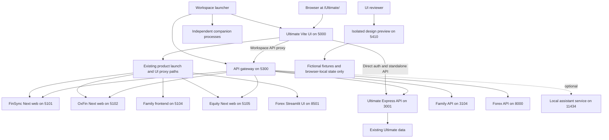
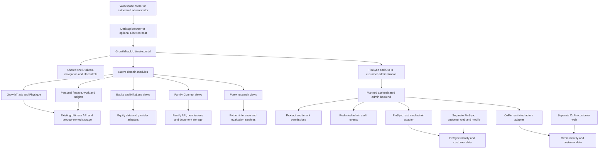
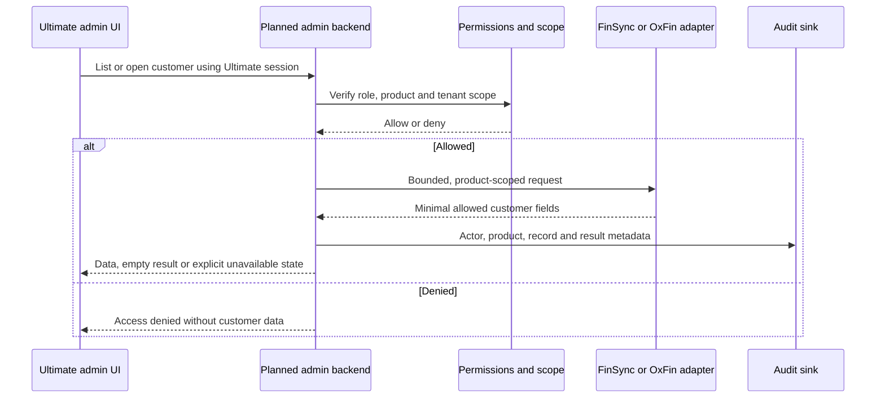
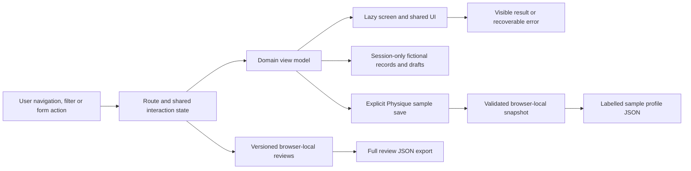
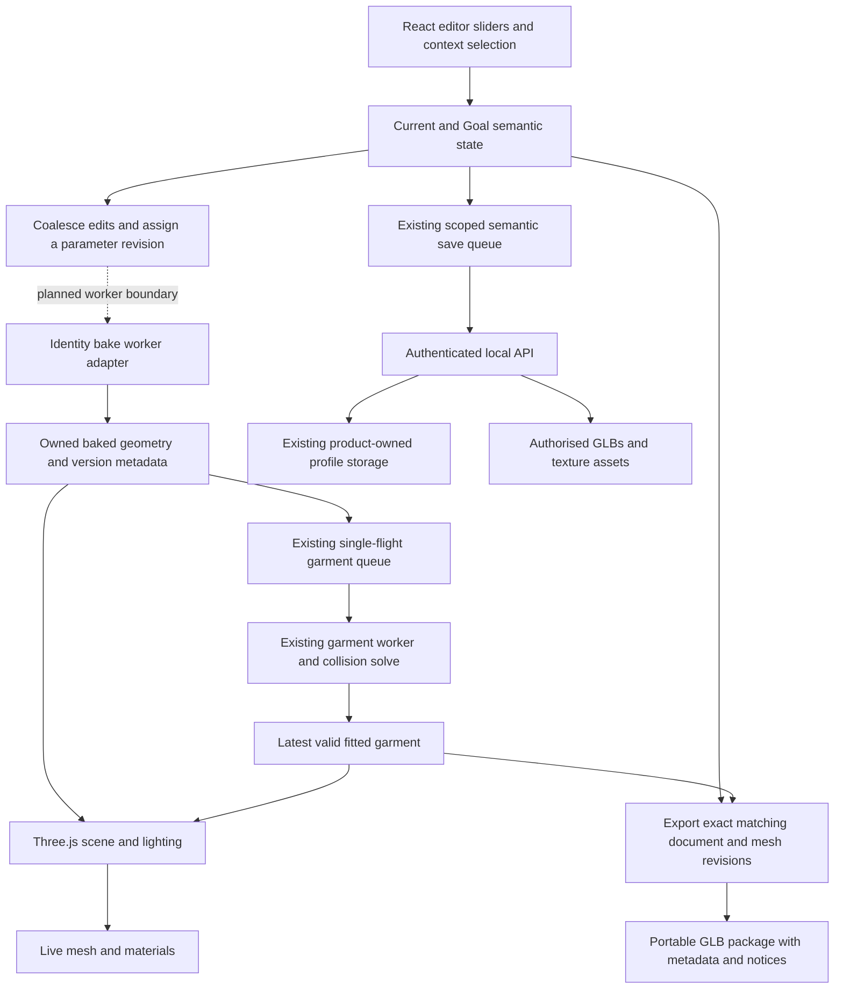
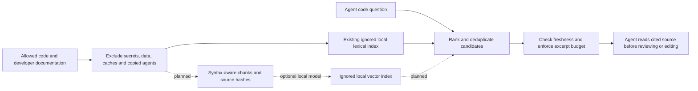

# GrowthTrack: complete architecture and UI review handoff

Prepared 28 October 2026. This is a portable handoff for an independent UI reviewer or redesign agent. Read the status labels before treating any diagram as deployed architecture.

## 1. Purpose and current work

We are designing one desktop administration/workspace portal in **GrowthTrack Ultimate**. GrowthTrack, personal finance/work/insights, Equity, Family Connect and Forex belong in native portal modules. **FinSync and OxFin remain separate customer products; Ultimate is their customer-administration home.** Their customer-facing apps are not merged into Ultimate's personal finance module.

The current deliverable is an isolated, interactive design demo. It has {{PAGE_COUNT}} pages, {{DESTINATION_COUNT}} page/tab destinations, {{FAMILY_COUNT}} lazy route families and both light/dark and comfortable/compact modes. The source inventory accounts for {{STYLE_COUNT}} stylesheets. The [supplied proposal](design/2026-10-28-ui-redesign-proposal.md) is implemented in this isolated demo with [documented adjustments and limits](plans/2026-10-28-proposal-implementation.md). The user has approved the demo direction and authorised real-app implementation. The approved theme, sidebar/header, shared primitives and customer-admin presentation are now in production source; see the [production UI integration](plans/2026-10-28-production-ui.md). Real customer adapters and complete native companion migrations remain outstanding. Rendered scope verification is still pending.

Status labels used in this document:

- **Working demo:** a local interaction with fictional data; does not imply a production API or permission boundary.
- **Layout proposal:** proposed content and visual structure; some tabs share a layout or lack their specialised workflow.
- **Existing runtime:** source already in the applications; not newly shipped by the demo.
- **Planned integration:** future work requiring adapters, tests and the relevant approval.
- **Needs browser review:** actual pixels, focus and browser behaviour have not been signed off.

The main jobs now are to verify the production UI in a browser, resolve remaining semantic/workflow gaps and migrate domain integrations in small reversible steps. Optional agents and code retrieval support development; they are not core product dependencies.

## 2. Product architecture and ownership

### Configured current development topology

This is the existing launcher/proxy arrangement, **not a live health report**. Ports below are source defaults and can be overridden by environment configuration. The design preview is a separate entry.



Source references: `scripts/workspace.mjs`, `scripts/gateway.mjs`, `scripts/workspace-proxy.mjs`, `growthtrack-ultimate/vite.config.js` and `src/config/products.js`. In standalone Ultimate mode, the normal API/auth proxy defaults to Ultimate's API; the workspace launcher opts into product routing. Gateway API defaults distinguish Family's API at 3104 and Forex's API at 8000 from their UI ports; older narrative port lists should not override source configuration. An optional developer database console is separate from the review demo.

### Target native portal composition

This is the **target composition**. Native integrations and customer-admin adapters shown below are planned; the current isolated demo does not call these APIs.



The existing local gateway/launcher composes current application runtimes; it is not proof that the native portal migrations above are complete. Preserve product data ownership. Portal navigation does not grant database access, and a customer-app login handoff is not an administrator credential.

| Product / application | Features and responsibility | Current UI status | Remaining work |
| --- | --- | --- | --- |
| Ultimate portal | Shell, search, settings, personal finance, work, growth, insights and life; review controls remain demo-only | Approved shared design integrated into the authenticated app; isolated review demo retained | Rendered regression review, remaining domain layout parity and native integrations |
| GrowthTrack / Physique | Routines, sleep, nutrition, hydration, training, wellbeing, measurements and avatar workspace | Sample growth screens; interactive Current/Goal schematic editor; existing separate 3D runtime | Specialised page workflows, real persistence and approved renderer integration |
| Equity / NiftyLens | Instruments, watchlists, indices, charts, options/chain and market research | Sample native portal layouts; existing separate Equity frontend | Adapt existing providers, preserve saved state and migrate UI after approval |
| Family Connect | Members/tree, memories, events, timeline, family documents and permissions | Interactive sample member/event views and family-scoped vault; existing separate family frontend/API | Native UI parity, authorised documents/uploads and family access controls |
| Forex | Currency pairs, model comparison, forecast context, analytics and volatility | Illustrative research demo; Python services remain separate | Native React views, provider timestamps, honest uncertainty/evaluation and unavailable states |
| FinSync customer product | Customer finance, budgets, spending, account connections and planning; web/mobile packages | Separate existing product; customer app is not redesigned by the portal demo | Its own UI review; production fixes; restricted admin adapter for Ultimate |
| FinSync administration | Directory, account status, profile, support and activity | Dedicated production UI and authenticated setup boundary; fictional mutations remain demo-only | Restricted product/tenant adapters, roles, bounded listing, audit and reviewed mutations |
| OxFin customer product | Customer identity, wallet/cards, payment/investment-related product areas and intelligence concepts | Separate existing web product and reference services; readiness varies by package | Its own UI review; verify real capabilities and identity; restricted admin adapter |
| OxFin administration | Directory, account status, profile, support and activity | Dedicated production UI and authenticated setup boundary; fictional mutations remain demo-only | Independent OxFin adapter, verified identity, permissions, audit and reviewed mutations |

Product features above describe ownership and intended surfaces, not a claim that every backend capability is production-ready. Appendix B lists every documented application/reference package and its recorded readiness.

### Admin request flow



Initial production capability should be read-only listing and summaries. Notes/entitlement changes follow with validation, stale-version checks, idempotency where needed, CSRF/origin protection and audit. Suggested API prefix: `/api/admin/products/:product/customers`. Real adapters must never substitute fictional demo records on failure.

The demo uses `/customers`, `/customers/finsync` and `/customers/oxfin`. Production now has `/customers`; existing `/finance/finsync` and `/finance/oxfin` paths show admin content, with `/customers/:product` redirects. Preserve these compatibility paths until a separately tested namespace change. Neither route convention changes the server-side permission requirement.

## 3. UI architecture: current source and intended organisation

### Current isolated preview

```text
growthtrack-ultimate/
  admin-demo.html
  vite.admin-demo.config.js        separate entry; no API proxy or real auth
  src/admin-demo/
    main.jsx                       fonts and entry styles
    AdminDemo.jsx                  shell, route, shared session state, review/save wiring
    catalog.js                     all pages, views and review scopes
    screenRegistry.js              thirteen lazy route families
    screens.jsx                    loading readiness and route error boundary
    components.jsx                 buttons, tables, charts, dialog and shared primitives
    dialogs/                       customer details, entry fields, review catalog
    models/                        domain records, scope, table/review and semantic state
    hooks/                         reference-counted scroll locking
    screens/                       {{SCREEN_COUNT}} presentation components, including shared views
    Scope.jsx / PreviewState.jsx   scope/provenance and six distinct design states
    WorkspaceNavigation.jsx        domain grouping within the shared rail
    portal.css                     shared layout and primitives
    styles/tokens.css              canonical accessible themes and density values
    styles/proposal.css            scope, adaptive frames and proposed domain layouts
    styles/workspaces.css          review and table additions
    styles/physique.css             lazy Physique domain styles
```

Source of truth: `src/config/featureRegistry.ts` for existing feature identity, `src/admin-demo/catalog.js` for demo routes and view contracts, and `screenRegistry.js` for route ownership. Other agents must inspect the current working tree as well as committed HEAD; the redesign may contain uncommitted/staged files.

### Target production structure

This is the incremental target. Customer-admin presentation already lives in its domain and the production shell consumes shared primitives; other domain moves remain staged:

```text
src/
  app/                            router, session providers, shell and navigation
  components/ui/                  accessible reusable controls and layout primitives
  styles/                         semantic tokens, themes and shared primitives
  domains/
    growth/                       growth views and their view models
    physique/                     editor UI, semantic model, viewer/worker adapters
    personal-finance/             ledger, budgets, subscriptions, planning
    workspace/                    tasks, notes, files, calendar, goals, focus
    insights/                     trends, comparison and research presentation
    equity/                       market views and Equity API client
    forex/                        research views and Python service client
    family/                       members, events, memories and file permissions
    customer-admin/
      shared/                     presentation and typed admin response contracts
      finsync/                    product-specific UI policy and client
      oxfin/                      product-specific UI policy and client
server/
  admin/                          authorised routes, product adapters and audit
```

Dependencies point from domain UI toward shared primitives/contracts and its own API/view models. Avoid sibling-domain implementation imports or a single mutable store containing every product's customer records. A shared UI component must not import private backend access. Introduce no new service solely to split files. Wrap existing runtime modules incrementally rather than renaming/replacing the 3D engine or product stores in one change.

### Shared screen contract

Every screen should have a clear title, purpose, primary action when appropriate, scope/context, content region and recovery path. Reuse the shell, buttons, tables, filters, dialogs, empty/loading/error/denied/unavailable states and semantic status styles. Keep domain-specific controls in the domain. Scope table scrolling locally; preserve meaningful page widths and browser zoom.

Current design direction is agreed: **light workspace, dark forest sidebar, matching dark mode, desktop first**. Inter is bundled locally. The demo consumes `styles/tokens.css`; production's source is `src/design/tokens.ts`, with generated `styles/design-tokens.css`. Do not invent independent palettes per module. Every demo page has DEMO/SETUP/PREVIEW scope and data panels carry provenance; no demo route is LIVE. Production uses its real domain data and explicit setup/read-only boundaries. The sidebar is 224 px, the top bar is 64 px, the drawer breakpoint is below 960 px, and main content has a readable maximum width. These are current implementation values to review, not immutable pixel requirements.

Styles must follow ownership: common tokens/primitives centrally; domain styles beside their domain. Audit all files in `css-migration-inventory.json`; regenerate generated adapters with `design:sync` instead of editing them manually. Replace redundant production CSS after approved pages move over, rather than adding another permanent override stack.

## 4. State, user interactions and persistence



| State | Current behaviour | Required review cases |
| --- | --- | --- |
| Route, page/view and overlay | Hash navigation; shared shell; catalog may preserve the selected preview state | Back/Forward, direct URL, unknown view, deep link, close overlay on navigation, focus destination |
| Theme and density | Browser-local preference; review keys distinguish both | Reload, switch while viewing data, compact long labels, no cross-mode approval reuse |
| Customers, notes and plan edits | Fictional session-only customer records | Product isolation, search/filter, duplicate validation, close/reopen, visible result, no invitation/API claim |
| Transactions, budgets, subscriptions and shopping | Typed sample entries feed native tables and summaries | Amount precision, dates, direction/status, totals, archive/upcoming filters, sorting and empty recovery |
| Family events and documents | Shared sample events feed family/calendar; vault is family-scoped | Date agreement, member count, unlinked members, file scope, long names, unavailable private files |
| Focus timer and history | Shell-owned deadline, unique session identity and shared sample/session history; separate timer, table and analytics artifacts | Leave/return, delayed ticks, pause/resume/reset, exactly-once completion off-page and matching daily/project totals |
| Notes and tasks | Selected drafts/completion retained in shared session state; global search includes current drafts and stable task records | Tab change, navigate away/back, completed filters, duplicate titles, local edits and search |
| Action triage | Session snooze for 24 hours, dismiss/restore and completion shared with tasks | Segment meaning, snooze expiry, restore, completion from another view |
| Notifications and logs | Read state/preferences retained in session; activity/auth/sync have distinct sample schemas | Unread/all, mark-read/unread/all, header count and no invented login/sync events |
| Physique drafts | Independent Current/Goal values, bounded sliders, 150 ms outline debounce | Rapid edits, context switch, tab/route persistence, saved history versus dirty draft |
| Physique saved profile | Explicit validated local snapshot; JSON download has a demo format | Reload, failed storage, corrupt data, download and clear distinction from GLB |
| Design reviews | Revision v5, compact local storage, full readable export | Exact scope, old/corrupt records, quota failure, frozen feedback viewport, whitespace-only feedback |

Preview empty/loading/error/denied/unavailable modes are selectable design states. They are not evidence of real network failures or successful API retries. Production UI needs independent permission-denied, offline, unavailable provider, stale-data, validation, conflict and partial-failure handling.

## 5. Physique / 3D flow from the supplied reference

The intended production flow is below. The **identity worker is a target integration**; the inspected `parametricIdentity.js` currently evaluates identity synchronously on the CPU. The garment worker queue and semantic/save contracts already exist.



Keep camera/lighting changes separate from identity recomputation. Jobs/results should carry person/editor/context identity, parameter revision and asset/topology version. Only the newest valid result can apply. Transfer owned buffers, keep live editing bases intact, cancel/dispose obsolete work, and reject export on stale geometry, failed fit or a closed editor. Saving semantic state may be independent of baking; geometry export must wait for the exact matching fit.

The **current demo** has an SVG schematic, not this rendering pipeline. Its controls, zoom, orientation, comparison, save and history flows can be reviewed now. GLB export is unavailable and sample JSON is labelled. Do not turn the diagram into an assertion that workers, cloth fitting, WebGL context recovery or runtime memory have been validated by this demo.

Inspect these existing source boundaries before implementing the target:

- `src/lib/avatarDocument.js`: semantic schema, asset compatibility and separate contexts.
- `src/hooks/useParametricAvatar.js`: per-person serialised save/flush and owner-scope checks.
- `src/components/morphEngine/parametricIdentity.js`: current CPU identity evaluation.
- `src/components/morphEngine/garmentFitQueue.js` and `garmentFit.worker.js`: newest-revision queue and worker.
- `src/components/morphEngine/posedGarmentContact.js`: owned posed geometry for worker payloads.
- `src/components/morphEngine/avatarPackage.js`: portable package boundary.

Paths in this list are relative to `growthtrack-ultimate/`.

## 6. What has been delivered, and what is still outstanding

Delivered in the local work:

- Isolated portal proposal covering the existing feature catalog plus all-customers and public pages; shared styling and lazy domain families.
- Fictional product-scoped customer master/detail; filtered finance totals and precise holdings; family/calendar/vault consistency; notes/tasks/focus persistence; separate timer/session/analytics artifacts; action triage, read-state notifications and distinct sample logs; skill-specific views; honest analytical contracts; accessible overlays; Physique controls and explicit local snapshots.
- Canonical accessible theme/density tokens, domain navigation, per-screen scope and per-panel provenance; six preview states; density-aware v5 review catalog, exact-scope progress, feedback/export and compact storage.
- Universal generated application READMEs and blank-secret environment examples. Secrets belong in ignored local environments or a deployment secret manager; public frontend variables are browser-visible.
- Historical v2/continuation/v3/v4 3D plans relocated under `growthtrack-ultimate/docs/3d-plans/`, with runtime assets kept separate.
- Optional local lexical code retrieval and an embedding plan. Generated `.code-index/` and the local `.codeindexignore` file itself are ignored and excluded from distribution. Historical `Claude/` material is not a mandatory product dependency.
- Route/CSS inventories, ownership/build boundaries, static change-impact analysis and synthetic model scale checks.

Outstanding:

- Browser inspection of every required page/view/scope and any follow-up design decisions. The user approved the demo direction and real-app implementation, but no pixel-perfect or full accessibility certification is claimed.
- Specialised workflows for layout-only tabs, real provider/device/file integrations, backend-derived analytics and policy/legal review.
- Remaining domain CSS consolidation and native Equity/Family/Forex migration; the shared production shell/style integration is implemented.
- Real FinSync/OxFin admin adapters, server-enforced permissions/audit and reviewed mutations.
- Production 3D adapter integration, identity-worker boundary, real-device/context-loss/memory verification and exact-fit export.
- Separate visual reviews of the FinSync/OxFin customer apps and mobile distribution.
- Optional embeddings only after retrieval/privacy evaluation. No source was uploaded to an embedding provider.

### Known coverage gaps the reviewer must check explicitly

These are implementation boundaries found in source, not claimed browser observations:

- Many secondary tabs reuse a layout family. A rendered route and a changed title do not establish that the tab's specialised function exists.
- Timesheet now separates timer, session table and daily/project analytics. Verify their shared local history, exactly-once completion and rendered layouts; real persistence is not connected.
- Action Center now has working local snooze/dismiss/restore segments; notifications have read-state transitions; logs have distinct activity/auth/sync sample schemas. Browser review and real service integration remain open.
- Strength `1rm`, nutrition `calculator`, assessment `questionnaire` and several analytical views now show explicit input/output contracts rather than simulated results. Their specialised production workflows remain incomplete. Dashboard arrangement supports local ordering, not server-saved dashboards.
- Skills uses its own library/groups/practice coverage/history; Progress has named artifact contracts. Some other growth fallback views still need domain-specific workflows; repeated routine content is not domain parity.
- File providers, financial CSV/history/accounts, connected apps and device integrations are setup/layout proposals, not connected services.
- Saved places are a schematic; no real map provider or precise location is attached. Public policy/billing screens are concepts, not published policies or checkout.
- Some local growth interactions use component state; verify navigation persistence rather than assuming every interaction is shell-owned.
- FinSync/OxFin customer-app pages are outside the 201 portal destinations. Review them separately; the admin portal is not their customer UI redesign.

## 7. Work packages and subtasks

IDs below are handoff work packages, not agents already spawned or assignments to named people. Review and implementation are separate tasks. Existing application owners retain their data/runtime responsibility.

| ID | Subtask | Owner area | Depends on | Acceptance / current state |
| --- | --- | --- | --- | --- |
| D01 | Maintain product/route/CSS inventory and independent build map | Portal platform | Source catalog | Delivered; regenerate/check on changes |
| D02 | Maintain fictional review demo, scoped feedback and safe sample state | Portal platform | D01 | Delivered; preserve isolation and scope |
| D03 | Maintain universal READMEs, env examples, plan relocation and ignore policy | Developer tooling | D01 | Delivered; docs/config/index checks remain passing |
| D04 | Implement supplied redesign proposal in the isolated review demo | Portal platform / domain owners | D02, supplied brief | Delivered supporting implementation; see reconciliation report; browser/user gates remain open |
| R01 | Capture rendered baseline and classify every required scope | Portal platform / reviewer | D02, connected browser | Screenshots, console observations, tested/untested ledger |
| R02 | Review shell, tokens, typography, density, navigation and overlays | Portal platform / reviewer | R01 | Desktop widths, zoom, focus, contrast and responsive fallback evidence |
| R03 | Review FinSync/OxFin admin directories, profiles, notes and statuses | Customer administration | R02 | Product scope, clear actions, tables, validation and failure states |
| R04 | Review ledger, budgets, subscriptions, portfolio, SIP and shopping | Personal finance | R02 | Amount/date/totals consistency, correct filters and distinct view intent |
| R05 | Review Equity and Forex research layouts | Markets / Insights | R02 | Legible numeric tables/charts, selected context, timestamps and honest sample uncertainty |
| R06 | Review family tree, events, memories, vault and life views | Family and life | R02 | Member/event consistency, document scope, long content and privacy-aware presentation |
| R07 | Review growth, health, routines, training and wellbeing views | Growth | R02 | Correct domain language, distinct specialised tabs and safe fictional data |
| R08 | Review work, calendar, files, notes, tasks, projects, goals and time | Workspace | R02 | Keyboard actions, state persistence, dates, timer, sorting and empty recovery |
| R09 | Review Current/Goal editor and 3D workspace controls | Physique | R02 | Draft/save/history boundaries, rapid edits, storage failure and honest export state |
| R10 | Review insights, settings, notifications, help, public and plan pages | Portal platform / Insights | R02 | No unrelated actions or invented backend/legal/billing capability |
| R11 | Review separate FinSync/OxFin customer apps and mobile fallback | Product owners | Their builds and configured preview access | Separate evidence; no portal approval reused for customer apps |
| R12 | Resolve cross-page patterns and present redesign proposals | Reviewer / designer | R03–R11 | Prioritised findings, reusable patterns, proposed page frames and tradeoffs |
| R13 | Record the user's design decisions and rendered coverage | User / reviewer | R12 | Demo direction and real implementation approved; unvisited rendered variants remain pending |
| I01 | Apply approved shell, tokens and shared primitives to the real app | Portal platform | User approval received | Implemented in source with existing auth/stores retained; 200 targeted production checks; rendered verification pending |
| I02 | Implement FinSync/OxFin read-only admin contracts and roles | Customer administration / backend | Approved contract, I01 | Auth, product/tenant isolation, bounded pagination, minimal fields and audit |
| I03 | Add support-note/entitlement mutations | Customer administration / backend | I02 | Validation, conflicts, retry/idempotency, audit and no false success |
| I04 | Migrate Equity views and remove iframe launcher after parity | Equity | I01, approved Equity pages | Providers/saved state preserved, tested redirects and isolated build |
| I05 | Migrate Family views and document permissions | Family | I01, approved Family pages | Family access, files/events parity, no data movement without a separate migration |
| I06 | Migrate Forex presentation while retaining Python services | Forex / Insights | I01, approved Forex pages | Timestamp/horizon/evaluation/uncertainty and unavailable model states |
| I07 | Replace layout-only Growth/Workspace/Insights workflows with domain UI | Respective owners | I01, relevant R13 | Correct inputs/results, real query states and integration regressions |
| I08 | Connect approved Physique UI to semantic save/viewer/worker adapters | Physique | R09, I01 | Revision/cancellation contract, owner scope, context loss and matching-fit export |
| I09 | Consolidate obsolete production CSS incrementally | Portal platform / domain owners | Each approved/migrated page | Every stylesheet disposition tracked; generated adapters stay consistent |
| I10 | Resolve documented production blockers before real customer writes | FinSync/OxFin owners / backend | Before I03 rollout | FinSync browser-held encryption replacement and verified OxFin identity; separate data/key migration approval |
| V01 | Run affected builds, contract checks and browser regression review | Each owner / QA | Relevant implementation | Evidence for changed consumers; no claim that one demo build certifies all apps |
| V02 | Release gradually with health checks and rollback | Release owner | V01, explicit deployment authorisation | Approved release, data preservation, failures observable and rollback verified |
| T01 | Evaluate parser-backed retrieval and optional local embeddings | Developer tooling | D03, evaluation set | Better bounded retrieval measured; no secret paths or silent source upload |

Do not treat the full plan as permission to deploy, change real customer accounts, rotate keys or delete/migrate data. The user has assigned real-app UI implementation; the [production report](plans/2026-10-28-production-ui.md) records its exact scope. Further work remains within explicitly assigned scope.

## 8. Review workflow for another agent

1. Read this document and `UI_REVIEW_AGENT_PROMPT.md`; use `ui-review-manifest.json` for exact destinations, owner batches, entry files and status descriptions.
2. Inspect `AGENTS.md`, current working-tree changes, the catalog and the relevant source. Do not reset or discard unrelated work.
3. For the authenticated production UI, use `npm run dev:ultimate` and `http://127.0.0.1:5000/Ultimate/` with the existing configured backend/session; never bypass sign-in. For the isolated fixture review, use `npm run dev:design`; open `http://127.0.0.1:5410/admin-demo.html`. The preview needs no product credentials. If reviewing from another host, forward the preview port or use an explicitly supplied reachable preview/screenshots; that host's localhost is not this machine. If dependencies are missing, follow the selected application's README rather than inventing setup.
4. Review shell/shared primitives first, then the owner batches below. Use fictional records only. Browse every destination; test dynamic cases according to its feature brief and source.
5. Inspect 1024×768, 1280×800, 1440×900 and 1920×1080 desktop targets, then 390×844. Cover light/dark, comfortable/compact and populated/empty/loading/error/denied/unavailable modes. Add zoom, long text, keyboard, denied storage and unavailable-service scenarios.
6. Record exact scope for every observation. A representative shared-state check can support a shared component finding, but cannot become blanket approval of unvisited pages. Use `not-tested` wherever evidence is missing.
7. Capture before/after screenshots only from an actual rendered browser, record console failures, and describe reproducible steps. Source-only review must be labelled source-only.
8. Return findings and redesign proposals for approval before editing live product pages. If explicitly assigned implementation, fix the shared cause first, keep domain ownership, update the design revision when layouts change and reverify affected consumers.
9. Use the demo's All pages & review catalog to request changes. Only mark a view approved with the user's authority for that scope; a reviewer recommendation is not the user's approval. Export the full review JSON.
10. Update the coverage ledger and remaining gaps. Passing tests, generated matrices and existing approved variants do not establish that untested pixels or workflows are correct.

### Review scope and scale

{{DESTINATION_COUNT}} destinations × 2 themes × 2 densities × {{STATE_COUNT}} design states = **{{BASE_REVIEW_VARIANTS}} base variants**. Across five specified viewports this is **{{VIEWPORT_VARIANTS}} planned scope combinations**. This is a review-planning count, not a claim that {{VIEWPORT_VARIANTS}} screens have been inspected.

The latest recorded local verification has {{UI_CHECKS}} passing demo checks, including {{RENDER_CHECKS}} route/view/theme/density renders. The production UI integration has 200 targeted passing checks plus its own successful build and clean changed-file lint. The preserved separate avatar baseline has {{AVATAR_CHECKS}} passing save/document/garment-queue tests; its implementation is unchanged. Synthetic model checks use 10,000 supplied records and {{VIEWPORT_VARIANTS}} review records. Build/token/docs/config/index/impact checks are recorded in the verification document. These are prior results; rerun checks relevant to new code changes. JSDOM and Node timing measurements do not verify browser layout, GPU behaviour, network reliability or production concurrency.

Current table bounds are 25 rows by default and 100 maximum selectable. The full synthetic review history was 7,835,521 bytes of UTF-8 JSON versus 2,176,543 bytes in the compact envelope. Browser quotas and long notes can still fail; inspect the persistent export warning. Real APIs need their own server pagination.

### Required review output

Provide a short assessment, then findings and a coverage ledger. Every finding must contain:

```json
{
  "id": "UI-001",
  "severity": "P1",
  "pageId": "physique",
  "view": "3d",
  "theme": "light",
  "density": "comfortable",
  "state": "populated",
  "viewport": { "width": 1440, "height": 900 },
  "reviewType": "browser",
  "summary": "Describe an observed issue; this object is a schema example",
  "steps": ["List exact reproducible steps"],
  "observed": "Actual result",
  "expected": "Required behaviour and reason",
  "evidence": ["Relative screenshot or trace path"],
  "sourceCandidates": ["growthtrack-ultimate/src/admin-demo/screens/PhysiqueScreen.jsx"],
  "affectedPages": ["physique"],
  "recommendation": "Concrete shared or domain correction",
  "verification": "How the correction will be checked"
}
```

Use P0 for a critical break/data exposure, P1 for a blocked core workflow or inaccessible essential content, P2 for material inconsistency/usability errors, and P3 for visual polish. Do not fill findings with fictional failures. For coverage, record `not-tested`, `reviewed-no-finding`, `changes-requested` or `blocked`, with the exact scope and evidence. Keep reviewer coverage separate from the demo's user approval format.

Return proposed changes grouped into shared shell/primitives and domain-specific work, plus affected routes, acceptance criteria, regression checks and dependencies. Include a short list of design choices needing the user's taste decision. Do not use a score alone as the acceptance gate.

### Owner batches

<!-- GENERATED_OWNER_BATCHES -->

## 9. Independent builds, developer tooling and environment

From the workspace root:

```powershell
npm run dev:design
npm run build:design
npm run test:design
npm run impact:ui:check
npm run scale:ui
npm run docs:check
npm run config:check
npm run design:check
node scripts/design-inventory.mjs --check
node --test tests/code-context.test.mjs
```

Individual builds are `build:ultimate`, `build:finsync`, `build:oxfin`, `build:equity`, `build:family:web` and `build:family:api`. Forex keeps its Python/service packaging; mobile keeps its own Expo/native commands. A build can require that application's configured environment. These are entry points, not an assertion that all existing builds pass.

The latest known baseline also records two existing FinSync `User.multiFactor` type errors and one 3D preview fingerprint mismatch; see the verification document. Do not hide baseline failures, alter models to silence them or broaden a UI review into an unrelated data migration.

For bounded source reading, use exact `rg` paths/symbols or `npm run context:index` followed by `npm run context:search -- "question or symbol"`. Read the cited source before changing it. The local index is optional; embeddings are planned and need evaluation. Ignore generated code indexes, the local ignore override itself, environments, databases, copied agent tools and private assets. Do not send source or credentials to an external provider just because this handoff is shared.



Universal READMEs come from `docs/applications.json` through `scripts/application-docs.mjs`. This handoff/manifest is regenerated by `scripts/ui-handoff.mjs`; edit the handoff template and feature briefs there, not a generated appendix alone.

## Appendix A. Complete portal page and tab inventory

All destinations below exist in the design catalog. Their presence is not proof of a complete specialised workflow. The preview-level note makes the current limits explicit. Each route link is a demo hash route; source entry/style ownership is in the machine-readable manifest.

<!-- GENERATED_PAGE_CATALOG -->

## Appendix B. Complete application/reference package catalog

Recorded product/package status from `docs/applications.json`. Reference services with incomplete manifests are not newly deployable microservices. Use the linked README for installation/configuration and limitations.

<!-- GENERATED_APPLICATION_CATALOG -->

## Supporting evidence and plans

- [Supplied UI proposal](design/2026-10-28-ui-redesign-proposal.md)
- [Proposal implementation, adjustments and verification](plans/2026-10-28-proposal-implementation.md)
- [Approved real-app UI implementation and remaining integration](plans/2026-10-28-production-ui.md)
- [Independent application builds and ownership](BUILD_BOUNDARIES.md)
- [Desktop portal and customer-admin plan](plans/2026-10-28-admin-redesign.md)
- [UI audit and corrected issues](plans/2026-10-28-ui-audit.md)
- [Current UI impact analysis](plans/2026-10-28-ui-system-impact.md)
- [Machine-readable static impact map](plans/ui-impact-analysis.json)
- [Verification results and baseline failures](plans/2026-10-28-verification.md)
- [Code retrieval and optional embedding plan](plans/2026-10-28-code-retrieval.md)
- [All stylesheet dispositions](plans/css-migration-inventory.json)
- [Existing feature/route migration inventory](plans/ui-route-inventory.json)

<!-- Generated by scripts/ui-handoff.mjs. Edit docs/templates/ui-architecture-handoff.md and the feature briefs, then regenerate. -->
