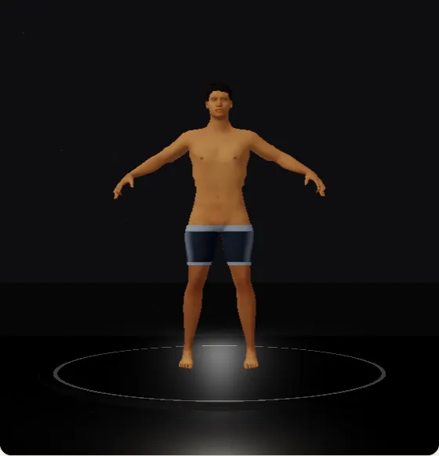
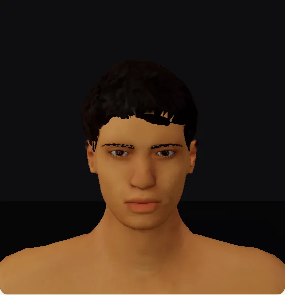
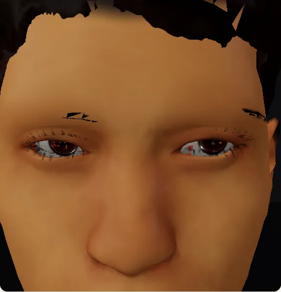
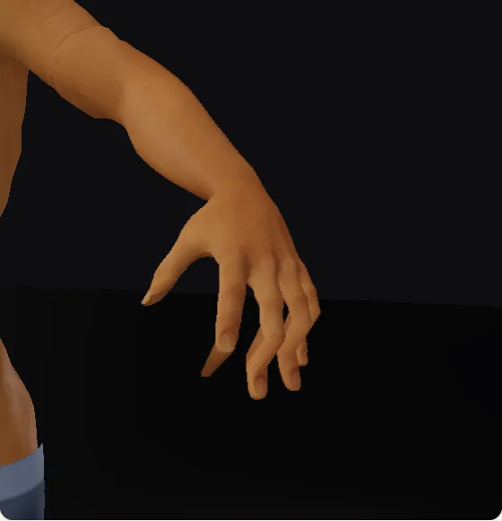
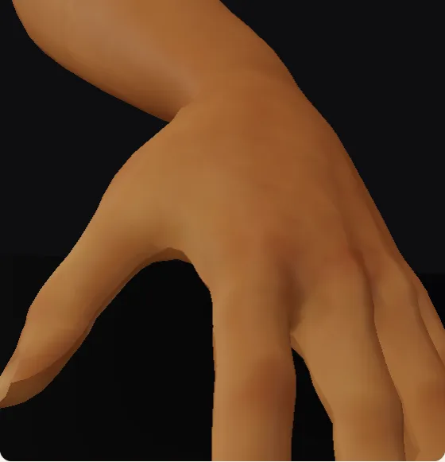
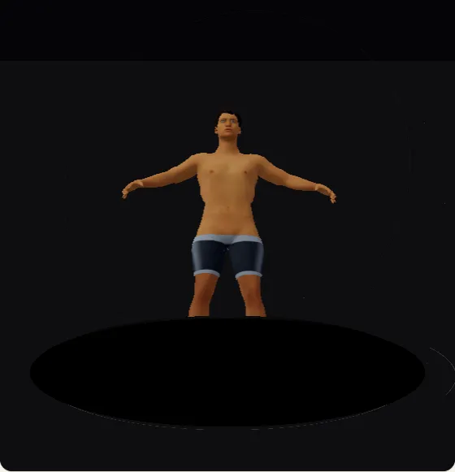
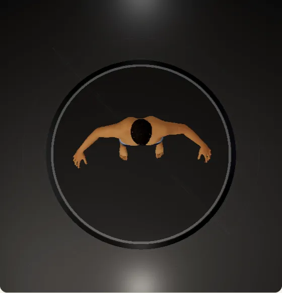

# 01 · Findings: what the model and the viewer are today

Everything here was measured, not assumed, and can be re-measured. The GLB numbers come from
`node scripts/analyze-human-model.mjs` (output in [`data/`](data/)); the viewer behaviour comes from
`node scripts/audit-physique-viewer.mjs`, which drives the real app in headless Chromium (software GL, 1440×1000, the
`/wellness/physique?view=3d` route, mocked `/api`) and reads the camera and canvas state; its latest run is in
[`data/viewer-audit.json`](data/viewer-audit.json) (**0 of 7 claims pass**, matching the table below). Screenshots are in
[`evidence/`](evidence/).

## The short version

| # | Finding | Why it matters |
| --- | --- | --- |
| 1 | The body skin is one 16,001-vertex mesh with **no finger, toe, jaw, eye or twist joints** (20 joints in total). | Hands cannot grip, mouths cannot open, forearms collapse when the wrist turns, and "drag the hand" has almost nothing to drive. |
| 2 | The head has **23 texels per cm** and each hand about **10**. At maximum zoom the head is stretched **1.4×** and the hand **2.9×**. | This is the "pixels break" you see. It is a data limit, not a shader bug. |
| 3 | **Absent entirely:** fingernails, toenails, teeth, gums, tongue, eye corners, body hair, facial hair, garment meshes, skeleton/muscle/fat layers. **Skin-surface only:** nose, ears, lips, eyelids, neck, chest, hips and more (no separate anatomy). | These are the parts that make a model read as a person. See the table below. |
| 4 | The three "wear" modes other than the body are **shaders on a copy of the body**, not clothes. | Shorts have no waistband thickness, no seams, no folds; "swimwear" and "underwear" are the same trick. |
| 5 | **Auto-rotate does not rotate.** It is a ±9° sway, only in the front preset, and it did not move the camera at all in the test. | You asked for a real turntable. |
| 6 | **Presentation mode is cosmetic.** It switches a lighting preset. It did not enter fullscreen or hide the interface. | You asked for a decent presentation mode. |
| 7 | **Quality tiers do not change what you'd expect.** Performance, Balanced and High gave the same canvas size and the same antialias setting. | Antialiasing is fixed when the canvas is created, so changing the tier later cannot turn it on. |
| 8 | **Export is the on-screen size** (559×580 px in the test, 164 KB). **Share** never attaches the picture. | Screenshots are low resolution and sharing sends text and a link only. |
| 9 | **The camera can go under the floor.** Dragging up reaches a camera height of **−1.52 m**; the floor then hides the model's legs. | The floor must be a hard limit. |
| 10 | **The background is a solid dark colour** in every preset; **"walk" and other animations have no way to start** in the UI (the animation panel is not mounted). | No space scene, no walking, no dragging a hand. |

The conclusion that shapes the whole plan: **the realism ceiling is the asset, not the shaders.** The earlier passes
(plan page: procedural eyes, strand hair, skin shading) showed what is possible on this mesh, and also where it stops.
The roadmap therefore rebuilds the asset (rig, tiles, parts) and the viewer together.

## A · The GLB

`public/assets/models/humanoid-base.glb`: 23.8 MB, 24,315 vertices, 44,760 triangles, 20 joints, 58 body morphs,
10 images (18 MiB of textures). Six meshes:

| Mesh | Vertices | Triangles | Morphs | What it is |
| --- | --- | --- | --- | --- |
| GrowthTrackBody | 16,001 | 29,682 | 58 | The skin, head to feet |
| GrowthTrackPrivateAnatomy | 4,803 | 9,536 | 8 | Adult-gated external anatomy (see [03](03-anatomy-spec.md)) |
| GrowthTrackEyes | 1,075 | 1,944 | 58 | Two eyeballs and cornea shells |
| GrowthTrackHair | 2,061 | 3,185 | 58 | Hair cards (one short style) |
| GrowthTrackEyebrows | 126 | 138 | 58 | One textured card |
| GrowthTrackEyelashes | 249 | 275 | 58 | One textured card |

Rig: 20 joints (Hips, three spine, Neck, Head, and Shoulder/UpperArm/ForeArm/Hand and UpLeg/Leg/Foot per side),
four influences per vertex. **Families present: clavicle 2, spine 3. Absent: fingers, toes, jaw, eyes, twist.**

### Resolution by region

Measured from the mesh and the first albedo (2048², `SkinAlbedo_YoungMale`). "Skin px/cm" is how many texels of colour
the skin has per centimetre; "mean edge" is the triangle edge length.

| Region | Vertices | Area (cm²) | Mean edge (mm) | Skin texels/cm |
| --- | --- | --- | --- | --- |
| Head | 4,241 | 1,530 | 6.0 | **23** |
| Hand (each) | 1,964 | 680 | 6.6 | **10.3** |
| Foot (each) | 1,350 | 1,167 | 10.3 | 9.5 |
| Forearm (each) | 252 | 679 | 20.7 | 8.3 |
| Lower leg (each) | 498 | 1,652 | 21.3 | 7.9 |
| Upper arm (each) | 368 | 941 | 18.2 | 11.9 |
| Torso (Spine1) | 319 | 1,142 | 22.2 | 12.6 |

A finger is about 16 mm wide; with 6.6 mm edges that is two or three triangles across, which is why fingers look like
tubes (`evidence/04-hand-close.webp`). The "lite" file keeps the same geometry with 512² textures, so its head is
**5.8 texels/cm** and its hand **2.6**.

### What a camera sees at the closest zoom

Using [`code/texel-density.mjs`](code/texel-density.mjs) (tested): at the closest the live viewer lets the camera get
(580 px canvas, 30° field of view, pixel ratio 1):

| Region | Distance | Screen px per cm | Texels per cm | One texel covers |
| --- | --- | --- | --- | --- |
| Head | 0.337 m | 32 | 23 | **1.4 px** |
| Hand | 0.363 m | 30 | 10.3 | **2.9 px** |

On a phone with a pixel ratio of 2 the same view needs twice the density again. The limit for "no visible blocks" is about
1.25 px per texel, which for today's hand means keeping at least **0.84 m** away (1.7 m at pixel ratio 2): the camera's
own zoom limit lets the user go to a quarter of that.

### Morphs

58 morphs, all plain vertex offsets, none of them declaring which part of the body it is allowed to move. Five move more than
5,000 vertices (`overall_mass` 5,425, `trap_rise` 10,376, `torso_length` 10,559, `shoulder_slope` and `clavicle_width` 5,030
each). Broad shapes are legitimate when a whole limb or the head has to travel with the body part that changed (widening the
clavicles carries the arms and hands outward), but then **the skeleton's joints must move with the vertices**, otherwise a
rotated shoulder pivots around a point that is no longer at the shoulder. The asset cannot say whether they do: it has no
per-morph joint offsets. Two (`d_length`, `d_girth`) move nothing.

The facial shapes are not facial. Of the vertices the shipped `jaw_open` moves, 14% are in the head region and 44% in the upper
arms (the rest in shoulders, neck and chest); `smile` has 38% in the head; `blink` moves 2,940 head vertices, the whole face, so a
lid cannot close on its own. This is why the plan page generated its own facial shapes and why [03](03-anatomy-spec.md) specifies a
new face set.

### Anatomy coverage

The audit script checks 31 parts a person has (full table with evidence in
[`data/glb-audit.humanoid-base.md`](data/glb-audit.humanoid-base.md)):

| Status | Parts | Count |
| --- | --- | --- |
| Separate mesh | scalp hair, eyebrows, eyelashes, eyeballs, adult external anatomy | 5 |
| Part of the skin surface | head, eyelids, nose, ears, lips, neck, shoulders and clavicles, chest/ribcage/spine, nipples and navel, hips/glutes/pelvis, thighs/knees/calves | 11 |
| Partial | arms (no twist), hands and fingers (no joints), feet and toes (no joints), skin base colour (one photo-like map, three tints), pores and veins (one 1024² normal map) | 5 |
| Absent | eye bones, tear line and caruncle, teeth/gums/tongue, jaw articulation, nails, body hair, facial hair, tan and regional pigment, garments, skeleton/muscle/fat | 10 |

Every one of these 31 rows is mapped to a part in [`code/anatomy-spec.mjs`](code/anatomy-spec.mjs), and a test fails if
the audit and the spec disagree.

## B · The viewer, request by request

| You asked for | What happens today (measured) | Cause in the code | Plan |
| --- | --- | --- | --- |
| Drag a hand; it should perform actions like walking | The 17 draggable chips in the body-part navigator only **focus the camera** when dropped on the model (`focusInspectionPart`). Nothing grabs a limb. There is no control that starts walking: `AnimationPanel.jsx` is imported nowhere, so the store's `animationState` stays at `idle`; the only pose controls are three posture presets (Relaxed, Attention, BB Pose). | `HumanoidViewer.tsx` `onDrop`; `AnimationPanel.jsx` unreferenced; `PostureRig.jsx` `BONE_MAP` names finger bones the GLB does not have; `animationPresets.js` offsets are Euler rotations on 20 joints. | [05 §6](05-viewer-and-interaction-spec.md): grab-and-drag IK, walk cycle, pose library. |
| A space background, but different | Solid colours: studio `#08080a`, outdoor `#0d0a10`, night `#010208`. | `cinematicProfiles.js`. | [05 §7](05-viewer-and-interaction-spec.md): a starfield/nebula sky with presets. |
| 360° around the body, not up or down; also see from above; rotate every way; the model itself must not rotate | Horizontal drag rotates freely (300 px = −100°, 1200 px = 136° after wrap). Vertical drag goes from straight overhead (5°) to 115°, which is **below the floor**. The model is fixed (only the camera changes, which is correct). There is no way to ask for "turntable only". | `CameraRig.jsx`: `minPolarAngle` 5°, `maxPolarAngle` 115°. | [05 §2](05-viewer-and-interaction-spec.md): four camera modes, floor clamp, hanging mode, ViewCube. |
| Zoom in and out without pixels breaking | Mouse wheel from the full-body view stops at 2.68 m; "Face" and "Hand" buttons fly to 0.96 m and 1.01 m; zoom-in buttons and the wheel then reach 0.34 and 0.36 m, where the hand is stretched 2.9×. | Texel density (above); `minDistance` is a fixed ratio of the framing distance, unrelated to texture density. | [05 §3](05-viewer-and-interaction-spec.md) and [04 §6](04-skin-hair-eyes.md): detail ladder, per-region minimum distance from `texel-density.mjs`. |
| Quality: high / balanced / automatic with its own behaviour | Options are Automatic (LOW), Performance, Balanced, High. Canvas size, pixel ratio and antialias were identical for all three; the label shows "Automatic (LOW)" and never changes. | `antialias` is a WebGL **context-creation** option in `gl={{ antialias: lodConfig.antialias }}`, which cannot change after mount; `QualityTelemetry` reports fps but nothing adapts. | [05 §4](05-viewer-and-interaction-spec.md): governor with hysteresis, tiers that change DPR, MSAA, shadows, hair, post-processing, texture level. |
| Auto-rotate works | Toggling it left the azimuth at 0° for 12 samples. When it does run it is a ±9° sway, only in the FRONT preset with no focus. | `CameraRig.jsx` `useFrame`: `Math.sin(t × 0.24) × 9°` with `cameraPreset === 'FRONT'`. | [05 §2](05-viewer-and-interaction-spec.md): `autoRotate()` turntable, speed in °/s, frame-rate independent. |
| Screenshots work | Export gives the on-screen size (559 px wide for a 559 px canvas; 164 KB and 388 KB in two runs; `MirrorChamber_<date>.png`). The private anatomy is correctly hidden. | `captureScreenshot` calls `canvas.toDataURL` at viewport size. | [05 §8](05-viewer-and-interaction-spec.md): high-resolution still in a render target, transparent or space background, `exportSize()`. |
| Sharing works | The share modal opens with the picture; its "Share" calls `navigator.share` with `title`, `text` and `url` and **no file** (observed with `navigator.share` stubbed, since headless Chromium has none), and "Post to X" opens a text-only intent URL. | `SocialShareModal.jsx` `handleShare`. | [05 §8](05-viewer-and-interaction-spec.md): `chooseShareMethod()` (native files → clipboard image → download). |
| Presentation mode should be decent | The switch changes a lighting preset (`PORTRAIT`/`ANALYTIC`); fullscreen stayed false and the interface stayed visible. | `HumanoidViewer.tsx` `handleCinematicPreset`. | [05 §9](05-viewer-and-interaction-spec.md): Fullscreen API, hidden chrome, turntable, wake lock, exit hint. |
| The bottom floor fixed | The floor is a 20×20 m plane, a pedestal and a ring; the camera can pass under it. | `ChamberFloor.jsx`; no camera constraint. | [05 §2](05-viewer-and-interaction-spec.md): `floorPolarLimit()` (property-tested). |
| The model "hanging", viewable from above, below and all round | Not available: the floor and pedestal are always present. | — | [05 §2](05-viewer-and-interaction-spec.md): HANGING mode removes the floor limit and the pedestal. |

## C · Evidence

| | |
| --- | --- |
|  | **Default view.** The wear is a shader on a copy of the body (shorts without thickness). Solid dark background, a grey pedestal, no space. |
|  | **Face, framed by the Face button.** The hair is a card helmet with a jagged, cut-out hairline; the brows are flat cards; the skin is uniformly smooth; the lips are a flat painted colour with no lip line or teeth behind them. |
|  | **Face at maximum zoom** (0.34 m). The brows break into black fragments (card alpha; rendered with software GL here, so a GPU may differ), the eyes show odd red reflections, the skin is smooth soft colour with no pores, and the hairline is a cut edge. |
|  | **Hand.** Fused finger tubes, no nails, no creases, no tendons. |
|  | **Hand at maximum zoom** (0.36 m): a smooth, featureless surface stretched 2.9×. |
|  | **Camera below the floor** after a vertical drag: the floor disc hides the legs. |
|  | **Top-down**, reached by dragging to the 5° limit. It works, and shows how little the model has from above: a flat dark pedestal ring and a solid background. |

## D · Repository findings made along the way

- **The dev server does not start from a clean checkout.** `vite.config.js` imports `./build/serviceWorkerPlugin.js`,
  but the `build/` folder is ignored by `.gitignore`, so the file is not in the repository. The audit used a local
  one-line stub (not committed). Fix: track the file or make the import optional.
- `docs/DIGITAL_HUMAN_V2_PLAN.md` still says the body has 14,517 vertices; the shipped file has 16,001 after the pelvis
  refinement (documentation drift; the audit script now reports the real numbers).
- Console warnings during every session: `THREE.Clock` is deprecated, `PCFSoftShadowMap` is deprecated (three falls
  back to `PCFShadowMap`), and `GLTFLoader: Missing min/max properties for accessor POSITION` (the repair script
  `repair-glb-accessor-bounds.mjs` exists, the shipped file still triggers the warning).
- The two zoom buttons are labelled "Zoom in" and "Zoom out" only through `aria-label`/`title` (no visible text);
  keep that when the control is redesigned.

## E · What this means for the plan

1. **Rebuild the asset, do not patch it.** Add the joints and parts above, split the face shapes from the body shapes,
   and move to texture tiles with a micro-detail layer. This is [07](07-asset-pipeline-and-glb-spec.md).
2. **Make the viewer's promises testable.** Every item in section B becomes a unit test of a pure module
   (`viewer-camera`, `quality-governor`, `share-export`, `texel-density`, `ik`, all already written and passing in
   [`code/`](code/)) plus one end-to-end probe, so a regression cannot ship.
3. **Separate what is a person from what is the room.** Skin tone, tan and blood are data about the person
   ([04](04-skin-hair-eyes.md)); camera, floor, sky and quality are about the room ([05](05-viewer-and-interaction-spec.md)).
