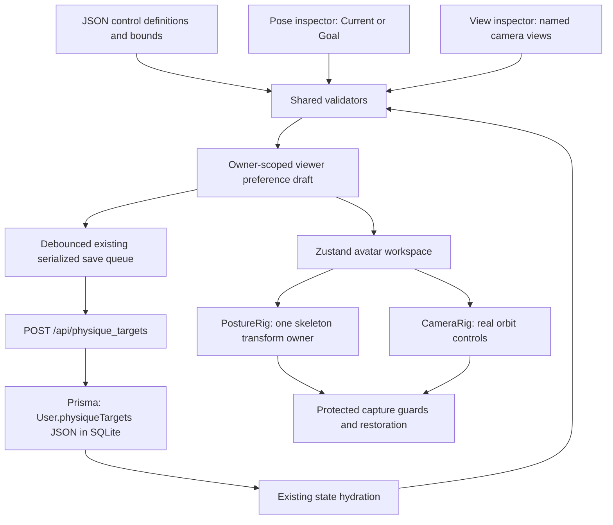

# Saved poses, limb reach and camera views

These three runtime checkpoints advance the planning tracker from 35 to 50. They reuse the shipped assets and existing owner database. They do not establish 50% mesh completion, calibrated anatomy or full V6a conformance.

## Persistence flow



`src/config/poseStudio.json` defines editable joints, artistic angle bounds, starting poses, limb chains, pole directions, bend limits, target steps, marker styling and the bounded body/head binding repairs. `src/config/cameraBookmarks.json` defines record/name limits and normalized camera bounds. These are product definitions; user choices live in database JSON. No schema migration, hard-coded user profile, new endpoint or owner-database rewrite is needed.

`viewerPreferences.poseStudio.current` and `.goal` each contain `{ enabled, joints, targets }`. Joint rotations are degrees in local XYZ order. Missing poses start disabled independently; Goal poses do not inherit Current. `viewerPreferences.cameraBookmarks` contains bounded `{ id, name, view }` records. Validators strip unknown joints, limbs and fields, reject invalid camera/target records, clamp finite values and create fresh nested objects.

`useAvatarPresentation` shares the existing serialized `updatePhysiqueTargets` queue with appearance edits. Its functional save merges the latest other targets, retains failed drafts for explicit retry, flushes when leaving the workspace and rejects old-owner drafts. Account changes clear the active camera bookmark too. Inspector forms are keyed by owner (and pose context). Layout reset preserves saved poses and views; **Reset this pose** affects only the selected context; **Remove** affects only the named camera record.

## One owner of the skeleton

`boneMap.js` resolves aliases in declared priority order. This fixes the former Spine/Spine1 ambiguity without changing measurement-to-posture semantics. `PostureRig` is still the single transform owner. Normal preview combines existing measured posture and animation. Saved posing restores every resolved bone's rest rotation/scale before applying measured posture, saved local joint angles, then endpoint IK. Clearing a pose cannot leave an old forearm rotation behind.

Saved posing is active only in an ordinary solo Current/Goal preview. Measurement and anatomy inspection, comparisons, difference rendering and timeline/snapshot overrides suppress it. Neutral views restore transforms immediately. Pose choices remain saved. Saved poses pause motion previews and natural breath/gaze; disabling the saved pose restores the existing motion selection. Manual facial expression values remain available. Surface-region invalidation compares actual pose values, so cloning validated preferences during an unrelated layout/background edit does not schedule pose reframing.

Visual inspection found a pre-existing weight mismatch: the body's facial skin blended Head/Neck with shoulder joints while the eye/hair/brow/lash nodes were rigidly Head-bound. Head rotation exposed detached eyes. For the bundled default assets only, `prepareHeadPoseBinding` copies the clone's skin attributes and rebinds vertices whose original dominant joint was Head or Neck. The face becomes rigid to Head and the lower neck blends smoothly using the actual joint separation. Other vertices' weights, rest positions, topology, morphs, authored files and custom assets remain unchanged. Tests check all four assets, normalized weights, rigid facial motion and unchanged unrelated weights. This limited runtime repair does not replace a fully authored, calibrated v3 rig.

## Wrist and ankle reach

The [50-point re-review](11-review-50.md) adds a measured-segment binding repair before head binding, because the original joint-origin weights also pulled torso/hand vertices during arm rotation. It changes only cloned skin attributes and retains source files and rest shape. After every pose/animation application, `PostureRig` refreshes conservative body/private-skin bounds through `onPoseApplied`. Static capture and restoration call the same updater without waiting for a render frame. Skinning bounds therefore follow actual rig/morph transforms for both culling and picking. The re-review documents the algorithm, JSON policy, tests and remaining authoring limits.

The loader separately evaluates a precise neutral model reference frame before viewer parenting and animation. Camera fitting and bookmark height normalization use that reference with the current height scale, rather than timing-dependent culling boxes. Enlarging an animation envelope cannot change a saved view after reload.

Enabling an endpoint starts from its actual rendered position, quantized to the JSON slider step. The target is an offset from the current shoulder/hip, divided by that limb's measured upper-plus-lower length, in the authored rig frame. This makes targets portable across the shipped full/lite assets and viewer height changes. The controls name wrists and ankles because the target is the Hand/Foot bone origin, not a fingertip or toe.

`poseRuntime.js` solves two-bone geometry analytically in the rig frame. The elbow/knee bends toward its configured pole. A least-aligned-axis fallback handles collinear poles. Distances outside the maximum reach or minimum bend distance are clamped without stretching bones. The upper/lower joints aim toward the solved positions in their respective parent frames. Outer nonuniform viewer height scaling and scene rotation do not corrupt that calculation. Evidence reports the actual endpoint and distance from the requested target, not only the saved request.

All four endpoints have keyboard-operable sliders. **Check reach** first checks that the preview applied the selected target, then reports success or limitation. A paused/offscreen preview asks the user to bring the model into view before checking again. Cyan markers show reached endpoints and amber shows limited ones while the Pose inspector is open. Markers are read-only and disappear for export. Pointer dragging, FABRIK head/hips manipulation, authored finger/toe controls, collision avoidance and walking foot lock are still open. Thus the original dragged-wrist and foot-skating V6a gate remains partial.

## Camera capture and recall

The canvas-scoped camera bridge reads the actual camera position and OrbitControls target. It never substitutes preset coordinates. A saved view stores azimuth/polar angles, distance divided by evaluated model height, and target coordinates divided by that height. It stores no copied body measurements. Recall scales these values with the current model, clears region focus and auto-rotation, and passes through the existing floor, camera-mode, distance and texture-density limits. These active limits can adjust a recalled view. Zoom uses the saved view as its distance basis; a new manual orbit/pan, focus, fit or preset clears the active bookmark override. Gesture transition suppression applies only to a changed gesture dependency, and cannot consume an explicit bookmark or named-preset request; the browser regression includes a real pan after region loading settles. Resize, model-height and quality changes re-evaluate the saved view using current bounds/resources.

Users can save, open, rename and remove up to the configured eight views. Open/save are unavailable in comparison/timeline or the sprite fallback. Layout resets retain the saved collection. Account switching clears the collection via normal hydration and clears the active transient request.

Protected export settles a static pose synchronously, including when the render loop is paused, then restores the prior skeleton in `finally`. Existing privacy guards still cover sensitive surfaces. Marker visibility also restores after capture. Eye/idle guards, renderer/composer resizing and failure restoration continue to compose with this path.

## Verification

From `growthtrack-ultimate`:

```powershell
npm.cmd exec -- vitest run src/components/morphEngine/poseRuntime.test.js src/components/morphEngine/headPoseBinding.test.js src/lib/viewerTools.test.js src/components/physique/ViewerToolsControls.test.jsx src/hooks/useAvatarPresentation.test.jsx src/store/__tests__/appearanceDatabase.test.js --maxWorkers=2
npm.cmd exec -- playwright test --config playwright.milestone-review.config.ts
npm.cmd run test:human-spec
npm.cmd run typecheck
npm.cmd run build
npm.cmd run validate:glb
npm.cmd run check:assets
```

The new browser flows verify real joint quaternions, separate Current/Goal records, neutral restoration, actual reachable/clamped endpoints, reloads, quality transitions, protected export, 390-pixel controls, real orbit/pan recall, renaming/removal and floor/top constraints. Earlier measurement, sky, skin, eye, hair, blink, idle, save recovery and capture flows run in the same isolated production smoke. The Prisma test reconnects to a temporary SQLite database and checks the persisted pose/view records alongside existing appearance and owner isolation. Browser HTTP fixtures do not open the owner's database. Native devices, Safari, anatomical calibration and full asset authoring remain unverified gates.
