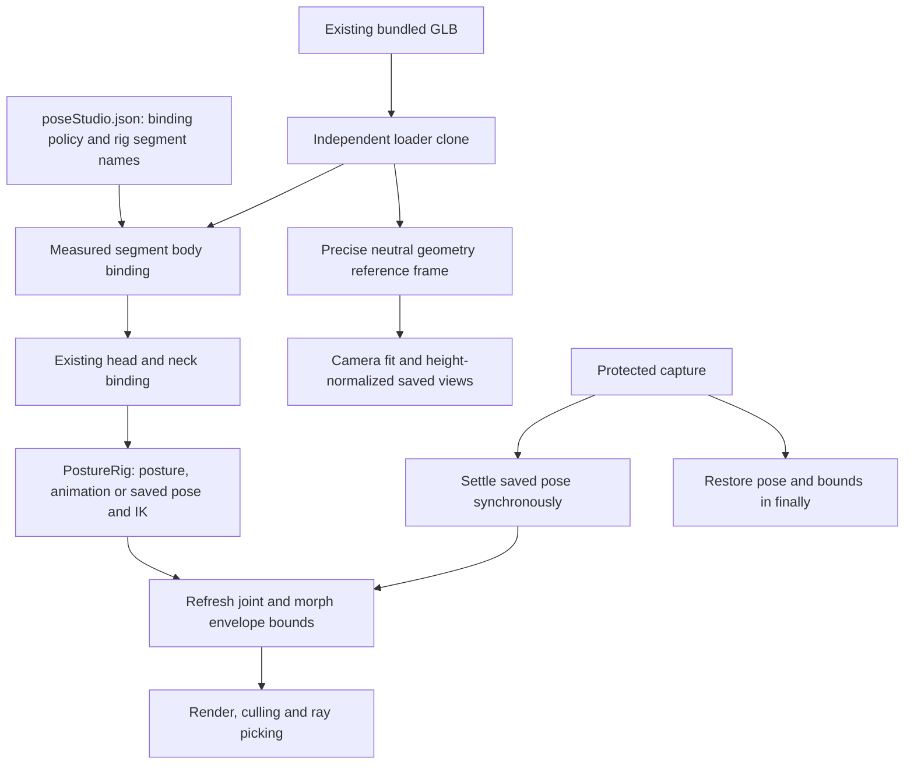

# Re-review of the 50-point checkpoint

Reviewed 2026-10-22. Scope: GrowthTrack 3D, preserving existing files and finance applications. **The tracker remains at 50/100 planning points.** Review repairs receive no extra points. This is a runtime milestone, not a claim of 50% photorealism or completed anatomical asset authoring.

## Findings and repairs

| Finding | Reproduction | Repair and evidence |
| --- | --- | --- |
| Cached skin bounds omit posed geometry | Cache the rest sphere, raise the left upper arm to the configured 100° roll limit: 1,901 body vertices fall outside it on each of the four assets | `skinnedBounds.js` refreshes conservative joint/morph bounds after pose application and synchronous capture/restoration. Tests include an actual ray hit on a triangle outside the old sphere. |
| Joint-origin proximity weights pull unrelated skin | Front/back screenshots of that pose showed a sharp torso fold and a drooping hand despite no wrist rotation | `bodyPoseBinding.js` reweights the bundled clone against measured bone segments, with a smooth shoulder-span gate that keeps arm influence out of the central torso. Four-asset tests require over 90% reduction in distal-hand error, under 2 mm residual error, over 80% reduction in central-torso drift and under 10 mm residual drift in this fixture. These are regression tolerances, not anatomical calibration. |
| Animation envelopes leaked into camera normalization | The first combined run passed 15/16 flows: a bookmark differed after reload because a frame-timing-dependent `setFromObject` read the enlarged culling box | The loader now evaluates a precise neutral reference frame once, before viewer parenting/animation. Camera scaling reads that frame and applies height scaling once. Four-asset tests prove oversized cached culling boxes cannot change normalization; the browser regression recalls a real orbit/pan after reload. |
| Runtime completion can be confused with authored-asset completion | Fresh audits of all four current files still pass 9/23 applicable full-v3 required checks and 0/5 recommended checks | Retain a separate [fresh asset scorecard](data/review-50/v3-conformance.humanoid-base.md). No full-v3 or finished-human claim is made. |

Before/after evidence: [front before](evidence/review-50-raised-arm-front-before.png), [front after](evidence/review-50-raised-arm-front-after.png), [back before](evidence/review-50-raised-arm-back-before.png), [back after](evidence/review-50-raised-arm-back-after.png), [high-quality face after](evidence/review-50-face-high-after.png), [protected export after](evidence/review-50-raised-arm-export-after.png). The after images show improved hand continuity and torso silhouette. Extreme shoulder deformation still needs authored weights/correctives; this preview repair is not anatomical approval.

## Implementation flow



`prepareBodyPoseBinding` runs once per bundled model clone, before viewer normalization. It derives endpoints, segment lengths, minimum-distance scale and shoulder span from the loaded rest rig. Four weights remain finite, nonnegative and normalized. The original head/neck region retains the existing head-specific repair. It copies skin-index/weight attributes and preserves rest positions, topology, morph deltas, texture resources, shared loader buffers and the on-disk GLBs. Custom assets bypass this default-model repair; unsupported skeleton names also return without mutation. Its falloff, shoulder blend and segment definitions are product policy in `src/config/poseStudio.json`, not user measurements embedded in code.

`createSkinnedBoundsUpdater` caches each influenced joint's bind-space envelope, including relative or absolute morph deltas over the standard 0–1 range. After bone transforms, it unions the current joint-transformed boxes in mesh space and derives the sphere. Nonnegative normalized skin weights make the deformed vertex a convex combination inside that union's enclosing box. This conservative-bound construction is our inference from the skinning equation; it does not claim tight per-frame vertex bounds. Its recurring box-transform work scales with joint count. Cache rebuilding handles changed geometry/skin attributes, versions, skeleton/bind matrices and morph mode. Nonstandard morph ranges or skin weights use exact posed-vertex bounds. The updater refreshes the attached mesh bind inverse after external transforms. Tests cover combined morphs, nonuniform outer transforms, geometry edits, actual ray picking and capture restoration without a render frame.

The body and visible private skin receive separate bounds updaters. Private geometry is excluded from read-only technical evidence. Existing capture guards, privacy rules and material pipelines remain in force. Frustum culling remains enabled.

`createModelReferenceFrame` evaluates all loaded geometry with Three.js's precise bounds path before the clone joins the viewer. It retains neutral center/size independently of the conservative animation bounds. `HumanoidClone` scales this reference once for the current height. This removes first-frame/cached-load timing and outer clone transforms from camera normalization. Pose/region framing still uses evaluated surface samples where appropriate. The first combined run exposed this integration defect introduced by the bounds change; its failure was retained and fixed rather than dismissed as loading noise.

No new database fields are needed for these derived renderer repairs. Saved Current/Goal pose angles, reach targets, camera views and appearance choices continue through the existing owner-scoped queue to `User.physiqueTargets` JSON in SQLite, then through validation on reload. See [pose/camera persistence architecture](10-pose-camera-architecture.md) and [appearance architecture](09-appearance-architecture.md). Tests use isolated SQLite/HTTP fixtures, not the owner's database.

## Research and its application

Primary references were checked against the installed Three.js 0.184.0 implementation and the shipped assets:

| Primary reference | What it establishes | Application and limits |
| --- | --- | --- |
| [Three.js r184 SkinnedMesh source](https://github.com/mrdoob/three.js/blob/r184/src/objects/SkinnedMesh.js) and [API documentation](https://threejs.org/docs/pages/SkinnedMesh.html) | Skin spheres are cached after first use; animated bounds need updating. Ray casting tests the sphere and optional box before triangles. Attached meshes refresh their bind inverse in `updateMatrixWorld`. | Fix both bounds after pose/capture changes. Test the posed triangle, not only a reported joint value. |
| [Khronos glTF skinning tutorial](https://github.khronos.org/glTF-Tutorials/gltfTutorial/gltfTutorial_020_Skins.html) | Inverse bind matrices and current joint transforms combine according to per-vertex joint indices and weights. | Keep coordinate transforms explicit and weights normalized. The envelope proof and segment-distance weighting are our implementation choices, not Khronos-prescribed algorithms. |
| [Unity Two Bone IK](https://docs.unity3d.com/Packages/com.unity.animation.rigging@1.2/manual/constraints/TwoBoneIKConstraint.html) | A two-bone constraint has root, middle, tip, target and optional bend hint. | Review the existing wrist/ankle chains, measured lengths, poles and reach clamping. This supports chain architecture, not medical joint limits or mesh calibration. |
| [Blender Armature modifier](https://docs.blender.org/manual/en/latest/modeling/modifiers/deform/armature.html) | Linear skinning and volume-preserving quaternion methods behave differently at rotations. Bone envelopes also have limited local influence. | Keep twist/shoulder volume and authored corrective work as explicit remaining gates. The current Three.js path remains linear skinning. |

The repair uses no external weight asset or additional skin textures. Segment falloff and shoulder blending are bounded artistic preview policy requiring future artist review; they are not inferred from clinical reference data.

## Verification and remaining gates

The [machine-readable re-review record](data/review-50/review.json) records final test counts, fresh audits and evidence. The focused suite covers prior measurements, appearance, persistence, pose/IK, camera, capture and privacy behavior. Production Chromium smoke includes all earlier flows plus raised-arm bounds, front/back rendering, export, quality replacement and neutral restoration. Browser evidence waits for painted model pixels; drawing-buffer readback synchronizes only in tests.

Final results: **314 distinct focused tests across 54 files**, **all 16 Chromium flows together in 6.3 minutes**, **84 reference/specification checks**, TypeScript, targeted ESLint, production build, four GLB validations and provenance pass. The preview shuts down automatically. The previously failing camera path now passes through actual orbit/pan recall, reload and floor/top constraints; [retained camera evidence](evidence/review-50-camera-oblique.png). No files were deleted or finance applications edited during this review.

Reproduce the new regressions and combined production smoke from `growthtrack-ultimate`:

```powershell
npm.cmd exec -- vitest run src/components/morphEngine/bodyPoseBinding.test.js src/components/morphEngine/skinnedBounds.test.js src/components/morphEngine/modelReferenceFrame.test.js src/components/morphEngine/poseRuntime.test.js --maxWorkers=2
npm.cmd exec -- playwright test --config playwright.milestone-review.config.ts
npm.cmd run test:human-spec
npm.cmd run typecheck
npm.cmd run build
npm.cmd run validate:glb
npm.cmd run check:assets
```

All four source files still have 16,001 body vertices, 29,682 body triangles, 20 joints and 58 body morphs. Full/lite tiers share geometry; texture resources distinguish them. Runtime repair does not satisfy missing authored finger/toe/twist joints, 52 face shapes, morph joint offsets, texture tiles, cornea/wetline or other full-v3 requirements. Collisions, walking foot lock, pointer-drag posing, calibrated anatomy, native-device performance and Safari remain open. The existing large Three.js build chunk warning remains; no repository-wide green claim is made.
