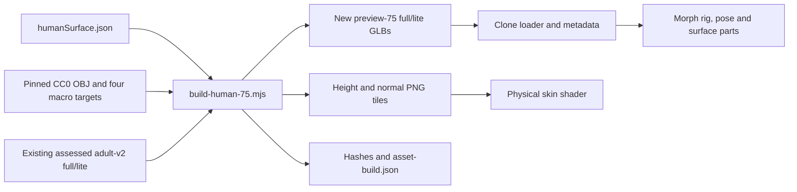

# Articulated preview and surface architecture

The 50 → 75 checkpoint adds five partial slices: pointer wrist/ankle reach, articulated fingers/toes, shape-dependent pivots, a periodic skin micro tile with surface attributes, and separate cornea/tearline/nail geometry. These are planning allocations. The model remains a generated preview with artist calibration and full-v3 gates outstanding.

## Definition, source and asset flow



`src/config/humanSurface.json` owns asset keys, landmark source scale/sculpt, artistic digit shapes and ranges, pivot limits, tile size/seed/physical scale, surface tessellation/material defaults, and pointer handle ratios. It contains definitions, not a person's saved body. The builder verifies original asset SHA-256 values against `ASSET-PROVENANCE.json` and the five source inputs against the pinned MakeHuman manifest before writing the **new** output names. It does not consume the distribution's AGPL weight file. The previously assessed four GLBs remain available.

The original body positions, normals, UVs, indices, all 58 morph deltas and original embedded images are retained byte for byte in each derivative. The build bakes the earlier measured-segment body/head binding repairs, extends the skeleton from 20 to 79 joints and generates digit weights on 4,948 vertices. Finger/toe chains use source helper landmarks transformed by the same base macro targets. Jaw, tongue and eye joint names are present for the structural contract; their presence does not establish a finished face animation system or mouth geometry. Twist nodes have runtime bindings; calibrated twist skin weights/corrective sculpts remain open.

The male preset resolves the new full/lite pair. Female/neutral presets retain their covered legacy fallback; custom same-origin and environment asset selections remain available. The new male preview is not presented as an authored female or neutral sculpt.

Morph region declarations and per-joint offsets are derived from skin deltas near each pivot. The derivative includes 41 non-empty physical offset sets; blink, smile, jaw opening, private dimension and corrective controls do not shift the skeletal pivots. This is a geometric estimate, not a clinical measurement or artist-authored skeleton fit. Tangents, region/tile identifiers and local UV scale are measured from the existing surface. The atlas remains a single legacy UV layout; identifiers alone do not create high-resolution regional texture tiles.

Twenty nail patches project onto actual skin triangles. Missed directional rays use a closest-triangle projection with barycentric skin/morph transfer, rather than leaving a patch at an unprojected helper point. Projection diagnostics are retained in the asset build report. Cornea caps follow the authored eyes; tearline strips transfer body skin/morph data. Parts keep only non-empty named morph arrays, limiting needless shader variants. The micro PNGs are deterministic periodic pore resources with physical tile and height scales in JSON. The normal companion is packaged for tooling; the live shader samples height and derives fine relief and roughness.

## Owner data and editing flow

```mermaid
flowchart LR
  Controls[Hand/toe and pore controls] --> Sanitize[Bounded sanitizers]
  Canvas[Captured pointer drag] --> Bridge[Canvas-scoped owner/context event]
  Bridge --> Sanitize
  Sanitize --> Draft[Current or Goal draft]
  Draft --> Queue[Existing serialized presentation save queue]
  Queue --> API[/api/physique_targets]
  API --> DB[(Prisma User.physiqueTargets JSON)]
  DB --> Hydrate[Owner-scoped hydration]
  Hydrate --> Draft
  Draft --> Render[Avatar renderer]
```

`appearanceMetrics.skinMicroDetail` stores the Current pore strength; Goal uses the existing goal appearance record. `viewerPreferences.poseStudio.current/goal.digits` holds optional per-side hand shape/strength/spread and foot curl records. The existing joint/target records, camera bookmarks and measurement flow retain their schemas. The optional field preserves old pose records. `sanitizeDigits` and the presentation sanitizer whitelist fields and clamp values; asset rig metadata determines whether the hand/toe controls are available. A custom model with many unrelated bones does not gain unsupported controls merely from its joint count.

There is no new singleton database or hard-coded user profile. The existing API, owner checks, optimistic draft handling, retry and serialized writes remain responsible for persistence. The focused SQLite integration test writes the new fields into an isolated database, disconnects/reconnects, and verifies owner separation. Browser fixtures verify UI-to-request-to-reload flow without touching an owner's database.

## Pointer ownership and solving

Four reach handles use a larger invisible hit area around the visible marker. A single captured pointer projects onto a view-facing plane through the current endpoint; the measured rig-frame upper/lower segment lengths normalize its target. The existing bounded two-bone solver handles reach and bend limits. Sliders retain keyboard access and depth adjustment.

Pointer capture is taken through R3F's event target. Scene propagation and the native event are stopped while the handle owns the drag. Orbit/pan/auto-rotation pause until release. Escape, native cancellation, lost capture, blur, hiding tools or replacing the model/owner/context cancels the session and restores its previous target. Events bubble only from the viewer canvas and carry owner/context identifiers; the editor validates that scope before applying a draft. The transient drag flag stays in render state, not in the database. Capture guards omit handles from exported images.

This follows [R3F's event and pointer-capture contract](https://r3f.docs.pmnd.rs/api/events). The production test performs a real mouse drag, checks the unchanged camera, endpoint error below 1 mm for its reachable target, cancellation, saved target and reload. General collision avoidance, multi-pointer limb manipulation, FABRIK head/hips and walking foot lock remain outside this slice.

## Render order, bounds and restoration

1. `HumanoidClone` applies interpolated morph influences and surface/idle state at frame priority −1.
2. `createMorphRig` applies metadata offsets before posing. Relative child/parent offset changes are limited against measured base segment lengths. Inverse bind matrices are updated in the original rig coordinates, keeping neutral skin from translating twice.
3. Head-bound rigid accessories compensate for the shifted rest pivot because their geometry already carries its own morph displacement. This also handles late-added attachments. Actual posed rotation still follows the shifted pivot.
4. `PostureRig` applies saved joints and reach, then metadata-driven digit rotations and twist bindings. Measurement/comparison inspection uses the neutral pose; returning to Pose restores the saved Current/Goal pose.
5. Skin bounds update after posing using cached mesh-space joint/morph envelopes and the current bind matrices. Moving inverse binds do not cause a full vertex-envelope rebuild each frame. Custom out-of-envelope weights use the exact posed-vertex fallback. Camera normalization continues to use the precise neutral reference rather than conservative animation bounds.

This preserves Three.js's [skinning and animated-bounds requirements](https://threejs.org/docs/pages/SkinnedMesh.html). Asset tests exercise actual finger/toe skin deformation, complete neutral reset, morph pivot changes under outer transforms, rigid attachment compensation, and posed vertex containment. The structural audit is separate from these behavior tests.

`configureSurfaceParts` assigns independent physical materials and disposes only its own instances. Cornea uses configured IOR/roughness and a thin transparent preview cap, with gaze rotating around the same measured eye pivots. It hides at full lid closure; tearline and nails follow their transferred skin/morph data. This is an optical approximation: Three.js documents that [opacity transparency and physical transmission differ](https://threejs.org/docs/pages/MeshPhysicalMaterial.html), and calibrated refraction remains open. The generic skin-material pass explicitly excludes these parts.

Export freezes idle motion, gaze, pupils, pose and surface visibility synchronously, renders through the existing protected capture path, then restores live state. Unit tests verify visibility/gaze/material restoration; the browser flow verifies closed-eye capture and protected PNG export. GPU synchronization used to obtain completed visual evidence is test-only and is absent from the application's render loop.

## Verification and remaining gates

Fresh measured audits for both new files are under [data/milestone-75](data/milestone-75/). Each passes **17/23 applicable required full-v3 checks and 0/5 recommended checks**. Full is about 23.7 MiB; lite is about 7.5 MiB, sharing the same body geometry. Lite is not the planned 3 MiB first-paint core and is not a new geometric LOD. All original body morphs and authored image bytes remain covered by integrity tests. The validator accepts constant PBR only on the three explicitly declared new surface types; skin and other existing accessories still require real maps.

The final verification record is [review.json](data/milestone-75/review.json). Remaining work includes 52 face shapes and expressive calibration, teeth/gums/tongue/scalp geometry, regional density and mesh detail, artist weights/collision/correctives, KTX2/meshopt and first-paint streaming, native GPU/Safari performance and final user/privacy review. The 75-point budget does not waive these gates.
