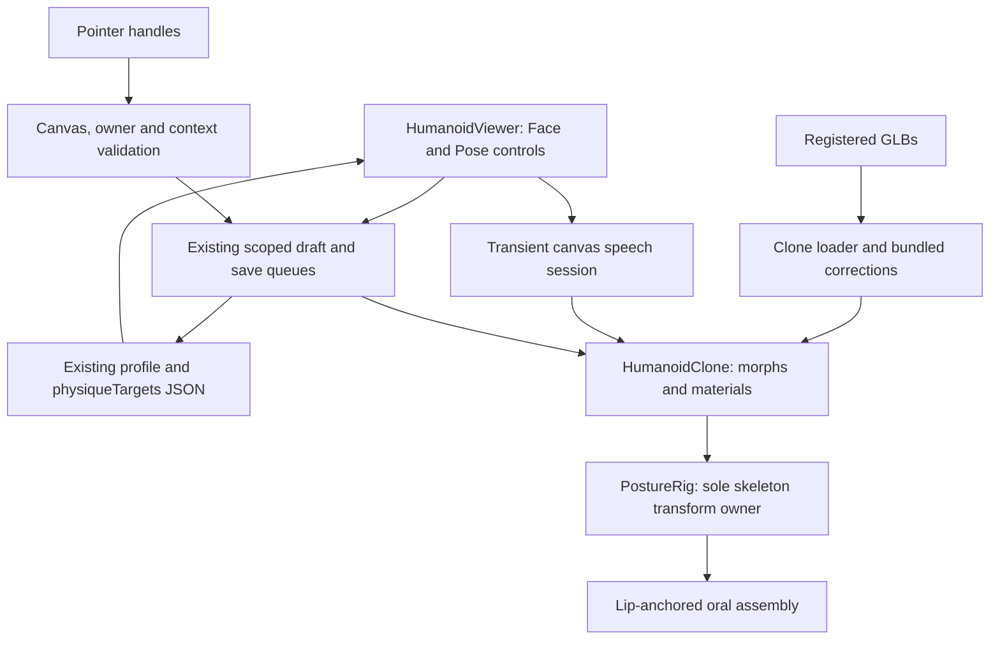

# Face studio, 1–75 review and continuation through 200

Reviewed 2026-10-22. The requested **200-checkpoint scope is not complete**. The earlier 75 points counted implementation slices, not a percentage of human realism. There are fifteen five-point milestones, not seventy-five numbered application files. The present viewer is an interactive human preview; its close-up face still looks synthetic. Neither passing tests nor adding controls establishes a photorealistic human or an accurate likeness of a particular person.

## What was wrong in the visible application

| Finding | Change in the running viewer | Limit |
| --- | --- | --- |
| An explicitly saved legacy asset kept loading even after the default model changed | **Model tools → Use articulated model** clears that bundled legacy selection in both profile stores and selects the current preview. Reload is covered. | Available for the supported male bundled family. Female/neutral presets retain their existing fallback; a custom model is not silently replaced. |
| Generated jaw/smile targets were centred below the actual mouth | Loader applies mouth-local correctives on clone-owned geometry for the six reviewed assets. Jaw opening moves the lower lip/chin; smile lifts the mouth corners. | Calibrated preview correctives, not 52 authored facial shapes. Custom models retain their own shapes. |
| The old fixed-position box teeth did not follow the lips | One oral assembly fits upper/lower teeth, gums, tongue and cavity to actual morphed and posed lip vertices. | Simplified runtime geometry; not authored dental anatomy or a modification of the exported GLB. |
| The cornea overlay obscured the iris and pupil | Removed its white diffuse contribution and duplicate clearcoat; restrained the reflective film and wet-eye material. | Approximate surface appearance, not calibrated corneal volume/refraction. |
| Face edits in Goal changed Current | Face controls, presets, optimistic drafts, saves and hydration now use the selected context. | Existing morph coverage still limits the possible face shapes. |
| Selecting an action could leave a saved pose in control | Actions are also accessible in Pose. Selecting an action releases the active saved pose while retaining its values. | Existing procedural action clips; foot contact and collision quality remain open. |
| Only wrist/ankle handles could be dragged | Added an orange handle for the selected head, neck, torso, arm, leg or foot joint. Horizontal/vertical dragging controls bounded turn/bend; sliders retain all three axes. | Fourteen configured joints plus four endpoint handles. This does not make every face vertex, digit or garment independently draggable. Reach targets take priority on their limb. |
| Escape cancelled a drag and closed its editor | Drag cancellation consumes Escape before the editor shortcut. Camera controls and previous pose restore. | Single captured pointer; no multi-touch manipulation claim. |

## New workflows

**Physique → 3D → Face** offers Generic adult and Personal reference. Three generic presets reuse existing face morphs. Personal reference accepts a local JPG/PNG/WebP (choose or drop), displays it next to the manual controls and releases its object URL when removed or the editing scope changes. The reference is excluded from saves/exports. This does not reconstruct a person from a photograph. Accurate personal likeness still requires reference material, a reconstruction/sculpt workflow and visual review.

Personal reference includes **How to take reference photos** with five phone-camera views, framing/lighting guidance and accepted formats. A local guide and empty photo folder were prepared at `local-private/avatar-reference/`; `/local-private/` is Git-ignored. No personal photos or scans were supplied or generated in this review. A 3D scan is optional for beginning manual matching.

The same tab offers text, device voice, speed, Speak and Stop. Optional Dictate uses the browser's speech-recognition service only after a click. Playback begins mouth motion on the actual speech-start callback, resynchronizes approximate text timing at word boundaries, and restores the saved jaw value when playback stops, fails or the scope closes. Speech text and animated weights are transient. The UI discloses browser speech-service use. Native voice audio and microphone operation require a device check; automated tests stub those APIs and verify their integration. Word boundaries can support approximate timing but do not supply phonemes; see [MDN's boundary event contract](https://developer.mozilla.org/en-US/docs/Web/API/SpeechSynthesisUtterance/boundary_event).

**Physique → 3D → Pose → Use saved pose** exposes endpoint dragging, the selected-joint handle, joint sliders, digit controls and action playback. Dragging owns the pointer and suspends camera orbit. Escape, capture loss, blur, model/account/context replacement and tool closure restore the cancelled edit. Saved poses remain independent for Current and Goal. Export guards hide handles and temporarily settle speech/idle state.

## Review of every 1–75 slice

All paths below are relative to the repository root. This table maps each five-point slice to live code; its continued existence is not a realism score. Earlier detailed acceptance records remain in [implementation progress](IMPLEMENTATION_PROGRESS.md).

| Points | Live responsibility / principal implementation | Review outcome |
| --- | --- | --- |
| 1–5 | Measurement entry: `src/lib/metricEntry.js`, `measurementEntry.js`, viewer Measure tab | Retained; parsing, validation and persistence regression coverage. |
| 6–10 | Space background: `src/components/morphEngine/SpaceSky.jsx`, `spaceSkyMaterial.js` | Retained; five skies, capture and selection persistence. |
| 11–15 | Skin, lids, idle: `physicalSkinMaterial.js`, `eyelidCorrective.js`, `idleMotion.js` | Retained; mouth correction is scoped separately from blink. |
| 16–20 | Tan/exposure: `skinAppearance.js`, `SkinLayerControls.jsx` | Retained; separate pigment/exposure inputs. |
| 21–25 | Hair detail: `featureMaterials.js`, `src/lib/appearanceDetail.js` | Retained; card hair remains an asset-quality limitation. |
| 26–30 | Freckles: skin material and `appearanceDetail.js` | Retained; seeded pigment layer and saved controls. |
| 31–35 | Iris/pupil: `eyeMaterial.js`, `EyeAppearanceControls.jsx` | Corrected excessive overlay/eye reflection; retained pigment/pupil controls. |
| 36–40 | Saved poses: `PostureRig.jsx`, `poseRuntime.js`, `src/lib/poseStudio.js` | Retained; action precedence and selected-joint dragging improved. |
| 41–45 | Endpoint reach: `poseRuntime.js`, `PoseStudioControls.jsx` | Retained; bounded solver and keyboard depth control. |
| 46–50 | Camera bookmarks: `cameraBookmarkRuntime.js`, `CameraBookmarkControls.jsx` | Retained; actual camera state, normalized recall and persistence. |
| 51–55 | Pointer reach: `poseDrag.js`, `PoseTargetMarkers.jsx` | Extended using the same event/save path; Escape ordering repaired. |
| 56–60 | Digits: `articulation.js`, `DigitPoseControls.jsx`, `humanSurface.json` | Retained; authored anatomical weights/collision still open. |
| 61–65 | Shape-dependent pivots: `morphRig.js`, preview rig metadata | Retained; these are measured estimates, not artist-approved fits. |
| 66–70 | Micro skin: physical skin material, generated tiles and surface attributes | Retained; micro relief does not replace missing regional source detail. |
| 71–75 | Cornea, tearline, nails: `surfaceParts.js`, preview surface geometry | Retained; corneal appearance repaired; calibrated optics still open. |

## Architecture and file usefulness

- `faceGeometry.js` owns both mouth-local corrective preparation and the matching oral geometry. It replaces the old portal with fixed-position cavity/box teeth. Geometry/material allocation has matching disposal, and shared loader geometry is not mutated.
- `avatarSpeech.js` owns transient speech state; `SpeechControls.jsx` owns browser voice/microphone UI. No speech database or second renderer was introduced.
- `LikenessControls.jsx` owns presets and local reference lifecycle. It delegates actual edits to the existing context-aware save path.
- Selected-joint dragging extends `poseDrag.js`, `PoseTargetMarkers.jsx` and the existing presentation queue. No separate pose engine or persistence schema was added.
- Asset builders, pinned provenance, conformance definitions, tests and representative evidence remain useful and are retained. Documentation reference modules that re-export runtime implementations should remain thin. Historical reports are clearly historical, not competing current specifications.
- No source files were deleted just to reduce their count. There is one continuation document instead of a file for every checkpoint. Generated raw logs and repeated browser captures stay in ignored output folders; retain only selected evidence.

## Continuation acceptance checklist, 76–200

These ranges organize the requested scope. They **do not award completion points** for bug fixes or scaffolding. “Partial” means the stated runtime subset is delivered while the acceptance item remains open. All asset-dependent items require actual new geometry, shapes, maps or calibration; changing labels or milestones cannot satisfy them.

| Range | Acceptance item | Current state / next gate |
| --- | --- | --- |
| 76–80 | Mouth and expression attachment | Partial: repaired jaw/smile and posed oral assembly. Authored facial topology and dental shapes remain. |
| 81–85 | Speech performance | Partial: device speech and approximate jaw timing. Native audio/mic checks and audio-aligned visemes remain. |
| 86–90 | Generic and personal face editing | Partial: presets, scoped saves and local reference workflow. Accurate generic sculpt and personal likeness remain. |
| 91–95 | Direct body manipulation | Partial: fourteen joint rotations and four endpoint handles. Hips, per-digit handles and collision constraints remain. |
| 96–100 | Discoverable actions and continuity | Partial: action controls, saved-pose handoff, model upgrade, cancellation and reload. Contact-correct actions remain. |
| 101–105 | Licensed high-detail generic adult source | Open: select/import a redistributable sculpt or scan with verified source and texture rights. |
| 106–110 | Face topology and density | Open: retopology with loops for lips/lids/nose, visible ears and close-up silhouette approval. |
| 111–115 | Full facial shape contract | Open: 52 independently useful shapes, calibrated ranges and combination checks. Existing 58 body/face morph names are not this set. |
| 116–120 | Authored oral anatomy | Open: teeth, gums, tongue, palate, jaw weights and mouth closure/contact across expressions. |
| 121–125 | Eyes and lids | Open: closed corneal volume, sclera/iris depth, tearline, lid contact and optical calibration. |
| 126–130 | Regional face textures | Open: de-lit albedo, normal/displacement, roughness and masks with measured close-up density. |
| 131–135 | Skin response | Open: reference lighting, subsurface approximation calibration and verified tone range. |
| 136–140 | Hair, brows and lashes | Open: authored scalp, believable hairline, strand/card assets and extreme-expression contact. |
| 141–145 | Face/body fit and diversity | Open: supported adult body/preset sculpts with fitted head/neck and rig calibration. |
| 146–150 | Personal reference reconstruction | Open: supplied reference/scan inputs, registration, likeness fitting and review; manual sliders do not complete this. |
| 151–155 | Body deformation quality | Open: shoulder, elbow, hip and knee weights, twist and corrective shapes under extreme poses. |
| 156–160 | Hands and feet | Open: calibrated digits, individual handles, palm/sole contact and nail attachment across poses. |
| 161–165 | Contact and collision | Open: self-intersection limits, foot planting and hand/object attachment. |
| 166–170 | Actions | Open: retargeted authored clips, smooth transitions, reach interactions and measured foot-skating gate. |
| 171–175 | Drag-and-drop customization | Open: validate/import supported assets, attach clothing/props and provide undo for changes. Existing photo and model-drop UI is not “drag everything.” |
| 176–180 | Geometry LOD | Open: real reduced geometry tiers with acceptable silhouettes, facial deformation and rig mappings. |
| 181–185 | Delivery and compression | Open: KTX2/meshopt or equivalent verified pipeline, streaming and first-paint budget. |
| 186–190 | Device performance | Open: desktop/mobile native GPU and Safari checks, memory/context recovery and sustained frame budget. |
| 191–195 | Capture and persistence release review | Partial: existing owner-scoped saves/export guards pass regression tests. New authored assets must pass the same gates. |
| 196–200 | Final human-likeness acceptance | Open: reference-comparable close-ups and actions across lighting/poses, user visual acceptance, no remaining required asset gates. |

The preview pair remains **17/23 required full-v3 checks and 0/5 recommended checks**. Its 16,001 body vertices and 29,682 triangles are shared across full/lite. Runtime oral geometry does not make the GLB itself pass a missing oral-asset gate. Both preset modes are now accessible, but neither a new photorealistic generic asset nor an accurate personal reconstruction is claimed.

## Verification

Final verification: **299 distinct focused unit checks**, **84 human-spec checks**, and **30 distinct Chromium flows validated across the combined run and targeted follow-ups**. The combined run initially passed 20/22; the two fixture/expectation corrections passed in the five-flow follow-up. All eleven model/face review flows subsequently passed, including six all-angle asset reviews. The new mobile photo guide passed its additional focused check. TypeScript, targeted ESLint, six project/official GLB validations (zero official errors/warnings), asset provenance and the final production build passed. The existing large Three.js chunk warning remains. These results do not establish a green repository-wide suite or native-device performance.

See the companion [verification record](data/face-studio-review.json) for final commands/results and retained images. Browser checks use a fresh production build with test-owned API fixtures; they do not modify an owner's database. A build in `dist` is a local build, not a remote deployment. Native audio/microphone, Safari/native GPU performance and final visual acceptance are separate open checks.

Selected live-render evidence: [neutral face](evidence/face-studio/face-neutral.png), [open mouth](evidence/face-studio/face-open-mouth.png), [head/torso manipulation](evidence/face-studio/head-and-torso-drag.png), [mobile reference editor](evidence/face-studio/face-editor-mobile.png). These show the present preview quality; they are not a photorealism certification.
