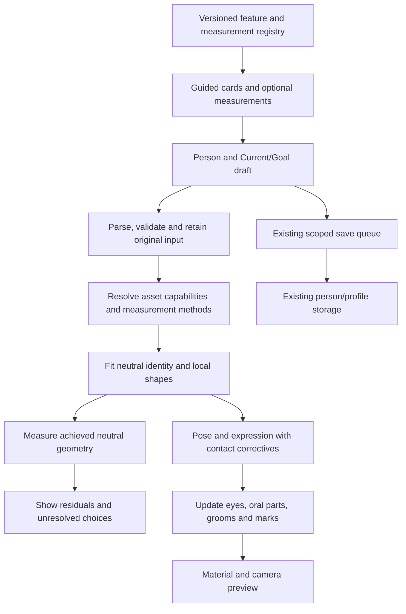

# Universal head editor: architecture and acceptance contract

Revision: 2026-10-24. **Proposed design; the complete registry, fitting solver, assets and UI below are not implemented by this research pass.** Read the [simple matrix](universal-head-matrix.md) first. Existing implementation evidence remains in dated project reports; this document does not grant it new validation.

## 1. One system, different people

One versioned feature registry defines labels, input types, diagrams, units, measurement methods, dependencies and asset requirements. Each person stores only their own values, observations, custom shapes and choices. An asset adapter maps those values onto a supported head. A new person's values must require no new component, database column, conditional branch or code deployment.

The system must not choose nose, eyes, skin, hair or teeth from ethnicity, caste, nationality, gender or DNA. Appearance controls remain independent of account identity. Optional life-stage context can help choose an appropriate asset, but does not silently overwrite authored features. The schema is extensible across ages; the currently reviewed adult assets do not certify all life stages or anatomical variations.



Appearance maps and grooms also feed the attachment/material stages. The diagram shows ownership and order; it does not propose a second renderer or a second person database.

## 2. Separate kinds of information

| Kind | Example | Contract |
| --- | --- | --- |
| Observation | A measured nose width, scan, local reference or marked outline | Method, date, unit, side, uncertainty if known and source status; never silently replaced by a solver |
| Physical target | Desired straight distance in mm | Compared against an equivalent measurement on the neutral model; not just mapped linearly to a slider |
| Visual intent | A fuller lower lip or more curved ear fold | Dimensionless adjustment, choice or curve with labelled preview; not a physical percentage |
| Identity geometry | Head surface, asymmetric ears, tooth arrangement | Saved separately from expression and camera; can include custom local shape data |
| Appearance and grooming | Pigment, marks, scalp style and beard length | Independent layers with stable seeds and bindings; changing lighting does not change pigment |
| Pose/expression | Blink, gaze, smile, jaw movement | Separate state and limits; cannot rewrite identity or observations |
| Derived result | Achieved width, fit error, preview bounds | Recomputed with asset/version/method provenance; never promoted to a personal measurement |

`unknown`, `notApplicable`, `unobserved` and `present` are distinct. For geometry, `absent`, `altered` and `prosthetic` are explicit component states. Zero is a real value only where meaningful (for example no visible grey fibres), never a universal missing-value sentinel. “Use the starting head here” is a reversible render fallback and remains labelled as a default.

## 3. Registry contract

The specialist matrices supply stable feature IDs. Side, region patch, tooth or feature-instance identity belongs in a separate key, so translation or camera changes cannot change it. A compound matrix row expands into named child fields; it must not ship as an opaque free-text blob. All listed controls start as **specified**, not supported.

Each executable definition must include:

| Field | Required meaning |
| --- | --- |
| `id`, `definitionVersion`, `group` | Stable machine identity and migration version |
| `label`, `aliases`, `help`, `diagramId` | Familiar wording, searchable technical term and endpoint/path illustration |
| `valueType`, `unit`, `sidePolicy`, `instancePolicy` | Number/choice/colour/curve/patch/component; mm, degrees or explicitly unitless; centre/paired/per-side/local/per-tooth |
| `entryModes`, `defaultPolicy`, `unknownAllowed` | Visual choice, optional measured input, reference trace or custom asset; unknown is allowed for personal measurements |
| `measurementProtocolId` | For physical fields: endpoints or path, coordinate frame, projection, pose, capture method and scale requirements |
| `inputConstraints`, `supportedDomain` | Syntax/math limits separate from the asset's tested envelope; no unsourced population min/max |
| `bindingId`, `dependencies`, `affectedRegions` | The capability and deformation/appearance owner, adjacent structures that must follow and expected effects |
| `previewViews`, `validationFixtures`, `evidenceRefs` | Required camera/motion cases and traceable verification; design evidence distinct from implementation results |

Numbers require finite values and correct dimensional units. Width cannot be negative; signed offsets and angles can be. Parse locale decimals, accept explicit mm/cm/in, convert lengths to mm for this head contract and retain the original display unit. Existing body metrics remain in cm; conversion happens once at the adapter boundary. Never reinterpret a legacy 0–1 weight as a percentage, a ratio between anatomical lengths or millimetres.

The definition must distinguish a 3D straight distance, a projected horizontal/vertical distance, a path over skin, a planar perimeter and an angle. Ratios need an explicit numerator and nonzero denominator. An angular control needs three points or two named directions/planes and a sign convention. No number field becomes available until its protocol and asset binding exist.

## 4. Per-person data and compatibility

Illustrative future payload; these key names are a proposed contract, not a live API. The feature ID below is an example namespace; implementation must use the corresponding exact ID from the versioned specialist registry.

```json
{
  "headDefinitionVersion": 1,
  "assetBindingVersion": "head-adapter-v1",
  "observations": [
    {
      "observationId": "local-observation-1",
      "featureId": "nose.alarWidth",
      "side": "centre",
      "status": "present",
      "value": 36,
      "unit": "mm",
      "methodId": "outer-alar-straight-3d-v1",
      "source": "selfMeasured",
      "uncertaintyMm": null,
      "observedAt": null
    }
  ],
  "targets": [],
  "visualAdjustments": [],
  "componentStates": [],
  "localShapes": [],
  "appearance": {},
  "grooms": {},
  "seeds": {},
  "extensions": {}
}
```

The containing existing record supplies owner, person, Current/Goal and revision. Do not duplicate owner authority in an arbitrary imported payload. The example number is synthetic, not a recommended or population-average nose width. A null uncertainty means unknown precision, not zero error. A target references an observation when the person chooses to apply that observation; visual goals can differ from measured Current values.

Persistence requirements:

1. Extend the existing person/profile JSON and serialized save path. Preserve legacy fields and their visible meaning; migrate additively with a recorded schema version.
2. Keep unknown newer IDs and unsupported values through asset fallback, save/reload and export. An older client must preserve an opaque newer block or open it read-only; its normalizer must not erase it.
3. Preserve one undo transaction across a coupled edit. Store measurements and intent, not live GPU buffers or animation noise. Asset hashes and adapter versions make derived results reproducible.
4. Key drafts, history, pending requests and results by owner/person/context/revision. Discard late solver results for older revisions; person or Current/Goal switches cannot apply another draft.
5. Retain failed saves for retry and show saved versus unsaved state. Changing asset cannot destroy values outside the new asset's capability.
6. Reset a region to that person's starting draft. Linking two sides changes future editing behaviour; copying one side over the other is an explicit undoable action. Bilateral and side-specific targets that conflict are reported, not averaged silently.
7. Custom shapes, prostheses and textures need immutable asset IDs, scale, rights/provenance and binding metadata. Session photo object URLs remain transient and excluded from saved JSON and exports.

## 5. Measurement and camera protocol

**Head frame:** a right-handed neutral local frame with +X toward the person's left, +Y superior and +Z forward. The origin is the midpoint of the two designated tragion landmarks. Orientation comes from a documented neutral acquisition frame or registered asset frame, not from camera position. Each asset declares its full transform into this frame. If landmarks are absent, altered or unobservable, use a declared alternate registration frame; do not invent ear landmarks or claim the same calibration. Local ear/nose measurement planes must declare their relation to this frame.

**Scale:** a calibrated asset/capture scale is required for achieved physical measurements. Whole-body stature alone does not validate each head dimension, and camera zoom never changes physical scale. A flat scale marker calibrates its own plane; it does not remove perspective across the whole face.

**Pose:** neutral head, relaxed brows and specified gaze/jaw/lip state for each protocol. Do not force lips closed or eyes open when that does not represent the person's resting anatomy. Record the alternative rest state, and only compare compatible protocols. Natural resting asymmetry stays in identity; animation is measured separately.

**Landmarks:** versioned points, curves and patches attached by mesh correspondence (for example triangle plus barycentric coordinates) with region checks. Recompute extreme-point landmarks when their definition requires it; a maximum-width point can move after editing. A fixed vertex index alone is not a portable anatomical landmark across topology or LOD changes. Traditional palpable bony landmarks and visually chosen soft-tissue landmarks are not interchangeable. [FaceBase's technical notes](https://www.facebase.org/resources/human/facial_norms/notes/)

**Views:** store nine named review stations: front, left/right quarter turn, left/right profile, back, top, underneath and a free-orbit review. Add rear obliques and feature close-ups where occluded surfaces need them. A continuous 360-degree turntable plus elevation sweeps catches defects between stations; nine screenshots do not prove every possible view. Label person's left/right independently of mirrored display. Keep the camera outside surfaces and show occlusion instead of clipping into the head.

**Projection:** use orthographic previews for defined projected measurements; use perspective cameras matched to references for likeness comparison. Store projection, camera pose, focal/intrinsic information when available, crop, mirror flag, lighting, exposure and scale provenance. Unknown camera information lowers confidence; do not compensate for a close-camera nose enlargement by changing anatomy. [NIST perspective-distortion definition](https://www.nist.gov/glossary-term/39671)

**References:** manual matching can start with a single image, but hidden surfaces remain unobserved. Offer front, both sides, both quarter turns, rear, top, underneath and relevant eye/ear/oral close-ups as optional capture cards. Hair-obscured scalp, hidden teeth and the far side of the nose remain unknown. Capture only comfortable views; a missing view never blocks a draft. Multi-camera capture research demonstrates a calibrated acquisition workflow, not proof that an ordinary selfie supplies a scan. [Disney's original facial-geometry capture project](https://studios.disneyresearch.com/2010/07/26/high-quality-single-shot-capture-of-facial-geometry/)

## 6. General fitting algorithm

This is a proposed deterministic constrained fitting approach, not a newly trained model or a demonstrated solution for current assets.

Let `q` be the selected asset's identity controls and optional local residual shape; `m_i(q)` is its neutral measurement under protocol `i`; `t_i` is the person's compatible target. Minimise a robust, dimensionless residual sum with a modest regularizer toward the person's starting shape, while enforcing mesh/contact limits. Normalize each residual by a declared tolerance or uncertainty scale in the same units. Never combine raw mm, degrees and slider values in one unweighted loss.

```text
input -> parse and retain -> reject incompatible protocols from fitting
      -> collect explicit targets, locks and current visual intent
      -> verify supported asset degrees of freedom and calibration
      -> solve bounded coupled identity controls
      -> apply optional local shape residuals and contact correctives
      -> remeasure final neutral geometry
      -> return candidate + per-field achieved result + residual + reason
```

Unknown uncertainty uses a labelled engineering weighting policy, never an invented statistical confidence. Exact-looking user inputs are not automatically more reliable than an approximate scan. Hard locks are checked for feasibility; conflicting locks keep the last valid preview and show which targets cannot be jointly satisfied. Soft targets show their residuals. The person chooses whether to keep an approximation, loosen a lock, edit visually or choose another asset.

A value entered in a field is never evidence that the head reached it. The final neutral surface must be remeasured **after** identity correctives. Expression/pose deformation is then evaluated for contact and appearance; smile measurements must not be compared with neutral targets. The design's dependency order is head size/shape, regions, local features, attachments, material/groom detail, with iteration when coupled constraints require it.

A one-dimensional morph may change several widths at once. Maintain an asset-specific sensitivity/dependency map and fit all pinned quantities together; do not equate one measurement to one morph weight. Underconstrained fits keep uncertain regions at the labelled starting shape. Multiple shapes can satisfy the same measurements; do not report unique reconstruction or certainty from a low residual.

For a shape outside the morph basis, use a licensed/custom head, a topology-preserving local displacement field, or a modular replacement with correspondence and rig fitting. New topology requires a compatible asset adapter, not an arbitrary per-person code branch. Shape residuals must not be silently baked into generic defaults. Fixed topology alone cannot represent every absence, opening, injury-related difference or prosthesis.

## 7. Asset capability and attachment contract

Each feature has separate status axes: definition readiness, input persistence, visual binding, physical calibration, motion/contact validation and export parity. A single “supported” Boolean is insufficient. Suggested user states are “Ready,” “Visual adjustment only,” “Saved, not shown by this model,” and “Needs a different model.”

| Asset data | Required proof |
| --- | --- |
| Asset ID/hash, units/frame, topology/LOD correspondence | Same saved identity and scale survive reload and supported quality changes |
| Actual morphs and local shape support | Tested visible effects and affected regions; a named morph alone proves nothing |
| Measurement bindings | Defined endpoints/path, calibrated scale, known envelope and residual tolerances |
| Eye/lid/lash and ear attachments | Preserve local shape and contact under identity edits, gaze, blink and head motion |
| Upper/lower teeth, gums, tongue and oral cavity | Upper assembly follows skull; lower follows jaw; local tooth placement and contact remain coherent |
| Scalp/brow/lash/beard/mustache grooms | Separate region masks, material values and stable root bindings; do not infer from one shared beard flag |
| Skin/marks/accessories | Rest-surface placement and scale, seam handling, physical material/render limitations |
| Variable/missing components | Defined absent/altered/prosthetic states, attachment/occlusion behaviour, fallback without silent restoration |
| Export | Exported geometry, materials and features compared with viewer; identify procedural effects not embedded |

The 52 ARKit-style expression names in older specifications cover an animation vocabulary. They are not a complete identity matrix, a complete human muscle simulation or proof of likeness. Static identity shapes and dynamic expression correctives need separate support. Required parts/counts in a GLB checklist are structural checks, not proof of their correct anatomy.

## 8. Integration with the current repository

These owners were inspected during this recheck. Proposed helpers should stay within the existing subsystem.

| Existing owner | Current finding / intended integration |
| --- | --- |
| `src/lib/physiqueProfile.js` | Existing cm head/face fields and eight ratio-labelled face channels; add a versioned head block without reinterpreting legacy values |
| `src/lib/avatarWorkspace.js`, person store and profile save path | Reuse person/context ownership, migration and serialized save behaviour |
| `src/config/appearanceDetail.json`, `src/lib/appearanceDetail.js` | Retain appearance definitions; add the shared head-feature registry and preserve unsupported/newer fields |
| `src/components/physique/LikenessControls.jsx` | Currently three artistic starting faces and a local single reference image; future guided cards and multi-view reference state are additional work |
| `src/components/morphEngine/morphMath.js`, `morphRig.js` | Existing weights are artistic bounds; introduce calibrated adapter/fitting responsibility without claiming existing weights are lengths |
| `src/components/morphEngine/modelMeasurements.js` | Currently neutral chest/waist/hip sections; this is not a facial landmark/calibration or head-fitting implementation |
| `faceGeometry.js`, `eyelidCorrective.js`, `surfaceParts.js` | Oral/eye fallback and contact work must be upgraded and checked against identity combinations |
| `browSurfaceBinding.js`, `featureMaterials.js`, `HumanoidClone.jsx` | Reuse binding and lifecycle owners for independent grooms, maps and clone isolation |
| Asset registry/manifest, capture/export and builders | Publish per-feature capability evidence, matching LOD correspondence and export parity |

Recommended new responsibilities are a declarative head-feature registry, a protocol/landmark evaluator and an asset fitting adapter. They are shared modules, not a new editor for every person. Existing UI and save code consume the same definitions. A generated consumer form and a developer dictionary must not drift into separate copies of feature meaning.

## 9. Acceptance matrix

Targets below are proposed release gates, **not results of this documentation pass**. Numerical geometry tolerances must be established per protocol/asset from measurement repeatability, capture uncertainty and intended use before calling an input physically calibrated. There is no universal promised sub-millimetre accuracy or realism percentage.

| Gate | Required demonstration |
| --- | --- |
| Beginner flow | People unfamiliar with anatomy can find a part, change it, skip a measurement and undo without reading the technical matrix. Record task completion, time, help requests and errors in a usability study; first study establishes useful time targets |
| Entry integrity | Unit conversion, decimal locale, blank versus zero, missing side and unknown values survive save/reload; ambiguous metric labels are absent |
| Physical fitting | Hold out measured reference cases; compare achieved neutral geometry with compatible targets per region, report errors and uncertainty; do not use training/calibration fixtures as independent validation |
| Range and interaction | Single controls, tested range ends, meaningful pairs and targeted high-risk combinations; include nose/lip, eye/lid/globe, jaw/teeth, ear/scalp, hair/face and asymmetric edits |
| Every-angle review | Matched front/quarter/profile/back/top/underneath plus continuous rotation/elevation; skin-only, groomed, clay and material views; view-specific defects cannot be hidden in an average score |
| Motion | Partial/full blink, gaze directions, smile, jaw opening, tongue and speech poses, unilateral expressions; sample intermediate frames and retain individual neutral asymmetry |
| Representation | Different ages where assets support them, pigment levels, hair fibre geometries, bald/thinning hair, independent beard/mustache, lid folds, nose/lip/ear/jaw variation, missing teeth/components and prostheses; report unsupported cases explicitly |
| Ownership | Same definition set used by at least three deliberately different synthetic profiles; isolated owner/person/Current/Goal edits, undo, delayed saves, reload, concurrent previews and late solver results |
| Accessibility | Keyboard, screen reader, touch assistive technology, zoom, named colours, reduced motion and non-drag alternatives; no field requires visual comparison as its only operation |
| Renderer/export | Named device/browser baseline, p95 interaction/frame time, memory/loading and recovery; viewer/export/LOD match within stated limits |

Synthetic fixtures test program behaviour; they do not establish representative human coverage. Individual reference matching tests likeness; demographic research does not replace it. A reference-matched prototype proves one working case, followed by varied cases through the **same** architecture. Fixing a case by hardcoding the person's identity fails the universal-system gate.

## 10. Delivery order

1. Publish the versioned feature/protocol registry, familiar labels and diagrams; inventory actual asset capabilities. Convert these research tables into executable definitions only with reviewable protocols.
2. Implement the reusable data/measurement/adapter path with synthetic profiles and a supported neutral head; demonstrate no per-person branching.
3. Produce one complete reference-matched head through that path, including grooms, eyes, mouth and head/neck junction; resolve local geometry/material defects.
4. Add guided controls, optional measured inputs, residual display, asymmetric editing and compatibility/undo; run beginner and accessibility checks.
5. Expand asset and life-stage/variation coverage, constrained fitting and custom-shape paths; validate every advertised physical field and motion combination.
6. Verify export, performance, migration and individual likeness across the review matrix before promotion.

The design and research requested in this pass are actionable without anyone first submitting their personal measurements. Building or promoting new assets is a separate deliverable; existing approval history does not turn this document into proof that the new features already run.
