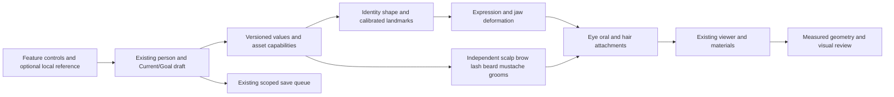

# Proposed face, hair and facial-hair implementation

Date: 2026-10-24. **Implementation continuation authorised; delivery is partial.** The [implementation record](implementation-progress.md) distinguishes completed slices from the remaining proposal.

This proposal translates the [research](README.md) into concrete work on the existing adult human editor. It does not claim that the [coverage gaps](coverage.md) are resolved. The initial research handoff was held for personal approval. The owner's subsequent 2026-10-24 instruction to continue the face anatomy changes in design and code authorises implementation continuation; it does not approve an unseen finished model or certify every proposed feature.

**Revised priority after the accuracy audit:** produce one reference-matched, lifelike adult head and its head/neck/body junction in the actual viewer before expanding the control library. The [audit and acceptance contract](audit-and-realism.md) is part of this proposal. A working feature menu, a dense mesh or a material slider at 100 does not establish a lifelike human.

The target is a convincing digital adult at portrait distance and in close-up, with coherent appearance in motion. A specific person's likeness is a separate objective requiring references for that person. The current scope concentrates on the requested head/face/hair work and its connection to the body; it cannot by itself certify full-body realism, hands, gait, clothing or every adult body type.

## First deliverable: a complete realism prototype

Choose one licensed scan/reference set or one carefully authored adult based on approved references. Record what is observed, what is measured and what is reconstructed. Frontal, side, oblique, neutral and expression references must agree in camera setup; a single photograph cannot establish hidden geometry or real-world dimensions. A generic reference can be selected during asset preparation; a personal photograph is not required to begin the approved generic-human work.

Build the prototype through geometry, eye/lid contact, fitted oral anatomy, skin appearance, one scalp groom and independent facial-hair variants. Evaluate the same head in clay, material and motion views. Correct the underlying shapes before covering defects with texture, dramatic lighting or blur. Reserve enough skin-only and hair-hidden views to inspect the actual face and hairline.

Asset production is substantive work: capture or sculpt, retopology, UVs, reflectance maps, groom guides and expression correctives. Parameter changes and subdivision of the current mesh alone are not a credible completion plan. The existing CC0 foundation remains a candidate input, not an automatic proof of close-up fidelity. Record an asset keep/rework/replace decision after reference comparison.

## Proposed user experience

The person edits a face by feature, compares it with their own optional reference, and sees which choices the selected asset can actually render. They can begin from an artistic starting face and change every supported trait. Starting faces have descriptive names and remain fully editable; none is labelled as the required appearance of a tribe, caste, nationality or language group.

The feature groups are Face shape, Eyes and eyelids, Nose, Brows and lashes, Lips and mouth, Teeth, Ears, Scalp hair, Beard, Mustache, and Skin detail. Search finds both anatomical terms and familiar descriptions. Each group offers preview, reset and undo; advanced left/right controls are optional. Numeric dimensions are shown only when the actual rendered geometry is calibrated and measured.

Hair texture and hairstyle are separate. A person can choose a shaved head with a full beard, independently coloured brows, a mustache without a beard, uneven density, or greying in one region. These are visible artistic choices, not inferred genetic or hormonal states. Cultural styles can be added with specific references and appropriate provenance, rather than assigned automatically to people.

Identity shape, expression, grooming and materials remain separate state. Blinking, smiling or speaking cannot rewrite the saved identity. A facial expression must not reset eyelid structure or turn asymmetric features symmetric.

## Proposed control and asset contract

The following are **candidate fields**, not a committed API or edits already made. Final numerical ranges depend on authored geometry and validation. Millimetres apply to measured dimensions; ratios describe artistic morph amounts and must not be displayed as physical measurements.

| Area | Candidate independent inputs | Asset/deformation dependency |
| --- | --- | --- |
| Head/face | Width, height, depth; forehead height/slope; cheekbone width/projection; cheek fullness; jaw width/angle; chin height/width/projection; asymmetry | Region-aware sculpt targets, head/neck fit, updated attachment frames and expression correctives |
| Eye placement | Interocular placement, globe size/projection, gaze | Eye transforms, socket geometry and coordinated lids; avoid arbitrary globe scaling |
| Eyelids | Opening width/height, corner tilt, crease visibility/height, hooding, medial fold, lower-lid contour | Authored upper/lower lid loops, full blink targets, gaze-follow correctives, tearline and lash attachments |
| Iris/sclera | Colour/pattern, limbal ring, pupil, scleral variation; optional left/right difference | Separate optical layers, bounded materials and stable capture behavior |
| Nose | Root, bridge width/height/profile, length, tip rotation/projection/fullness, alar width, nostril contour and columella | Proper nasal topology and nostril interior; changes coordinated with adjacent cheek/upper lip |
| Brows | Width, arch, start/end, separation, direction, density, strand length, colour | Independent groom with skin-bound roots; eyebrow shape separate from brow ridge |
| Lashes | Upper/lower density, length, curl, direction | Lid-bound groom that follows open, closed and partial blinks |
| Lips | Upper/lower height and projection, Cupid's bow, philtrum, width, corners, colour | Lip loops with thickness, inner/outer surfaces, mouth closure and combination correctives |
| Oral assembly | Jaw movement, smile/opening controls, tongue poses, gum visibility | Maxillary/mandibular dental arches, gums, tongue, palate and cavity fitted to the head/jaw |
| Teeth | Tooth proportions, spacing, alignment, wear, shade; optional missing/restored teeth | Distinct incisor/canine/premolar/molar forms and realistic arch fit; no diagnostic claims |
| Ears | Height/width, rotation/protrusion, lobe size/attachment, helix/antihelix/concha/tragus; asymmetry | Authored geometry with attachment to the head and preserved silhouette in every LOD |
| Scalp | Fibre diameter, curvature/radius/pitch, density, length, direction, clumps/frizz, hairline, part, colour/grey/dye | Growth masks, guide curves, style assets, scalp contact and LODs |
| Beard | Separate sideburn/cheek/chin/jaw/neck density and length, patchiness, curl, direction, colour/grey | Independent region masks/groom; skin-bound roots and mouth/jaw contact handling |
| Mustache | Width/height, centre gap, density, length, direction/curl, tips, colour/grey, beard connection | Separate upper-lip groom and expression-aware root binding |
| Detail | Pores, fine lines, freckles, moles/scars, peach fuzz and local colour | Licensed or authored maps/decals with correct scale; no baked lighting |

“Independent” means separately editable intent, not permission for impossible intersections. Geometry constraints can coordinate neighbouring structures while preserving the person's saved values and explaining asset limits.

Editable controls also do not imply statistical independence. Use coordinated sculpt targets/correctives for linked structures, retain the person's intent and report a constrained preview instead of silently distorting adjacent anatomy. Do not make a universal face by combining community averages.

### Material, eye and motion requirements added by the audit

- Skin needs measured or reference-fitted colour, regional roughness, normals/displacement at the correct physical scale and a tested treatment of subsurface diffusion. The current sheen/clearcoat and disabled transmission do not supply it. Prototype a diffusion approximation against a reference render; do not make the whole skin surface glass-like by enabling transmission indiscriminately [S44/S49/S50 in the research register].
- Keep illumination and occlusion separate from reusable colour textures wherever the source permits. Check the actual AO texture channel: installed Three.js 0.184.0 supports channel selection, so an old “AO requires UV2” comment is not sufficient grounds to discard the map. Include direct, indirect and shadowed views, with consistent colour management [S48].
- Eyes need fitted corneal geometry or a documented optical approximation, iris depth, appropriate highlights, scleral variation, moist lid margins and medial-corner anatomy. Validate gaze, convergence where used, upper/lower-lid tracking and partial/full blinks together. Camera exposure changes must not be presented as physiological pupil response; use a separately defined scene-light proxy or an explicit artistic mode [S45].
- Teeth need individual crown silhouettes, enamel appearance, gums and anatomically coherent arches. Fit the upper arch to the skull and lower arch to the jaw; lip gap alone must not determine dental motion. Tooth count and restoration choices need not assume all adults have an identical dentition.
- Facial movement needs coordinated lids, cheeks, lips, jaw, tongue and expression-dependent skin folds. Use observed timings and asymmetry for the chosen reference. Avoid arbitrary perpetual jitter as a substitute for life. Idle movement remains optional; reduced-motion and paused capture views remain stable [S46].
- Hair needs root contact, growth direction, thickness variation, clumps and controlled flyaways, plus consistent highlights and shadows under rotation. Test dark, grey and light grooms against light/dark backgrounds and at multiple distances. Eyelashes, eyebrows, scalp, beard and mustache each retain their own groom and material responsibilities.
- Label the existing `humanRealismPercent` control as a surface/detail strength if retained. Preserve persisted-key compatibility, but never display it as the percentage of realism achieved. Physical millimetres, melanin measurements, artistic values and UI colour swatches require distinct labels.

## Architecture in the existing project

Extend the current renderer and scoped save path. Do not introduce a second avatar engine or duplicate person/profile database.

| Existing location | Proposed responsibility |
| --- | --- |
| `src/config/appearanceDetail.json`, `src/lib/appearanceDetail.js` | Shared definitions, defaults and normalisation for appearance; add versioned feature definitions where appropriate. |
| `src/lib/physiqueProfile.js` and existing person/store paths | Additive migration and persistence; preserve owner/person and Current/Goal isolation. |
| `src/components/physique/LikenessControls.jsx`, `HumanoidViewer.tsx` | Feature discovery, starting faces, local reference and capability-aware controls. |
| `src/components/morphEngine/morphMath.js`, `morphRig.js` | Shape channel resolution and transformed landmarks; audit against actual asset targets rather than target names alone. |
| `src/components/morphEngine/faceGeometry.js` | Replace/extend procedural oral fallback with authored, fitted oral assets and expression contracts. |
| `eyelidCorrective.js`, `eyeMaterial.js`, `surfaceParts.js` | Coordinated eyelid/eye/wet-surface behavior and rendering. |
| `browSurfaceBinding.js`, `featureMaterials.js`, `HumanoidClone.jsx` | Reuse attachment principles; distinct groom materials, masks, seeds and lifecycle ownership. |
| Human asset registry/manifest and existing asset builders | Actual per-asset capabilities, source hashes, shape support, LODs and provenance. |

New helper modules are justified only when a responsibility cannot cleanly fit these existing owners. New keys must not silently change the meaning of existing saved keys such as `lip_fullness` or `eye_size`.

### Persistence and compatibility rules

1. Resolve old profiles to the same visible defaults until the owner edits a new control. Preserve unrecognised/newer values during older-asset fallback.
2. Store stable values and seeds, not derived rendering buffers. Keep transient blink, speech and gaze animation out of saved identity.
3. Treat availability as an asset capability. An unsupported control must not promise a result merely because a database field exists.
4. Keep Current/Goal, named people and simultaneous figures isolated; shared GLB source geometry remains immutable.
5. Preserve the existing local-reference lifecycle. Adding saved reference photos or external reconstruction would be separate, explicitly reviewed scope.
6. The research inventory stays documentation/asset provenance. The application does not need to collect community identity or DNA to provide appearance controls.

## Delivery sequence and reviewable outputs

These milestones are not completion percentages. Each ends with artifacts the owner can inspect.

| Step | Work after approval | Reviewable result and gate |
| --- | --- | --- |
| R0: record continuation scope | Owner's 2026-10-24 instruction authorises continued face anatomy design and implementation; research gaps remain documented | Authorisation is recorded here and in the implementation record. No exhaustive-coverage or finished-model acceptance is inferred. |
| M0: reference and capabilities | Inventory actual morphs/grooms across retained and R2 core/hero assets; define landmark/measurement methods and approved reference inputs | Capability table, baseline front/profile/oblique close-ups, asset/source ledger and numerical range plan. No unlicensed photo/mesh import. |
| M0a: one complete realism prototype | Apply M1–M5 to one chosen adult head first, including the neck junction and representative blink/smile/gaze motion | Matched reference/render contact sheets, fixed-light turntable and a 20-second motion clip in the actual renderer. Resolve visible anatomy/material defects before broad asset/control expansion. This is integrated prototype work, not an extra paper milestone. |
| M1: neutral head geometry | Author face, nose, ears and independent lip/eyelid shape targets, with subtle editable asymmetry | Clay renders at neutral and extremes; continuous head/neck silhouette; no new foldovers or unintended changes outside the edited region. |
| M2: eyes/lids/brows/lashes | Fit globe/cornea/iris/wet surfaces; author blink/gaze and brow/lash attachments | Open, partial and closed blink close-ups across lid variants and gaze directions; no exposed seam at full closure or detached roots. |
| M3: mouth/teeth | Author dental arches, gums, tongue/palate/cavity; jaw and expression combinations | Closed-mouth, smile, open-mouth and speech-preview sequences; correct upper/lower attachments, lip contact and tooth silhouettes. |
| M4: scalp and facial hair | Build straight/wavy/curly/coiled fibre coverage, hairlines and style assets; independent beard/mustache regions | Groom turntables, hairline close-ups, greying/dye examples and smile/jaw-motion contact views. Styles only listed as supported after assets pass. |
| M5: skin and optics | Author/calibrate regional maps; tune eye/lip/ear/teeth/hair materials under fixed lighting | Matched clay and material renders in neutral, warm and cool light; retained details across the supported pigmentation range. |
| M6: editor and migration | Connect only supported controls to existing profile/save architecture; undo/reset and keyboard operation | Browser flows showing edit, save/reload, person switch, Current/Goal comparison, fallback and recovery. |
| M7: representative review | Audit chosen references across feature extremes, ages, appearances and sourced geographic coverage | Contact sheets with explicit coverage and gaps; Tamil Nadu review represented by actual consented/reusable references if available. Synthetic fixtures carry no claim of community authenticity. |
| M8: delivery and owner acceptance | Validate GLBs/export, performance, capture parity and resource cleanup; fix findings | Actual model files, editable source, test report and owner visual review. Promotion is separate from technical test success. |

A scalp style menu should initially aim to cover bald/shaved, buzz, short, medium, long and tied styles across the supported fibre geometries; braids, locs, twists and culturally specific styles require authored examples and reference review. This is an asset backlog, not a claim those styles can all be produced by one curl slider.

## Verification and acceptance

### Geometry and contact

- Every proposed control must have a visible, intended effect on each asset where it is advertised. Check neutral, minimum/maximum and meaningful pairwise combinations, including asymmetric cases.
- Measure the final deformed mesh, including pose and expressions. Identify landmarks and coordinate frames explicitly. Reject unit mismatches, NaNs, unintended disconnected surfaces and inverted triangles introduced by the change.
- Check mouth closure, lip/teeth clearance, jaw/arch attachment, eyelid-to-globe contact, tearline continuity, brow/lash roots and beard/mustache contact. Sample intermediate animation frames as well as endpoints.
- Distinguish renderer error from reference uncertainty. No universal millimetre accuracy is promised until calibration, capture error and acceptable tolerances are established in M0.

### Visual matrix

For each new asset family, review front, both profiles, both obliques, rear, top and under-chin views. Use neutral, closed-eye, partial-blink, smile, jaw-open and asymmetric-expression states. Include neutral studio, warm indoor, cool daylight and grazing light where it reveals surface defects.

The fixture set should explicitly cover dark/light and intermediate pigmentation, different nose/lip/jaw/ear shapes, visible and hidden lid creases, medial folds, straight through tightly coiled hair, thin/dense brows, sparse/full beard, separate mustache, greying and asymmetry. These are **coverage fixtures**, not claims about their prevalence in a region. Keep identity and lighting fixed when comparing material or LOD changes.

A practical automated matrix can use pairwise combinations plus targeted high-risk cases, followed by human close-up review. Pairwise coverage is not equivalent to testing every possible combination; failures add targeted combinations to the matrix.

### Behavior and data

Use meaningful tests for save/reload and migrations, person/Current/Goal isolation, unsupported asset fallback, undo/reset, deterministic seeds, capture freezing/restoration, resource disposal and load failure recovery. Retain existing protected capture behavior. Exercise actual browser interactions and compare exported files with the viewer.

The original research-only change did not require an application test run. Implementation requires focused unit tests, relevant Playwright face/appearance/asset flows and the production build; asset changes additionally require official/project GLB checks. Record exactly which checks ran; old test reports do not validate new code or assets.

### Performance and export

Measure frame time, load time, draw calls, GPU/CPU memory where available, and context recovery on the agreed browser/device matrix. Establish budgets from the current baseline before adding groom density or transmissive passes. The Disney hair paper [S39 in the research report] is a shading reference, not proof that path-traced hair fits this browser budget.

Use glTF material/geometry features supported by the actual exporter and loader. Compare standalone GLB rendering with runtime materials; successful validation alone cannot guarantee visual parity. Keep lower-detail silhouettes, eye/lip closure and groom coverage intact. Choose hair cards/ribbons/strands based on measured quality and cost rather than a claimed biological strand count.

## Explicit open dependencies

| Dependency | Current state | Effect on delivery |
| --- | --- | --- |
| Exhaustive worldwide/community research | Unmet | Cannot claim it complete or proceed if the owner retains it as a strict prerequisite. |
| Representative modern Tamil Nadu 3D face/hair references | Not verified/acquired | Manual editor design is proposed; community-specific fidelity cannot yet be certified. |
| Licensed reference/mesh/groom sources | Existing provenance can be reused within its terms; new assets not selected | Author or obtain approved assets before marking capability available. |
| Numerical calibration and uncertainty | Not established for proposed new controls | No medically or genetically meaningful units/percentiles inferred from artistic sliders. |
| Final visual quality | Unreviewed | Automated tests cannot replace the owner's visual acceptance. |
| Production head asset and reference match | Current foundation has not passed the new close-up contract | The prototype may require substantial sculpt, texture, groom and rig replacement. |
| Whole-human appearance beyond the requested regions | Not certified by this head-focused proposal | Check head/neck/body consistency now; review hands, body dynamics and other systems against their own requirements before a whole-human completion claim. |

No external contact, data purchase, participant recruitment, DNA processing, deployment or new machine-learning model is included in this proposal. Those would require their own concrete scope if later requested.

## Owner decision recorded

On 2026-10-24 the owner requested continuation of the face anatomy changes in design, code and related work. Implementation can proceed within this editor/renderer scope with the research gaps retained. The [implementation record](implementation-progress.md) tracks the actual work and verification. Promotion of a finished asset, individual likeness, calibrated physical fields and final visual acceptance remain separate gates. Unknown population distributions remain unknown.
